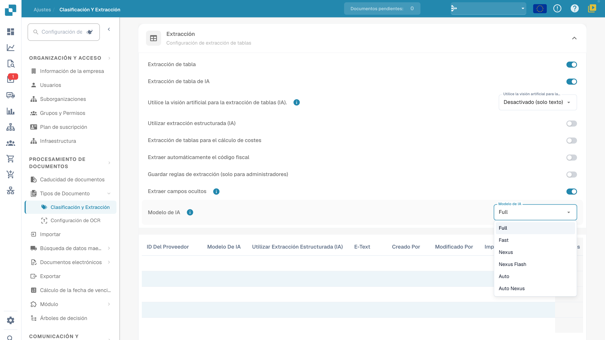

# Modelo de IA

## Descripción general

La configuración del modelo de IA define el modelo de la organización para la extracción de campos y tablas. La tabla de asignación permite revisar las preferencias asociadas a las plantillas. Consulte los costes en la información vigente de su entorno y en las condiciones contratadas.

## Cómo acceder

En **Ajustes**, abra **Clasificación y Extracción** desde **Tipos de Documento** y despliegue **Extracción**. El selector **Modelo de IA** se encuentra en esa sección.

## Opciones del Modelo de IA

El menú ofrece **Full**, **Fast**, **Nexus**, **Nexus Flash**, **Auto** y **Auto Nexus**. Son nombres de niveles del producto. Las opciones disponibles, los modelos subyacentes y los costes pueden cambiar; no utilice nombres históricos de proveedores ni precios fijos como una promesa permanente.

Compare los niveles con la misma muestra representativa y compruebe los valores extraídos, el tiempo de procesamiento y los costes. Full no garantiza siempre la mayor precisión, ni Fast o Nexus Flash garantizan siempre el menor tiempo. Auto y Auto Nexus requieren la misma comprobación de resultados y costes.

Cuando no existe una preferencia para la plantilla de extracción actual, se utiliza la configuración de la organización. La ausencia de un modelo específico del proveedor no significa universalmente Fast. Un cambio de modelo no garantiza la validación, la conciliación de pedidos, la aprobación ni la exportación.

<figure><figcaption>
Configuración actual de Extracción con los seis niveles Full, Fast, Nexus, Nexus Flash, Auto y Auto Nexus. Los valores privados están ocultos; no se cambió ningún modelo.
</figcaption></figure>

## Tabla de Asignación del Modelo de IA

La pantalla de validación ofrece un acceso a los modelos específicos del proveedor. La preferencia se guarda por organización y plantilla de extracción actual (`tfidf_id`); la asociación con un proveedor no actualiza automáticamente todas sus plantillas ni todos sus documentos históricos.

Revise las columnas que realmente muestra su versión: asociación del proveedor, nivel del modelo, opciones de extracción e información de creación y modificación. Las columnas pueden variar.

[aquí](../../../../end-user-and-partner-section/end-user-section/validation-screen/supplier-specific-ai-model-for-field-and-table-extraction.md)

<!-- Obsolete illustration retired: Historical navigation, table or deletion picture is not current read-only model-menu evidence -->

### Eliminar una entrada: quitar preferencias de la plantilla

Antes de eliminar una entrada, identifique la plantilla y todas sus preferencias. La eliminación puede quitar varias preferencias de esa plantilla, no solo el modelo de IA. Si un administrador necesita eliminarla, utilice la acción de eliminación de la fila correspondiente y revise la confirmación antes de continuar.

<!-- Obsolete illustration retired: Historical navigation, table or deletion picture is not current read-only model-menu evidence -->

<!-- Obsolete illustration retired: Historical navigation, table or deletion picture is not current read-only model-menu evidence -->

En el procesamiento posterior se aplican la configuración de la organización y los valores de respaldo pertinentes para esa plantilla. Otras plantillas del mismo proveedor pueden conservar sus propias preferencias. La eliminación no vuelve a procesar automáticamente los documentos históricos. Durante esta revisión no se eliminó ninguna entrada ni se comprobó una extracción posterior a la eliminación.
