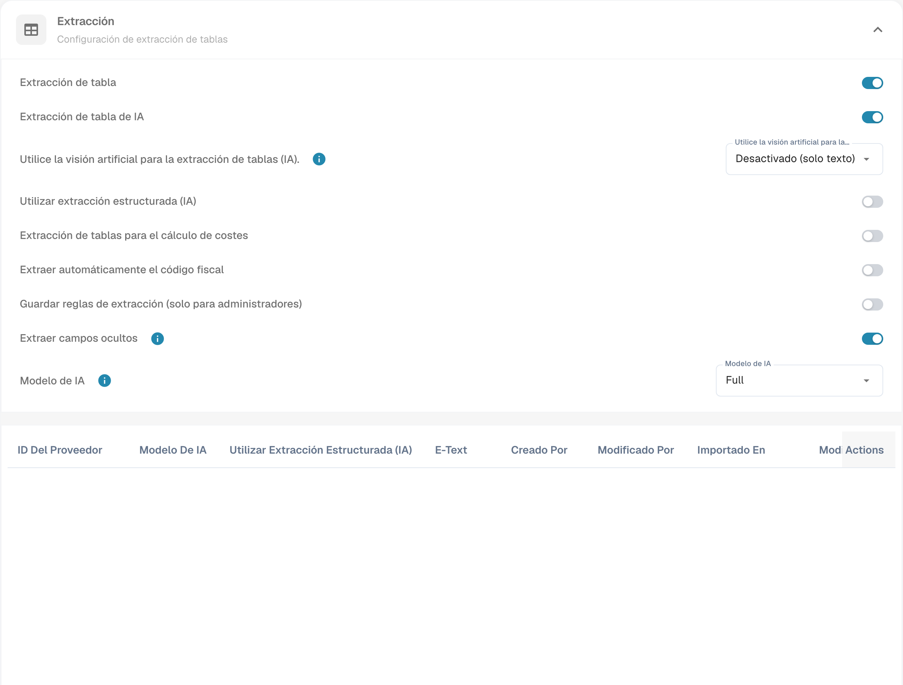

# Extraer automáticamente el código fiscal

## Configuración

Abra **Ajustes → Tipos de Documento → Clasificación y Extracción** y localice **Extraer automáticamente el código fiscal**. Revise la configuración prevista antes de activarla y guardarla.

<figure><figcaption>
Configuración de extracción automática del código fiscal.
</figcaption></figure>

## Función y requisitos

Cuando la función está activa y existe un campo de código fiscal configurado, DocBits puede rellenarlo automáticamente durante la validación. Compruebe el código obtenido con el documento y la configuración de su ERP. Esta captura muestra los controles de configuración, no una extracción fiscal ya comprobada.

La tabla siguiente conserva los códigos técnicos y las reglas del ejemplo de integración. No es una lista universal de códigos fiscales; valide los valores correspondientes a su empresa.

<table data-full-width="true"><thead><tr><th>Tipo de factura</th><th></th><th>Código fiscal</th><th>O en el campo de texto</th><th>Número de pedido</th><th>País del proveedor</th><th>Regla</th></tr></thead><tbody><tr><td>Factura de costes</td><td>Con importe de impuesto</td><td>NAGDH</td><td>LD + % (redondeado al mayor importe absoluto)</td><td>Vacío</td><td>Pueden ser los dos primeros caracteres del identificador fiscal  o el país de la dirección del proveedor: tccom120.cadr → tccom130.cadr, campo tcom130.ccty</td><td>Cuando el país coincide con el de la empresa</td></tr><tr><td>Factura de costes</td><td>Sin importe de impuesto</td><td>NAGD0</td><td>LD + % (redondeado al mayor importe absoluto)</td><td>Vacío</td><td>Pueden ser los dos primeros caracteres del identificador fiscal  o el país de la dirección del proveedor: tccom120.cadr → tccom130.cadr, campo tcom130.ccty</td><td>Cuando el país coincide con el de la empresa</td></tr><tr><td>Factura de costes</td><td>Sin importe de impuesto</td><td>EUDH</td><td>ED 0 %</td><td>Vacío</td><td>Pueden ser los dos primeros caracteres del identificador fiscal  o el país de la dirección del proveedor: tccom120.cadr → tccom130.cadr, campo tcom130.ccty</td><td>Cuando el país difiere del de la empresa y figura como miembro de la UE en la tabla de países (tcmcs010)</td></tr><tr><td>Factura de pedido</td><td>Con importe de impuesto</td><td>NAHGH</td><td>IG + % (redondeado al mayor importe absoluto)</td><td>No vacío</td><td>Pueden ser los dos primeros caracteres del identificador fiscal  o el país de la dirección del proveedor: tccom120.cadr → tccom130.cadr, campo tcom130.ccty</td><td>Cuando el país coincide con el de la empresa</td></tr><tr><td>Factura de pedido</td><td>Sin importe de impuesto</td><td>NAHG0</td><td>IG + % (redondeado al mayor importe absoluto)</td><td>No vacío</td><td>Pueden ser los dos primeros caracteres del identificador fiscal  o el país de la dirección del proveedor: tccom120.cadr → tccom130.cadr, campo tcom130.ccty</td><td>Cuando el país coincide con el de la empresa</td></tr><tr><td>Factura de pedido</td><td>Con importe de impuesto</td><td>EUGH</td><td>ED 0 %</td><td>No vacío</td><td>Pueden ser los dos primeros caracteres del identificador fiscal  o el país de la dirección del proveedor: tccom120.cadr → tccom130.cadr, campo tcom130.ccty</td><td>Cuando el país difiere del de la empresa y figura como miembro de la UE en la tabla de países (tcmcs010)</td></tr><tr><td>Factura de costes</td><td>Sin importe de impuesto</td><td>IMGD</td><td>ID 0 %</td><td>Vacío</td><td>Pueden ser los dos primeros caracteres del identificador fiscal  o el país de la dirección del proveedor: tccom120.cadr → tccom130.cadr, campo tcom130.ccty</td><td>Cuando el país difiere del de la empresa y no figura como miembro de la UE en la tabla de países (tcmcs010)</td></tr><tr><td>Factura de pedido</td><td>Con importe de impuesto</td><td>IMHG</td><td>IG 0 %</td><td>No vacío</td><td>Pueden ser los dos primeros caracteres del identificador fiscal  o el país de la dirección del proveedor: tccom120.cadr → tccom130.cadr, campo tcom130.ccty</td><td>Cuando el país difiere del de la empresa y no figura como miembro de la UE en la tabla de países (tcmcs010)</td></tr></tbody></table>
