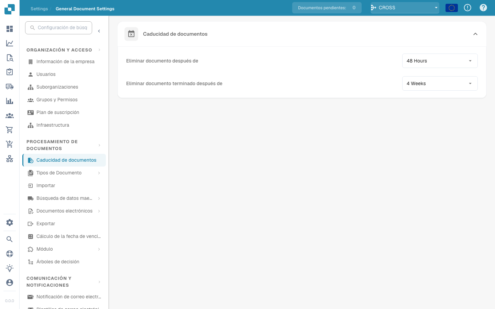

# Caducidad de Documentos

<figure><figcaption></figcaption></figure>

In the "Documents Expiry" setting under the "DOCUMENT PROCESSING" section, you can configure the automatic deletion schedules for your documents within the system. This feature is particularly useful for managing data retention policies and ensuring compliance with legal or organizational standards regarding document storage.

Here’s what each setting does:

1. **Delete document after**: This dropdown allows you to set the time frame after which a document that has been processed will be automatically deleted from the system. You can choose from predefined options like 48 Hours, 1 Week, 2 Weeks, or 4 Weeks. This helps in managing space and maintaining document lifecycle policies.
2. **Delete finished document after**: Similar to the previous setting, but specifically targets the finished or fully processed documents. It allows the same time frame options for deletion, ensuring that completed documents are not stored longer than necessary.

Both settings ensure that documents are not kept indefinitely on your system, helping to avoid unnecessary storage use and keeping the document processing workflow clutter-free. These settings are vital for organizations needing to adhere to specific regulatory requirements about document retention.

<figure><figcaption></figcaption></figure>
