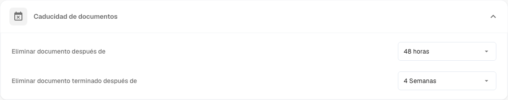
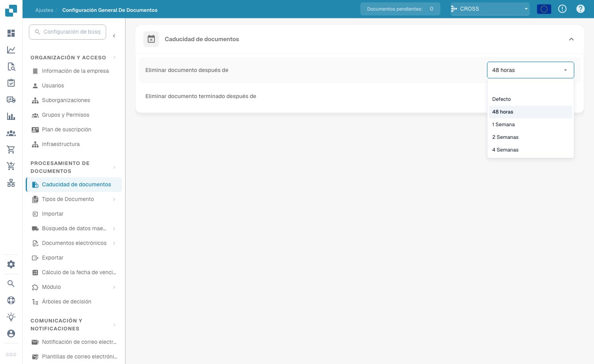

# Documents Expiry

<figure><figcaption>
Configuración de Documents Expiry
</figcaption></figure>

En **Document Processing → Documents Expiry** usted controla durante cuánto tiempo conserva DocBits sus documentos antes de eliminarlos automáticamente. Esto le ayuda a gestionar el almacenamiento, aplicar políticas de conservación de datos y cumplir las normas legales u organizativas sobre el tiempo que pueden almacenarse los documentos.

Dos ajustes controlan la eliminación automática:

| Ajuste | Qué controla |
|---------|------------------|
| **Delete document after** | Durante cuánto tiempo se conserva cualquier documento procesado antes de eliminarse automáticamente. |
| **Delete finished document after** | Durante cuánto tiempo se conserva un documento finalizado (completamente procesado y exportado) antes de eliminarse automáticamente. |

Para cada ajuste se elige un período de tiempo en la lista desplegable:

<figure><figcaption>
Períodos de conservación disponibles
</figcaption></figure>

| Opción | Significado |
|--------|---------|
| **Default** | Utiliza el período de conservación predeterminado del sistema (sin personalización). |
| **48 Hours** | Elimina 48 horas después del procesamiento. |
| **1 Week** | Elimina tras una semana. |
| **2 Weeks** | Elimina tras dos semanas. |
| **4 Weeks** | Elimina tras cuatro semanas. |

Ambos ajustes garantizan que los documentos no se conserven en el sistema más tiempo del necesario: esto evita un uso innecesario del almacenamiento y mantiene el flujo de trabajo de documentos libre de desorden. Son especialmente importantes para las organizaciones que deben cumplir requisitos normativos específicos sobre la conservación de documentos.
