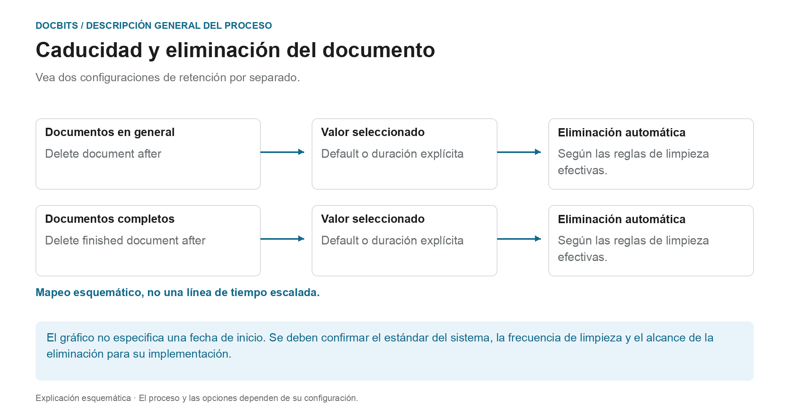

# Caducidad de documentos

## Dos reglas de retención en lugar de un período de eliminación general

<figure><figcaption>
Vea dos configuraciones de retención por separado. El diagrama es esquemático; La configuración activa de su organización determina el comportamiento real.
</figcaption></figure>

La caducidad del documento distingue la retención general de documentos de la retención de documentos completos. Verifique ambas configuraciones junto con los requisitos de su proceso y el archivo de destino previsto.

| Configuración | lo que debes aclarar |
| --- | --- |
| **Delete document after** | Qué valor de retención de documentos es realmente efectivo en su organización. |
| **Delete finished document after** | Qué valor se aplica a documentos completos, totalmente procesados y exportados. |
| **Default** | Qué estándar del sistema está almacenado en su implementación. El nombre por sí solo no indica la duración. |

El diagrama **no es una línea de tiempo dibujada a escala**. No especifica ni el inicio técnico del período de retención ni qué configuración tiene prioridad. Un valor desplegable por sí solo no establece un tiempo de eliminación exacto al segundo. Para una planificación confiable, confirme también la frecuencia con la que se realiza la limpieza.

### Exportación, retención y copias de seguridad separadas

Una exportación exitosa no prueba que la copia DocBits ya haya sido eliminada. Por el contrario, eliminar un documento en DocBits no elimina un ERP almacenado de forma independiente ni una copia de archivo. Las copias de seguridad pueden tener reglas de retención independientes; Eliminar un documento del sistema en vivo no prueba que todas las copias de seguridad se hayan eliminado al mismo tiempo.

Verifique los plazos antes de realizar cambios y acuerde el archivo de destino y el manejo de las copias de seguridad. La descripción general de [Almacenamiento, retención y eliminación de datos.](../../../security/data-storage-and-retention.md) explica las diferencias entre documentos, archivos intermedios, registros y copias de seguridad de OCR.

<figure><figcaption>
Configuración de Documents Expiry
</figcaption></figure>

En Procesamiento de documentos → Caducidad de documentos, configure la retención de documentos. Verifique la configuración efectiva, el archivo de destino y el alcance de eliminación de su organización antes de cambiarlos.

Dos ajustes controlan la eliminación automática:

| Ajuste | Qué controla |
|---------|------------------|
| **Delete document after** | Durante cuánto tiempo se conserva cualquier documento procesado antes de eliminarse automáticamente. |
| **Eliminar documento terminado después de** | Durante cuánto tiempo se conserva un documento finalizado (completamente procesado y exportado) antes de eliminarse automáticamente. |

Para cada ajuste se elige un período de tiempo en la lista desplegable:

<figure><figcaption>
Períodos de conservación disponibles
</figcaption></figure>

| Opción | Significado |
|--------|---------|
| **Default** | Utiliza el período de conservación predeterminado del sistema (sin personalización). |
| **48 Hours** | Valor de retención explícito de 48 horas; confirmar el inicio del período y el cronograma de limpieza por separado. |
| **1 Week** | Valor de retención explícito de una semana. |
| **2 Weeks** | Valor de retención explícito de dos semanas. |
| **4 Weeks** | Valor de retención explícito de cuatro semanas. |

Estas configuraciones admiten la retención planificada de documentos. No reemplazan la confirmación de los períodos de retención efectivos, el archivo de destino y el tratamiento de las copias de seguridad para su organización.
