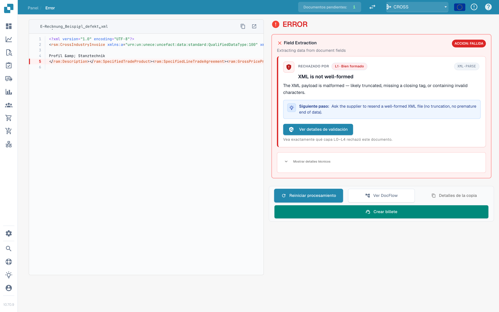
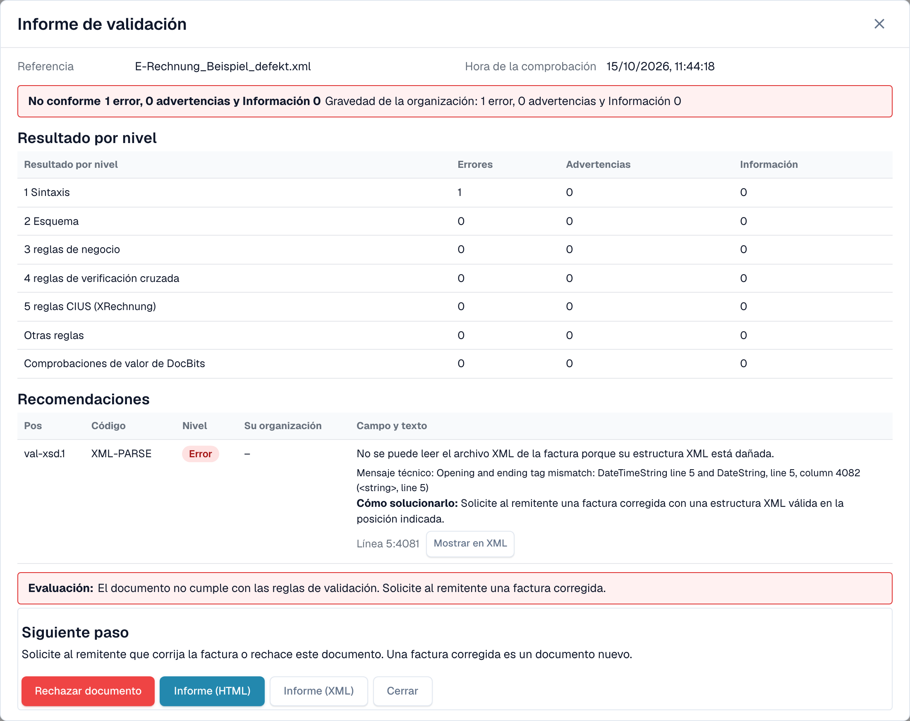
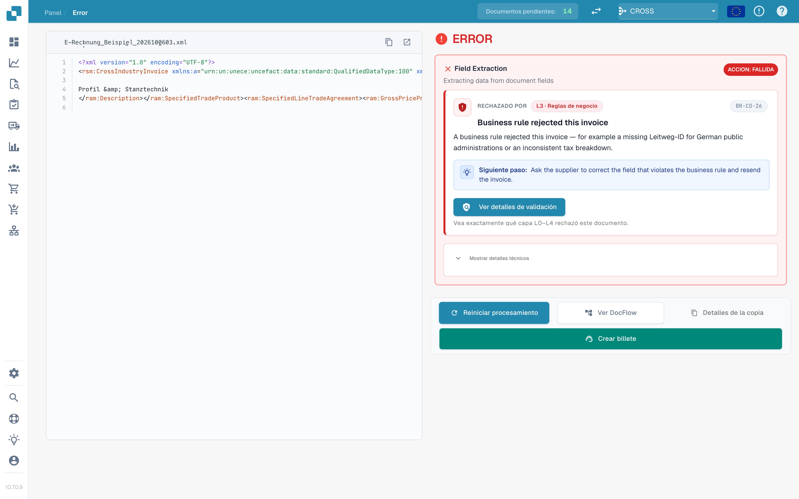

# La pantalla de error de una factura electrónica rechazada

Cuando carga una factura electrónica incorrecta, DocBits no la pierde. El documento recibe el estado **Error** y la pantalla de error le indica qué está mal, dónde y qué hacer a continuación. Esta página muestra dos ejemplos: un archivo XML que no está bien formado y una factura que infringe una regla de negocio.

> Una factura recibe el estado **Error** solo cuando la validación está **activada** y **bloquea** para su tipo de documento. Consulte [Validación para cada tipo de documento](validation-per-document-type.md).

## Ejemplo 1: el archivo XML está dañado

Un proveedor envía un archivo XML en el que una etiqueta de cierre no coincide con su etiqueta de apertura. El archivo no se puede leer, por lo que DocBits se detiene en la primera comprobación, **L1 · Bien formado**.

<figure><figcaption>
La pantalla de error de un archivo XML dañado. La línea defectuosa está marcada en el XML. Archivo de ejemplo con datos ficticios.
</figcaption></figure>

La pantalla tiene dos lados:

* **Izquierda: el archivo XML.** DocBits muestra el archivo con números de línea. La línea con el problema está marcada en rojo. Use los botones situados sobre el archivo para copiar el XML o abrirlo en una pestaña nueva.
* **Derecha: la explicación.** La tarjeta **Rechazado por** indica la comprobación que detuvo el archivo (aquí **L1 · Bien formado**) y el código de la regla (aquí `XML-PARSE`). Debajo verá un título en lenguaje claro (*XML is not well-formed*), una breve explicación y el bloque **Siguiente paso**.

Seleccione **Ver detalles de validación** para abrir el [informe de validación](validation-report.md) completo.

<figure><figcaption>
El informe del archivo dañado: un error en el nivel 1 Sintaxis, con el mensaje técnico y la posición
</figcaption></figure>

El informe indica la posición exacta (aquí línea 5, columna 4081) y el mensaje técnico del analizador XML. Seleccione **Mostrar en XML** para saltar a esa línea. La indicación **Cómo solucionarlo** le dice que solicite al remitente un archivo corregido.

## Ejemplo 2: la factura infringe una regla de negocio

El XML es correcto, pero falta un campo obligatorio. Por ejemplo, no se puede identificar al vendedor porque no hay identificador del vendedor, identificador de registro ni identificador de IVA (regla `BR-CO-26`).

<figure><figcaption>
La pantalla de error de un error de regla de negocio: la capa <strong>L3 · Reglas de negocio</strong>, el código de la regla y un siguiente paso
</figcaption></figure>

Aquí la tarjeta indica la capa **L3 · Reglas de negocio** y el código `BR-CO-26`. El informe enumera todos los hallazgos de la factura; consulte [Informe de validación](validation-report.md).

## Los botones debajo de la tarjeta

| Botón | Qué hace |
| --- | --- |
| **Reiniciar procesamiento** | Ejecuta de nuevo el procesamiento del documento, por ejemplo después de cambiar un ajuste. La comprobación usa los ajustes actuales. |
| **Ver DocFlow** | Muestra el flujo de trabajo del documento. |
| **Detalles de la copia** | Copia los detalles del error, por ejemplo para un mensaje a su administrador. |
| **Crear billete** | Abre un ticket de soporte con los detalles del error. |

Seleccione **Mostrar detalles técnicos** en la tarjeta para ver la información técnica sin procesar.

## Qué hacer a continuación

* **Errores:** solicite al remitente una factura corregida o [rechace el documento](validation-next-step-and-reject.md). Una factura corregida es un documento nuevo.
* **Solo advertencias:** el documento no está bloqueado. Puede continuar.

## Páginas relacionadas

* [Informe de validación](validation-report.md): todos los hallazgos, nivel por nivel.
* [Siguiente paso y rechazar un documento](validation-next-step-and-reject.md)
* [Validación para cada tipo de documento](validation-per-document-type.md): active la validación y defina el bloqueo.
