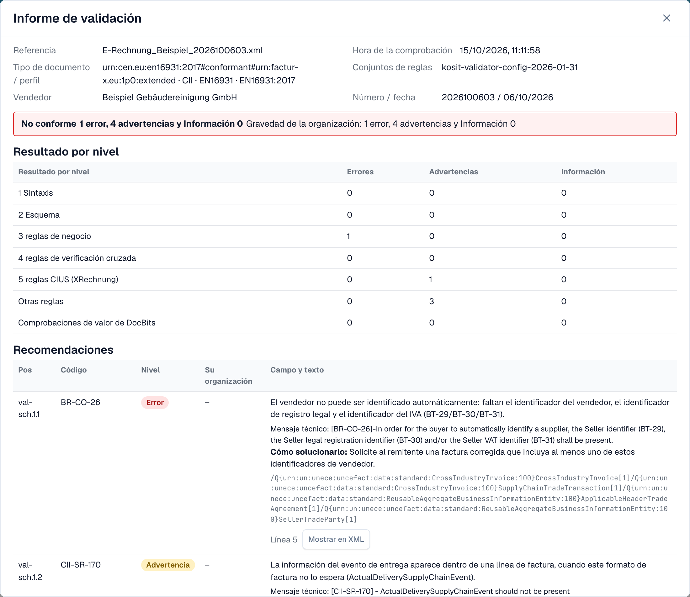
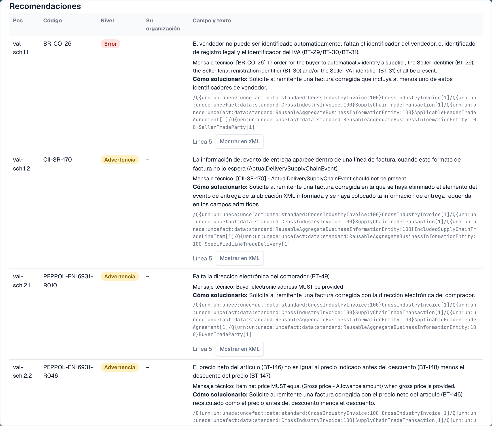

# Informe de validación

Cuando DocBits rechaza una factura electrónica, puede ver exactamente el motivo. El **informe de validación** enumera cada hallazgo en lenguaje claro, indica qué corregir y muestra el siguiente paso. Se abre desde el documento, no desde los ajustes. La pantalla donde lo encuentra se describe en [La pantalla de error de una factura electrónica rechazada](validation-error-screen.md).

Esta página es para las personas que procesan facturas. Los administradores configuran las reglas en la página [Validación de facturas electrónicas](validation-rules.md) y eligen por tipo de documento si una comprobación fallida bloquea la factura; consulte [Validación para cada tipo de documento](validation-per-document-type.md).

## Cuando un documento recibe un error

Si la validación está **activada** y **bloquea** para el tipo de documento, una factura con un hallazgo bloqueante recibe el estado **Error**. Abra el documento desde el panel. La vista de error muestra el XML a la izquierda y el motivo a la derecha.

<figure><figcaption>
La vista de error: el XML de la factura y el primer hallazgo bloqueante con un siguiente paso. Factura de ejemplo con nombres ficticios.
</figcaption></figure>

La tarjeta de la derecha indica la capa que rechazó la factura (por ejemplo, **L3 · Reglas de negocio**), el código de la regla (por ejemplo, `BR-CO-26`), una breve explicación y un **Siguiente paso**. Seleccione **Ver detalles de validación** para abrir el informe completo.

## Leer el informe

<figure><figcaption>
La parte superior del informe: datos del archivo, el veredicto y el resultado de cada nivel
</figcaption></figure>

El informe empieza con los datos del archivo:

| Campo | Qué muestra |
| --- | --- |
| **Referencia** | El nombre de archivo de la factura. |
| **Hora de la comprobación** | Cuándo ejecutó DocBits la comprobación. Un informe guardado no cambia después. |
| **Tipo de documento / perfil** | El formato de la factura, por ejemplo CII y EN 16931. |
| **Conjuntos de reglas** | La versión de los conjuntos de reglas que usó DocBits. |
| **Vendedor** | El vendedor, leído del XML. |
| **Número / fecha** | El número y la fecha de la factura, leídos del XML. |

Debajo de los datos del archivo verá el **veredicto**, por ejemplo **No conforme**, con el número de errores, advertencias y mensajes de información. Si su organización cambió la gravedad de una regla, una segunda línea **Gravedad de la organización** muestra los recuentos según los ajustes de su organización.

### Resultado por nivel

La tabla **Resultado por nivel** muestra cuántos errores, advertencias y mensajes de información encontró cada comprobación. Las comprobaciones se apoyan unas en otras:

| Nivel | Qué comprueba |
| --- | --- |
| **1 Sintaxis** | El XML está bien formado. |
| **2 Esquema** | La estructura sigue el esquema XML oficial. |
| **3 reglas de negocio** | Los campos obligatorios están presentes y son correctos (reglas `BR-…`). |
| **4 reglas de verificación cruzada** | Los campos concuerdan entre sí, por ejemplo las sumas. |
| **5 reglas CIUS (XRechnung)** | Las reglas alemanas adicionales de XRechnung. |
| **Otras reglas** | Otras reglas, por ejemplo las reglas PEPPOL. |
| **Comprobaciones de valor de DocBits** | Comprobaciones que añade DocBits, por ejemplo IBAN e IVA. |

> En las facturas con perfil EN 16931 o EXTENDED, las reglas específicas de XRechnung se muestran como **advertencias**, no como errores.

## Los hallazgos

<figure><figcaption>
Cada hallazgo tiene un código, un nivel, un texto legible y una indicación de cómo solucionarlo
</figcaption></figure>

Cada hallazgo es una fila en la sección **Recomendaciones**:

* **Pos** y **Código**: la posición en el informe y el código de la regla, por ejemplo `BR-CO-26`.
* **Nivel**: **Error**, **Advertencia** o **Información**.
* **Su organización**: el nivel según los ajustes de su organización. Un guion significa que su organización no cambió el nivel.
* **Campo y texto**: el problema en lenguaje claro, el campo afectado (por ejemplo, *BT-29 Seller identifier*), el **Mensaje técnico** del validador y **Cómo solucionarlo**.
* **Línea** y **Mostrar en XML**: seleccione **Mostrar en XML** para cerrar el informe y saltar a la línea en el visor XML.

DocBits tiene textos en lenguaje claro para las reglas más habituales. Para una regla sin ese texto, el informe muestra el mensaje técnico del validador.

## Siguiente

* [Siguiente paso y rechazar un documento](validation-next-step-and-reject.md): qué hacer después de leer el informe.

## Páginas relacionadas

* [Validación de facturas electrónicas](validation-rules.md): versiones aceptadas, perfiles y la gravedad de cada regla.
* [Validación para cada tipo de documento](validation-per-document-type.md): active la validación y defina el bloqueo.
* [Enrutamiento de notificaciones](notification-routing.md): quién gestiona cada hallazgo.
