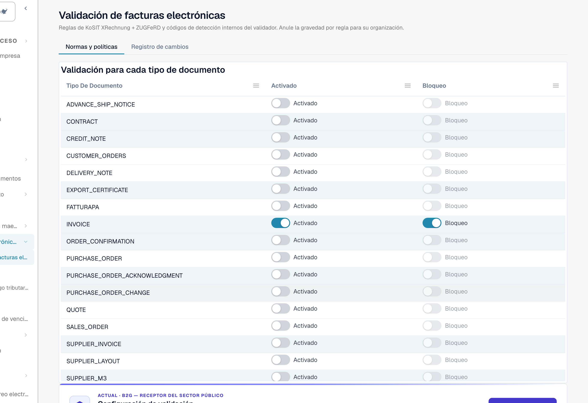

# Validación de facturas electrónicas

La página **Validación de facturas electrónicas** (**Ajustes → Documentos electrónicos → Validación de facturas electrónicas**, ruta `/settings/einvoice-validation`; antes se llamaba *Reglas de validación*) controla cómo DocBits valida las facturas electrónicas entrantes. Se basa en el conjunto oficial de reglas **KoSIT XRechnung + ZUGFeRD** más los códigos de hallazgo internos del validador, y le permite anular la gravedad de cada regla para su organización.

> Esta página es para **facturas electrónicas** (XRechnung, ZUGFeRD, Factur-X). No es lo mismo que las **Reglas de validación de datos**, que comprueban los campos extraídos de un documento.

## Qué hay en esta página

<figure><figcaption>
La página Validación de facturas electrónicas. La pestaña <strong>Normas y políticas</strong> empieza con la tabla <strong>Validación para cada tipo de documento</strong>. Organización de ejemplo.
</figcaption></figure>

| Tema | Qué hace | Quién |
| --- | --- | --- |
| [Configuración de validación y versiones aceptadas](validation-setup.md) | El asistente de configuración, las versiones de XRechnung aceptadas, los perfiles aceptados y qué significa cada gravedad. | Administradores de la organización |
| [Gravedad de las reglas](validation-rule-severities.md) | La tabla de reglas: cambie la gravedad de cada regla para su organización. | Administradores de la organización |
| [Validación para cada tipo de documento](validation-per-document-type.md) | Active la validación (**Activado**) y decida si una comprobación fallida detiene el documento (**Bloqueo**). Cada cambio necesita una confirmación. | Administradores de la organización |
| [Registro de cambios](validation-change-log.md) | Cada cambio de los ajustes: cuándo, quién, qué regla, desde → hasta. | Administradores de la organización |
| [La pantalla de error de una factura electrónica rechazada](validation-error-screen.md) | Lo que ve al cargar un XML incorrecto: la explicación, la línea defectuosa y el siguiente paso. | Todas las personas que procesan facturas |
| [Informe de validación](validation-report.md) | Lo que ve un usuario cuando una factura falla: los hallazgos en lenguaje claro. Se abre desde el documento, no desde esta página. | Todas las personas que procesan facturas |
| [Siguiente paso y rechazar un documento](validation-next-step-and-reject.md) | Qué hacer después de leer el informe, la descarga del informe y **Rechazar documento**. | Todas las personas que procesan facturas |
