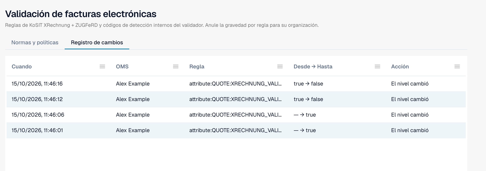

# Registro de cambios

El **Registro de cambios** registra cada cambio de los ajustes de validación. Pertenece a [Validación de facturas electrónicas](./). Solo los administradores de la organización pueden verlo.

Abra la pestaña **Registro de cambios**, junto a **Normas y políticas**.

<figure><figcaption>
El registro de cambios con cuatro entradas de ejemplo. El nombre de usuario está sustituido por un nombre de ejemplo.
</figcaption></figure>

| Columna           | Qué muestra                                                                                                    |
| ----------------- | -------------------------------------------------------------------------------------------------------------- |
| **Cuando**        | La hora del cambio.                                                                                            |
| **OMS**           | El usuario que hizo el cambio.                                                                                 |
| **Regla**         | El ajuste o la regla que cambió.                                                                               |
| **Desde → Hasta** | El valor anterior y el nuevo.                                                                                  |
| **Acción**        | El tipo de cambio. Las filas del asistente de configuración se pueden abrir para ver los cambios individuales. |

La lista muestra 50 entradas por página.

Cada cambio en la tabla [Validación para cada tipo de documento](validation-per-document-type.md) crea una entrada después de confirmarlo.
