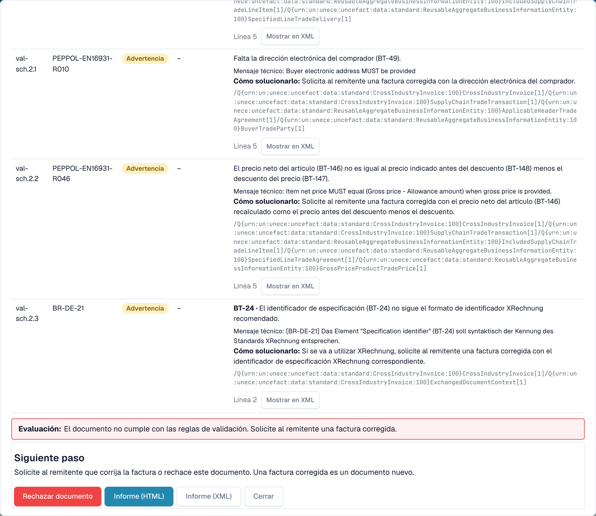
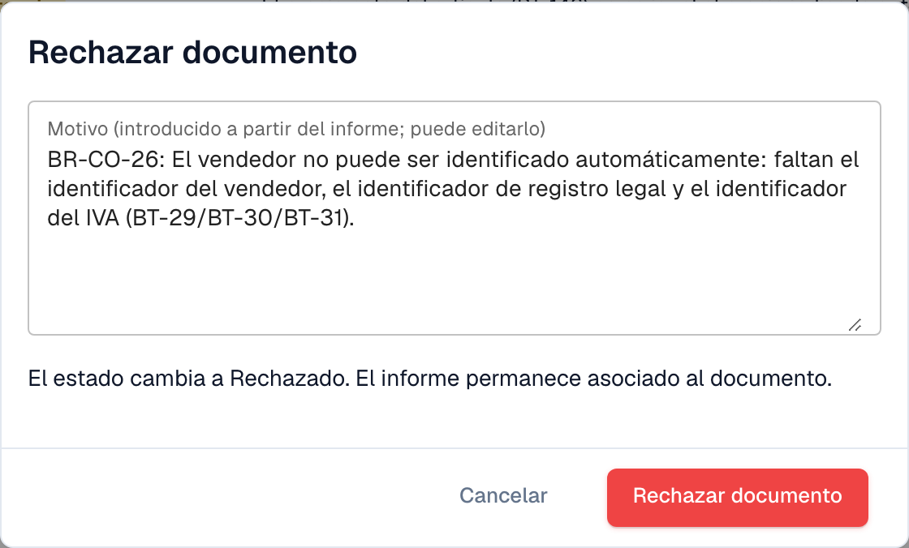

# Siguiente paso y rechazar un documento

Después de leer el [informe de validación](validation-report.md), el informe le indica qué hacer. También puede rechazar el documento.

## Qué hacer después

<figure><figcaption>
La evaluación, el siguiente paso y los botones al final del informe
</figcaption></figure>

La **Evaluación** dice en una frase si la factura es conforme. El bloque **Siguiente paso** le indica qué hacer:

| Resultado             | Siguiente paso                                                                                                   |
| --------------------- | ---------------------------------------------------------------------------------------------------------------- |
| Al menos un **error** | Solicite al remitente una factura corregida o rechace el documento. Una factura corregida es un documento nuevo. |
| Solo **advertencias** | Puede continuar con el documento.                                                                                |

Los botones al final del informe:

* **Rechazar documento**: abre el cuadro de diálogo de rechazo (véase más abajo).
* **Informe (HTML)** e **Informe (XML)**: descargan el informe, por ejemplo para enviarlo al proveedor.
* **Cerrar**: cierra el informe y vuelve al documento.

## Rechazar un documento

<figure><figcaption>
El motivo se rellena a partir de los errores del informe. Puede editarlo.
</figcaption></figure>

1. En el informe, seleccione **Rechazar documento**.
2. Revise el **Motivo**. DocBits lo rellena a partir de los errores del informe. Puede editar el texto.
3. Seleccione **Rechazar documento** para confirmar. El estado cambia a **Rechazado**. El motivo se guarda como nota y el informe permanece asociado al documento.

Seleccione **Cancelar** para dejar el documento como está.

> Solo los usuarios con permiso para editar documentos ven **Rechazar documento**. El botón se oculta cuando el documento ya está rechazado o completado.
