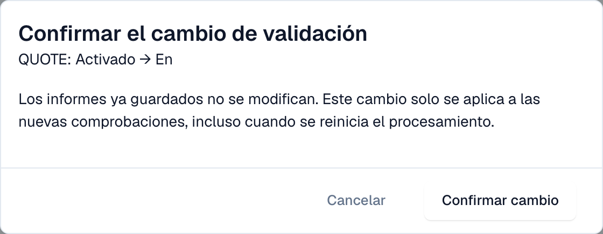

# Validación para cada tipo de documento

Los administradores deciden para cada tipo de documento si DocBits valida las facturas electrónicas entrantes y si una comprobación fallida bloquea el documento. Cada cambio se confirma y se escribe en el [registro de cambios](validation-change-log.md).

> Solo los **administradores de la organización** pueden cambiar estos ajustes. Los demás usuarios ven la tabla en modo de solo lectura o no la ven.

## La tabla

Vaya a **Ajustes → Documentos electrónicos → Validación de facturas electrónicas**. La pestaña **Normas y políticas** empieza con la tabla **Validación para cada tipo de documento**.

<figure><figcaption>
Una fila por tipo de documento con los interruptores Activado y Bloqueo. Organización de ejemplo.
</figcaption></figure>

| Interruptor  | Qué hace                                                                                                                                                                                                                       |
| ------------ | ------------------------------------------------------------------------------------------------------------------------------------------------------------------------------------------------------------------------------ |
| **Activado** | DocBits valida cada factura electrónica entrante de este tipo de documento y guarda un [informe de validación](validation-report.md).                                                                                          |
| **Bloqueo**  | Un hallazgo que es un error detiene el documento. Recibe el estado **Error**. Con el bloqueo desactivado, DocBits guarda el informe y el documento continúa. Solo puede activar **Bloqueo** cuando **Activado** está activado. |

Si un tipo de documento tiene excepciones por subtipo, la tabla muestra una nota al respecto.

## Cambiar un ajuste

1. Seleccione el interruptor que quiere cambiar.
2. DocBits muestra **Confirmar el cambio de validación** con el tipo de documento y el cambio, por ejemplo _QUOTE: Activado → En_.

<figure><figcaption>
Cada cambio necesita una confirmación
</figcaption></figure>

3. Lea la nota: **Los informes ya guardados no se modifican.** El cambio solo se aplica a las nuevas comprobaciones, también cuando se reinicia el procesamiento de un documento.
4. Seleccione **Confirmar cambio**, o **Cancelar** para mantener el ajuste anterior.

Si no tiene el permiso, DocBits muestra un mensaje indicando que se necesita un administrador de la organización y no cambia nada.

## Páginas relacionadas

* [Validación de facturas electrónicas](./)
* [Registro de cambios](validation-change-log.md)
* [Configuración de validación y versiones aceptadas](validation-setup.md)
* [Informe de validación](validation-report.md)
* [Activar o desactivar la validación de facturas electrónicas](../#activar-o-desactivar-la-validacion-de-facturas-electronicas)
