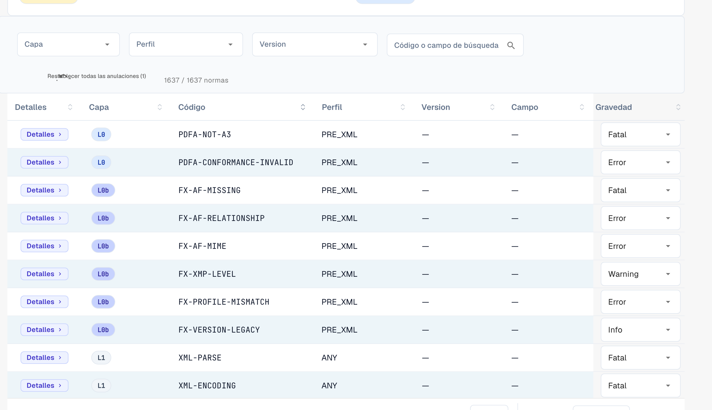

# Gravedad de las reglas

Cada regla de validación tiene una gravedad. Puede cambiar la gravedad de cada regla para su organización. Esta página pertenece a [Validación de facturas electrónicas](./). Solo los administradores de la organización pueden cambiar las gravedades.

<figure><figcaption>
La tabla completa de reglas con anulación de gravedad por regla
</figcaption></figure>

La tabla de reglas enumera todas las reglas de validación (más de 1.600 en total). Filtre por **Capa (Layer)**, **Perfil** o **Versión**, o busque por código o campo. Para cada regla puede anular la **Gravedad** desde el menú desplegable para ajustarla a la política de su organización; por ejemplo, bajar una regla de `ERROR` a `WARNING` para que deje de rechazar el documento.

El significado de **FATAL**, **ERROR**, **WARNING** e **INFO** se explica en [Configuración de validación y versiones aceptadas](validation-setup.md#perfiles-aceptados-y-modelo-de-gravedad). Una gravedad modificada también aparece en el [informe de validación](validation-report.md), en la columna **Su organización**.
