# Exportar

Las capturas muestran borradores sin guardar. La traducción española del producto muestra actualmente SMB como **PYMES** e Infor como **Información** en algunos selectores. Conserve el protocolo SMB y los nombres técnicos Infor/ION/IDM al preparar la integración. Algunos placeholders y **Deployment Type** siguen en inglés.

## Descripción general

La página de Exportación muestra todas las configuraciones de exportación configuradas, incluyendo si están activas o inactivas. Desde aquí, los usuarios pueden:

* Ver y gestionar las configuraciones de exportación existentes
* Crear nuevas conexiones de exportación (por ejemplo, a **Infor**, **Infor & IDM**, **Webhook** o **SFTP**)
* Editar o eliminar configuraciones de exportación existentes

## Dónde encontrarlo

Puede encontrarlo en: **Configuración** → **Procesamiento de documentos** → **Exportar**

<figure>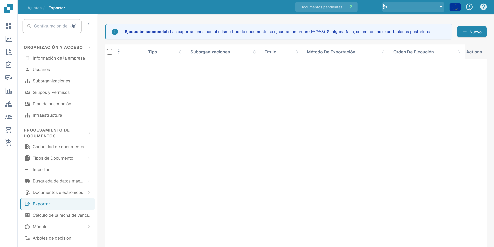<figcaption>
Acceso a la configuración de exportación desde los ajustes.
</figcaption></figure>

## **Uso de la página de Exportación**

Cuando abra la página de Exportación, verá una lista de todas las configuraciones de exportación existentes.

Cada fila en la lista muestra:

* **Indicador de estado**
  * **Verde** significa que la exportación está activa
  * **Rojo** significa que la exportación está desactivada
* **Nombre** – el nombre de la configuración de exportación
* **Tipo de documento** – el tipo de documento para el que está configurada la exportación
* **Suborganización** – si la exportación está limitada a una suborganización específica
* **Método de exportación** – dónde se enviará el documento (por ejemplo, Infor, IDM, SFTP)
* **Acciones** – botones para **editar, eliminar** o **activar/desactivar** la configuración

#### **Reglas importantes para la configuración de exportación**

Para cada **tipo de documento** **dentro de una organización o suborganización determinada**, se aplican las siguientes reglas:

* Solo puede tener **una exportación Infor activa**
* Solo puede tener **una exportación no-Infor activa** (por ejemplo, Webhook, SFTP)

Sin embargo, es posible tener:

* **Una exportación Infor activa** _y_ **una exportación no-Infor activa** al mismo tiempo para el mismo tipo de documento
* **Diferentes configuraciones de exportación para diferentes suborganizaciones** — por ejemplo, una exportación Infor para Sub-Org A y otra exportación Infor para Sub-Org B

## **Crear una nueva exportación**

Para crear una nueva exportación:

1. Haga clic en el botón **"Nuevo"**.

<figure>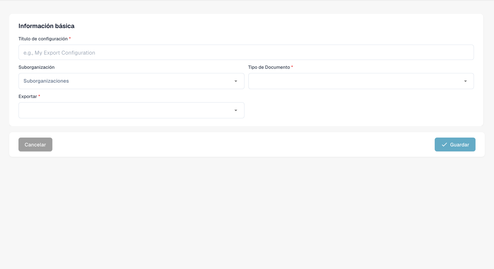<figcaption>
Borrador de una nueva configuración de exportación.
</figcaption></figure>

2. Seleccione el **Tipo de exportación** que desea configurar (por ejemplo, Infor, IDM, SFTP).
3. Complete los campos requeridos según el tipo de exportación.
4. Guarde la configuración.

## Opciones de exportación

#### Webhook

Webhook

<figure>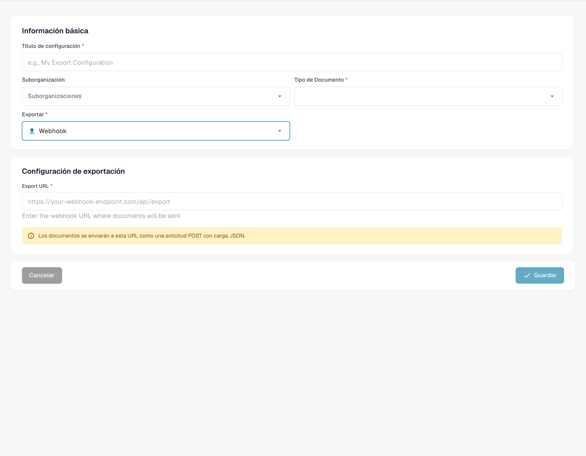<figcaption>
Borrador de configuración de exportación por Webhook.
</figcaption></figure>

**Descripciones de campos**

* **Título** El nombre de la configuración de exportación. Aparecerá en la lista de exportación.
* **Suborganización** _(opcional)_ Un menú desplegable con todas las suborganizaciones disponibles.
  * Si se deja vacío: se aplica a la organización principal.
  * Si se selecciona: la exportación solo se aplicará a la suborganización elegida.
* **Tipo de Documento** Menú desplegable que lista todos los tipos de documentos disponibles. Esto determina a qué tipo de documento se aplica esta configuración de exportación.
* **Export URL** La URL de destino donde se debe exportar el documento.

#### SFTP

SFTP

<figure>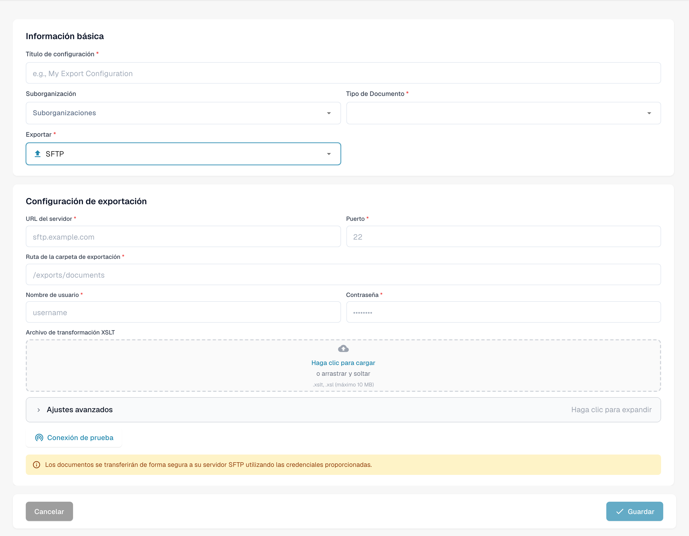<figcaption>
Borrador de configuración de exportación por SFTP.
</figcaption></figure>

**Descripciones de campos**

* **Título** El nombre de la configuración de exportación. Aparecerá en la lista de exportación.
* **Suborganización** _(opcional)_ Un menú desplegable con todas las suborganizaciones disponibles.
  * Si se deja vacío: se aplica a la organización principal.
  * Si se selecciona: la exportación solo se aplicará a la suborganización elegida.
* **Tipo de Documento** Menú desplegable que lista todos los tipos de documentos disponibles. Esto determina a qué tipo de documento se aplica esta configuración de exportación.
* **Nombre de usuario** El nombre de usuario utilizado para autenticarse en el servidor SFTP.
* **CONTRASEÑA** La contraseña correspondiente para la cuenta SFTP. Asegúrese de que la cuenta tenga acceso de escritura a la carpeta especificada.
* **URL del servidor** El nombre de host o dirección IP del servidor SFTP de destino.
* **Puerto** El puerto utilizado para conectarse al servidor SFTP.
* **Carpeta** La ruta en el servidor SFTP donde se deben cargar los documentos (por ejemplo, `/incoming/invoices/`). Debe existir y ser escribible.
*   **XSLT File (Opcional)**

    El **archivo XSLT** permite la transformación del formato de exportación predeterminado de DocBits.

    * **Cuándo usar:** Solo si el sistema receptor requiere una estructura diferente o un formato específico que difiere del predeterminado de DocBits.
    * **Déjelo vacío** si el formato de exportación predeterminado cumple con los requisitos.

**Configuración avanzada:**

* **Modo de exportación de nombre de archivo** Especifica si el archivo exportado conserva su nombre de archivo original o se renombra usando el ID de documento de DocBits.
* **Incluir historial de documentos** Cuando está habilitado, el archivo exportado incluirá el historial del documento basado en los registros disponibles en el panel de control.

<figure>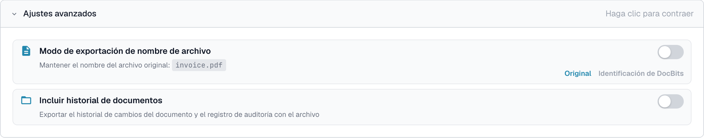<figcaption>
Opciones avanzadas de exportación SFTP sin guardar.
</figcaption></figure>

#### Exportación Infor a SFTP

Exportación Infor a SFTP

<figure>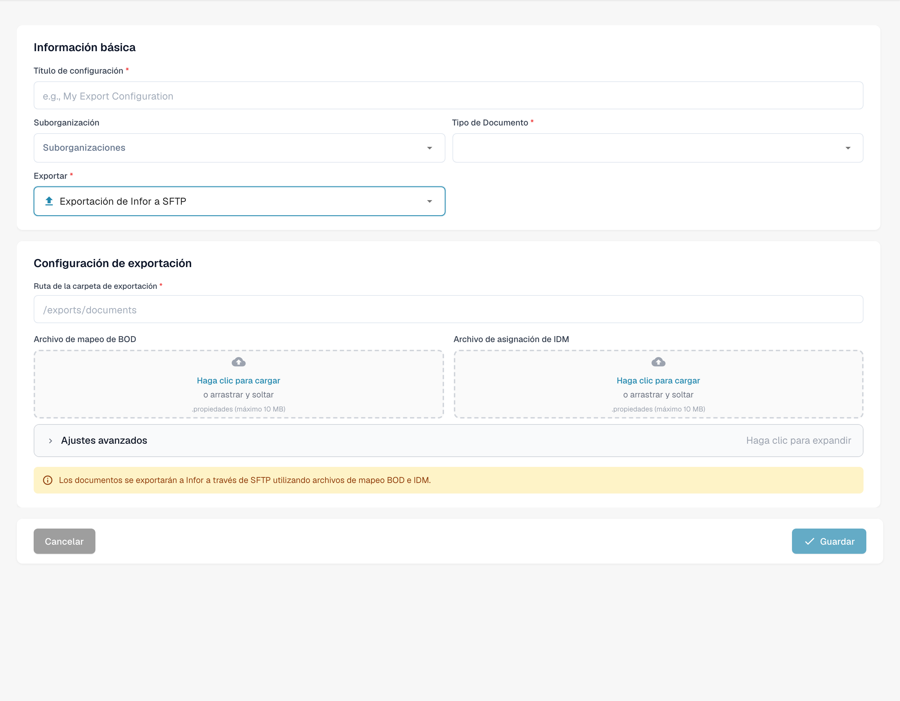<figcaption>
Borrador de exportación mediante Infor SFTP.
</figcaption></figure>

**Descripciones de campos**

* **Título** El nombre de la configuración de exportación. Aparecerá en la lista de exportación.
* **Suborganización** _(opcional)_ Un menú desplegable con todas las suborganizaciones disponibles.
  * Si se deja vacío: se aplica a la organización principal.
  * Si se selecciona: la exportación solo se aplicará a la suborganización elegida.
* **Tipo de Documento** Menú desplegable que lista todos los tipos de documentos disponibles. Esto determina a qué tipo de documento se aplica esta configuración de exportación.
* **Archivo de asignación de IDM** Seleccione un archivo de mapeo del administrador de archivos. [¿Necesita ayuda para crear uno? Ver la Guía de Mapeo IDM](../../../infor-integration-and-configuration/exporting-to-infor/creating-an-idm-mapping-file.md)
* **Archivo de mapeo de BOD** Seleccione un archivo de mapeo del administrador de archivos. [¿Necesita ayuda para crear uno? Ver la Guía de Mapeo BOD](../../../infor-integration-and-configuration/exporting-to-infor/creating-a-bod-mapping-file.md)
* **Carpeta** La ruta en el servidor SFTP donde se deben cargar los documentos (por ejemplo, `/incoming/invoices/`). Debe existir y ser escribible.

#### **SMB**

SMB

<figure>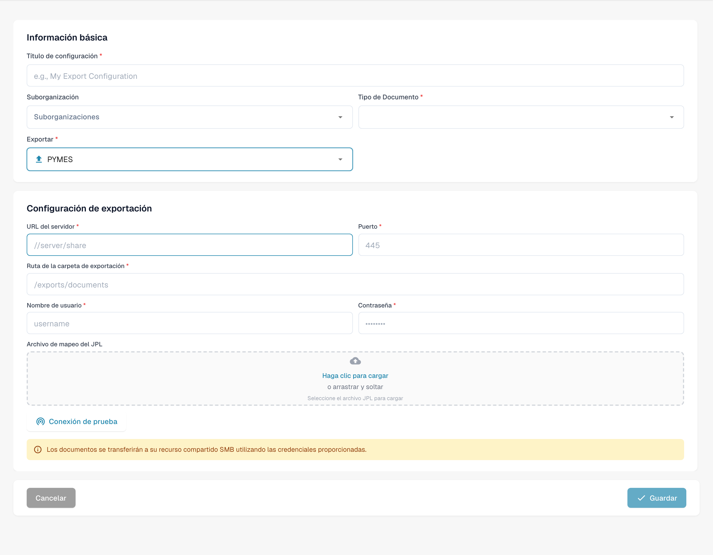<figcaption>
Borrador de exportación mediante SMB; conserve el protocolo previsto.
</figcaption></figure>

**Descripciones de campos**

* **Título** El nombre de la configuración de exportación. Aparecerá en la lista de exportación.
* **Suborganización** _(opcional)_ Un menú desplegable con todas las suborganizaciones disponibles.
  * Si se deja vacío: se aplica a la organización principal.
  * Si se selecciona: la exportación solo se aplicará a la suborganización elegida.
* **Tipo de Documento** Menú desplegable que lista todos los tipos de documentos disponibles. Esto determina a qué tipo de documento se aplica esta configuración de exportación.
* **Nombre de usuario** El nombre de usuario utilizado para conectarse al recurso compartido SMB.
* **CONTRASEÑA** La contraseña correspondiente para la autenticación SMB.
* **URL del servidor** La dirección del servidor SMB.
* **Puerto** Número de puerto utilizado para acceder al recurso compartido SMB.
* **Carpeta** La ruta de la carpeta dentro del recurso compartido SMB donde se deben guardar los documentos (por ejemplo, `/incoming/invoices/`). Debe existir y ser escribible.
*   **JPL Mapping File (Opcional)**

    El **archivo JPL** se utiliza para definir una transformación de los datos exportados antes de que se escriban en el recurso compartido SMB.

    * **Cuándo usar:** Solo cuando los datos del documento exportado necesitan ajustarse para coincidir con el formato externo o las expectativas del sistema.
    * **Déjelo vacío** si no es necesaria ninguna transformación.

#### **Infor IDM**

Infor IDM

<figure>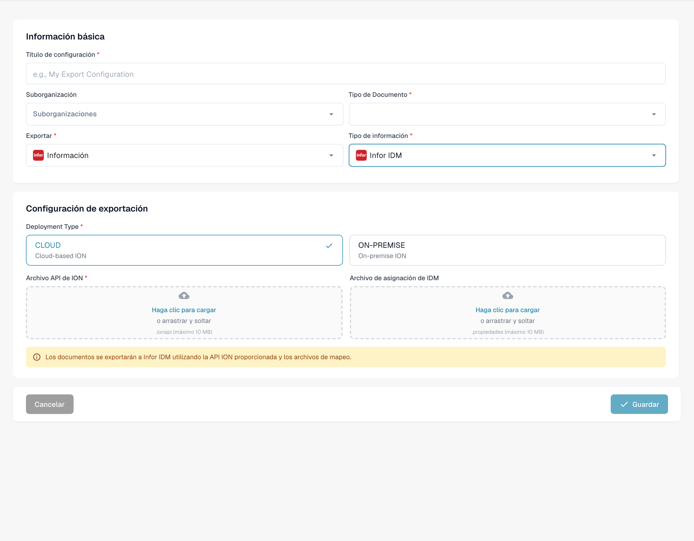<figcaption>
Borrador de exportación a Infor IDM.
</figcaption></figure>

**Descripciones de campos**

* **Título** El nombre de la configuración de exportación. Aparecerá en la lista de exportación.
* **Suborganización** _(opcional)_ Un menú desplegable con todas las suborganizaciones disponibles.
  * Si se deja vacío: se aplica a la organización principal.
  * Si se selecciona: la exportación solo se aplicará a la suborganización elegida.
* **Tipo de Documento** Menú desplegable que lista todos los tipos de documentos disponibles. Esto determina a qué tipo de documento se aplica esta configuración de exportación.
* **Archivo de mapeo ION** Seleccione un archivo de mapeo del administrador de archivos.
* **Archivo de asignación de IDM** Seleccione un archivo de mapeo del administrador de archivos. [¿Necesita ayuda para crear uno? Ver la Guía de Mapeo IDM](../../../infor-integration-and-configuration/exporting-to-infor/creating-an-idm-mapping-file.md)
* **Cloud / On-Prem Toggle** Un interruptor para indicar el tipo de implementación de Infor:
  * **Despliegue en la nube**: Seleccione esto si es cliente de Infor CloudSuite.
  * **On-Prem**: Seleccione esto si Infor está alojado localmente.

#### **Infor ION**

Infor ION

<figure>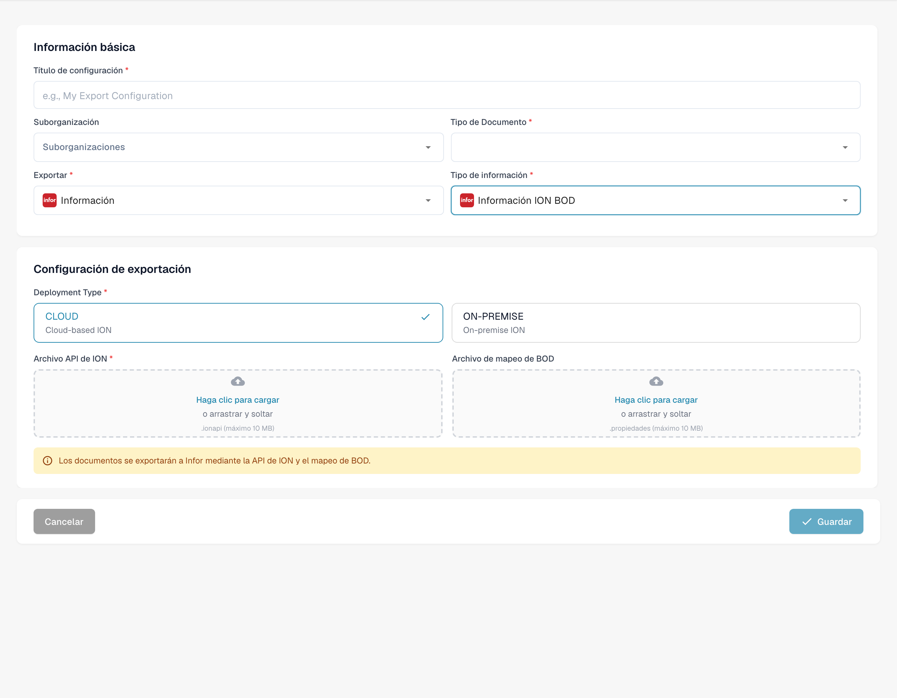<figcaption>
Borrador de exportación a Infor ION.
</figcaption></figure>

**Descripciones de campos**

* **Título** El nombre de la configuración de exportación. Aparecerá en la lista de exportación.
* **Suborganización** _(opcional)_ Un menú desplegable con todas las suborganizaciones disponibles.
  * Si se deja vacío: se aplica a la organización principal.
  * Si se selecciona: la exportación solo se aplicará a la suborganización elegida.
* **Tipo de Documento** Menú desplegable que lista todos los tipos de documentos disponibles. Esto determina a qué tipo de documento se aplica esta configuración de exportación.
* **Archivo de mapeo ION** Seleccione un archivo de mapeo del administrador de archivos.
* **Archivo de mapeo de BOD** Seleccione un archivo de mapeo del administrador de archivos. [¿Necesita ayuda para crear uno? Ver la Guía de Mapeo BOD](../../../infor-integration-and-configuration/exporting-to-infor/creating-a-bod-mapping-file.md)
* **Cloud / On-Prem Toggle** Un interruptor para indicar el tipo de implementación de Infor:
  * **Despliegue en la nube**: Seleccione esto si es cliente de Infor CloudSuite.
  * **On-Prem**: Seleccione esto si Infor está alojado localmente.

#### Infor IDM + ION BOD

Infor IDM + ION BOD

<figure>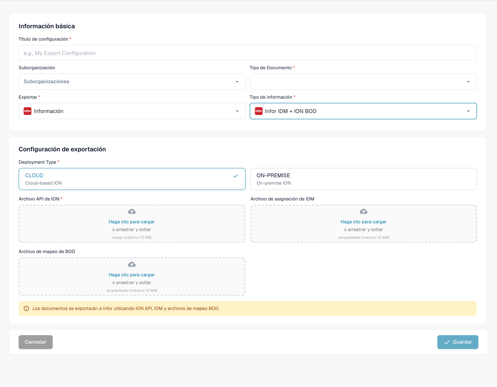<figcaption>
Borrador de exportación a Infor IDM ION BOD.
</figcaption></figure>

**Descripciones de campos**

* **Título** El nombre de la configuración de exportación. Aparecerá en la lista de exportación.
* **Suborganización** _(opcional)_ Un menú desplegable con todas las suborganizaciones disponibles.
  * Si se deja vacío: se aplica a la organización principal.
  * Si se selecciona: la exportación solo se aplicará a la suborganización elegida.
* **Tipo de Documento** Menú desplegable que lista todos los tipos de documentos disponibles. Esto determina a qué tipo de documento se aplica esta configuración de exportación.
* **Archivo de mapeo ION** Seleccione un archivo de mapeo del administrador de archivos.
* **Archivo de asignación de IDM** Seleccione un archivo de mapeo del administrador de archivos. [¿Necesita ayuda para crear uno? Ver la Guía de Mapeo IDM](../../../infor-integration-and-configuration/exporting-to-infor/creating-an-idm-mapping-file.md)
* **Archivo de mapeo de BOD** Seleccione un archivo de mapeo del administrador de archivos. [¿Necesita ayuda para crear uno? Ver la Guía de Mapeo BOD](../../../infor-integration-and-configuration/exporting-to-infor/creating-a-bod-mapping-file.md)
* **Cloud / On-Prem Toggle** Un interruptor para indicar el tipo de implementación de Infor:
  * **Despliegue en la nube**: Seleccione esto si es cliente de Infor CloudSuite.
  * **On-Prem**: Seleccione esto si Infor está alojado localmente.

### Para clientes de Infor CloudSuite

#### Infor IDM + LN

Infor IDM + LN

<figure>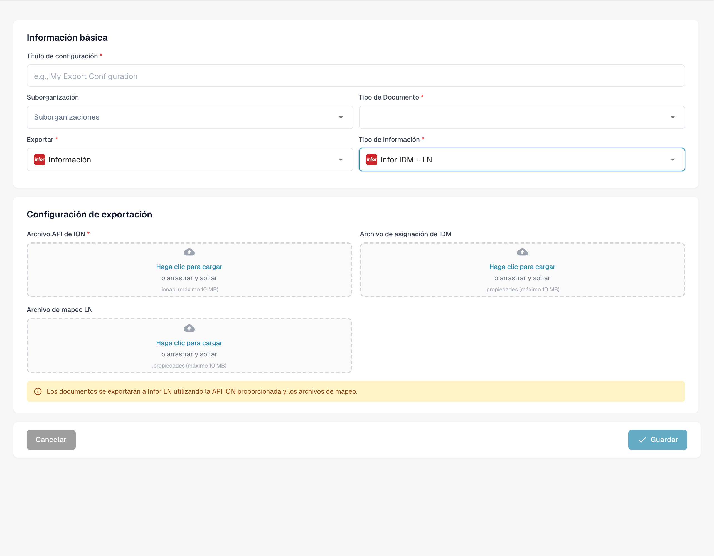<figcaption>
Borrador de exportación a Infor IDM LN.
</figcaption></figure>

**Descripciones de campos**

* **Título** El nombre de la configuración de exportación. Aparecerá en la lista de exportación.
* **Suborganización** _(opcional)_ Un menú desplegable con todas las suborganizaciones disponibles.
  * Si se deja vacío: se aplica a la organización principal.
  * Si se selecciona: la exportación solo se aplicará a la suborganización elegida.
* **Tipo de Documento** Menú desplegable que lista todos los tipos de documentos disponibles. Esto determina a qué tipo de documento se aplica esta configuración de exportación.
* **Archivo de mapeo ION** Seleccione un archivo de mapeo del administrador de archivos.
* **Archivo de asignación de IDM** Seleccione un archivo de mapeo del administrador de archivos. [¿Necesita ayuda para crear uno? Ver la Guía de Mapeo IDM](../../../infor-integration-and-configuration/exporting-to-infor/creating-an-idm-mapping-file.md)
* **Archivo de mapeo LN** Seleccione un archivo de mapeo del administrador de archivos. [¿Necesita ayuda para crear uno? Ver el Ejemplo de Mapeo LN](../../../infor-integration-and-configuration/exporting-to-infor/ln/example-export-ln/)

#### Infor IDM + M3

Infor IDM + M3

<figure>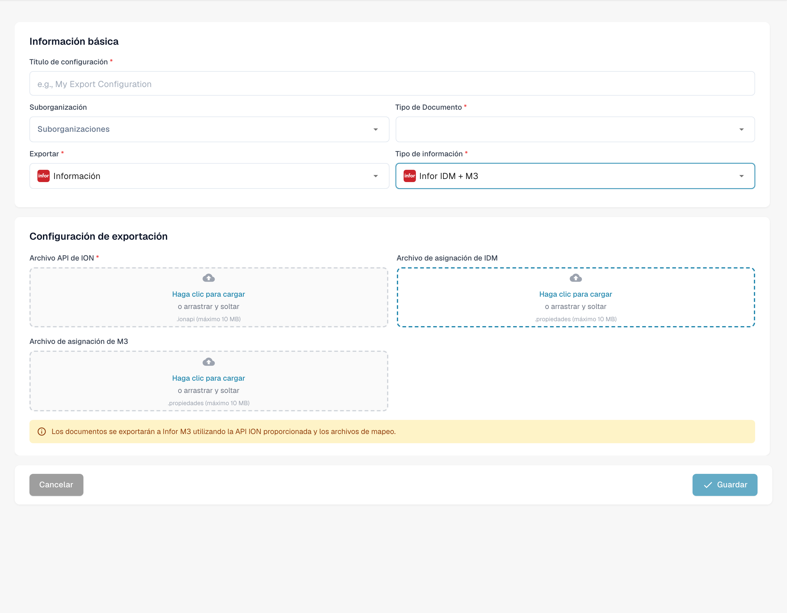<figcaption>
Borrador de exportación a Infor IDM M3.
</figcaption></figure>

**Descripciones de campos**

* **Título** El nombre de la configuración de exportación. Aparecerá en la lista de exportación.
* **Suborganización** _(opcional)_ Un menú desplegable con todas las suborganizaciones disponibles.
  * Si se deja vacío: se aplica a la organización principal.
  * Si se selecciona: la exportación solo se aplicará a la suborganización elegida.
* **Tipo de Documento** Menú desplegable que lista todos los tipos de documentos disponibles. Esto determina a qué tipo de documento se aplica esta configuración de exportación.
* **Archivo de mapeo ION** Seleccione un archivo de mapeo del administrador de archivos.
* **Archivo de asignación de IDM** Seleccione un archivo de mapeo del administrador de archivos. [¿Necesita ayuda para crear uno? Ver la Guía de Mapeo IDM](../../../infor-integration-and-configuration/exporting-to-infor/creating-an-idm-mapping-file.md)
* **Archivo de asignación de M3** Seleccione un archivo de mapeo del administrador de archivos. [¿Necesita ayuda para crear uno? Ver el Ejemplo de Mapeo M3](../../../infor-integration-and-configuration/exporting-to-infor/m3/example-export-m3.md)

#### Infor IDM + M3 (toml)

Infor IDM + M3 (toml)

<figure>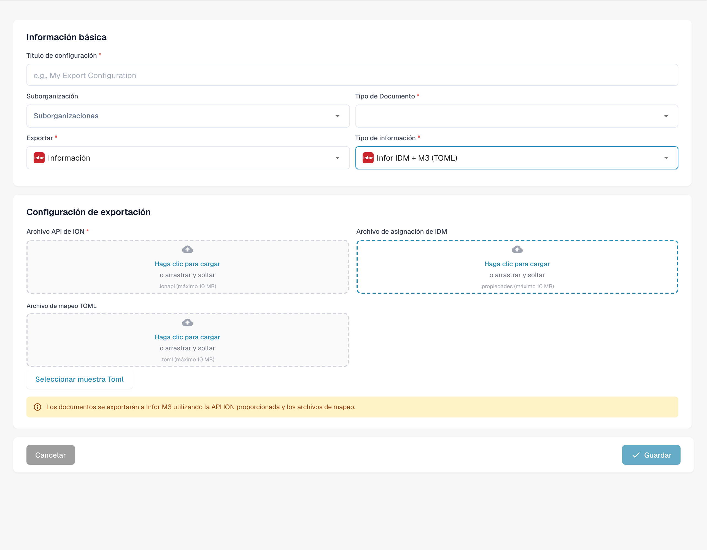<figcaption>
Borrador de exportación a Infor IDM M3 con TOML.
</figcaption></figure>

**Descripciones de campos**

* **Título** El nombre de la configuración de exportación. Aparecerá en la lista de exportación.
* **Suborganización** _(opcional)_ Un menú desplegable con todas las suborganizaciones disponibles.
  * Si se deja vacío: se aplica a la organización principal.
  * Si se selecciona: la exportación solo se aplicará a la suborganización elegida.
* **Tipo de Documento** Menú desplegable que lista todos los tipos de documentos disponibles. Esto determina a qué tipo de documento se aplica esta configuración de exportación.
* **Archivo de mapeo ION** Seleccione un archivo de mapeo del administrador de archivos.
* **Archivo de asignación de IDM** Seleccione un archivo de mapeo del administrador de archivos. [¿Necesita ayuda para crear uno? Ver la Guía de Mapeo IDM](../../../infor-integration-and-configuration/exporting-to-infor/creating-an-idm-mapping-file.md)
* **Archivo de mapeo M3 TOML** Seleccione un archivo de mapeo del administrador de archivos o use la opción seleccionar Toml para usar un toml creado con el gestor de reglas. [¿Necesita ayuda para crear uno? Ver la Guía del Gestor de Reglas](rule-manager/)

## Videotutorial: Configurar y probar la exportación al ERP


Configurar y probar la exportación al ERP


[Ver con subtítulos y capítulos](https://docbits-videos.fra1.cdn.digitaloceanspaces.com/settings-assistant/erp-export-admin/v1/es.html)

Algunas etiquetas nativas pueden permanecer en otro idioma. Se conservan los identificadores técnicos de los campos.

Utilizo una configuración y un tipo de documento propios para esta prueba. Las facturas contienen datos ficticios. Nuestro receptor de prueba comprueba la transmisión; no realiza ninguna contabilización en un ERP de producción. No modifico otras integraciones existentes.

En la configuración de exportación, compruebo el tipo de documento, la organización y el tipo de exportación. Este ejemplo utiliza Generic API en la nube. Las credenciales JSON y el mapeo de campos TOML son archivos separados. En proyectos reales, el sistema de destino, los permisos y la suborganización deben coincidir con el proceso previsto.

<figure>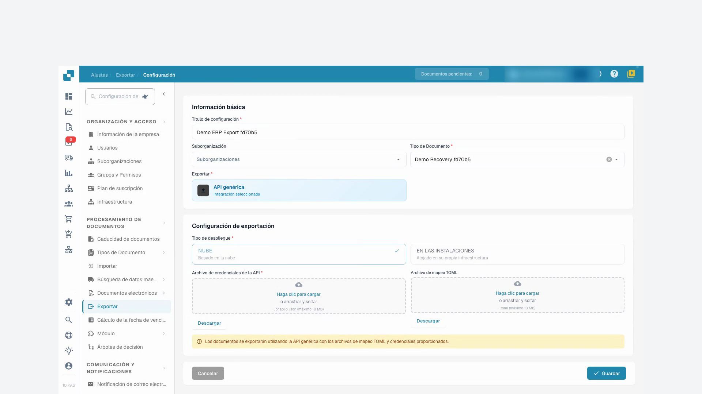<figcaption>
Configuración de exportación limitada al tipo de documento de formación
</figcaption></figure>

En el mapeo corregido, el campo invoice_id de DocBits proporciona el número de factura enviado al receptor de prueba. También se asignan el proveedor, el importe total y la moneda. Esta prueba comprueba los datos de cabecera. Las líneas de factura y la contabilización en el ERP requieren controles de negocio específicos para cada proyecto.

Subo el archivo TOML corregido y guardo la configuración. Luego la vuelvo a abrir y compruebo que el cambio se ha guardado. Las credenciales de prueba se mantienen; las credenciales de producción no deben aparecer en la grabación.

Vuelvo a la factura de prueba cuya exportación ha fallado y reinicio la exportación exactamente una vez. Espero a que termine el procesamiento. Aceptar la solicitud por sí solo no demuestra que la transmisión haya sido correcta.

DocBits muestra ahora la factura como finalizada. Además, compruebo el justificante de recepción del receptor de prueba. El número de factura, el proveedor, el importe y la moneda coinciden con la factura de prueba. La autenticación y la transmisión han funcionado. El receptor de prueba no confirma ninguna contabilización en el ERP.

<figure>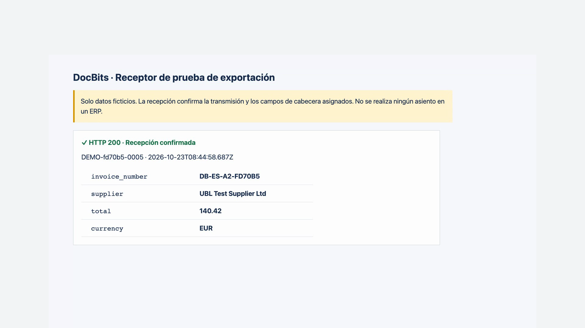<figcaption>
Recepción real en el receptor de pruebas; sin contabilización en el ERP
</figcaption></figure>
