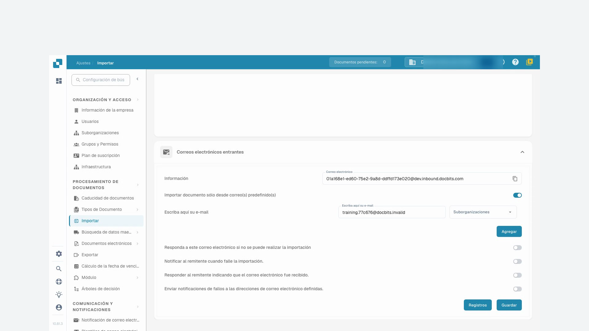
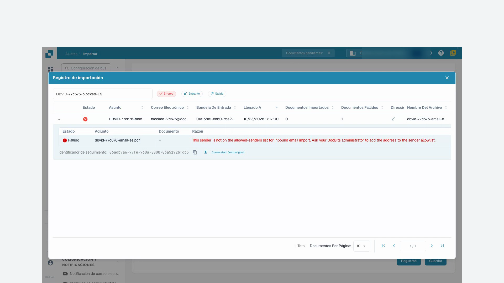

# Importar

Los ajustes de importación determinan el tratamiento de los documentos y permiten configurar la recepción automática por FTP o correo electrónico. Abra **Configuración → Procesamiento de documentos → Importar**.

## Opciones de los documentos

Revise el límite de páginas, el plazo de pago predeterminado en días y el formato de fecha. Las páginas que superen el límite configurado pueden descartarse. El valor predeterminado documentado para esta función es 60 páginas; confirme la configuración de su organización antes de importar.

## Importación FTP

Se necesita un servidor FTP compatible, credenciales autorizadas y una carpeta de importación dedicada accesible para la cuenta del servidor.

<figure><figcaption>
Resumen de las conexiones de importación FTP.
</figcaption></figure>

### Configurar una conexión

Cree una conexión. El asistente comienza por la configuración del servidor y continúa con las opciones y la configuración de importación.

<figure><figcaption>
Configuración del servidor en el asistente de importación FTP.
</figcaption></figure>

| Ajuste | Significado |
| --- | --- |
| Protocolo y puerto | Elija FTP, FTPS o SFTP y el puerto confirmado por el administrador del servidor. |
| Servidor y credenciales | Dirección del servidor y cuenta autorizada para leer la carpeta de importación. |
| Patrones de nombres de archivo | Limitan la importación a los nombres coincidentes. |
| Suborganización | Determina la asignación de los documentos importados. |
| Clave API | Si aparece en la configuración, debe corresponder a la organización correcta. No publique su valor. |
| Carpeta principal y carpeta de importación | Indican la ubicación de los archivos en el servidor. |
| Archivo tras importar | Mueve los archivos importados correctamente a la carpeta de archivo indicada. La cuenta necesita los permisos adecuados. |
| Incluir subcarpetas | Amplía la búsqueda a las carpetas subordinadas. |

Revise todos los pasos antes de guardar. Después, confirme por separado si la conexión está activa. Las acciones disponibles incluyen probar la conexión, consultar registros, activar, desactivar, editar y eliminar. Lea el resultado de la prueba y los registros antes de iniciar la importación habitual. Las imágenes muestran la lista y el primer paso del asistente sin guardar; no demuestran una conexión al servidor verificada.

## Importación de correo electrónico {#email-import}

Una conexión de correo recoge documentos de un buzón propio mediante IMAP u OAuth Microsoft365. El reenvío a una dirección proporcionada por DocBits es otro método; consulte [Correos entrantes](../module/inbound-emails.md).

### Adjuntos compatibles

Los tipos importados incluyen `.pdf`, `.tiff` / `.tif`, `.eml`, `.dat`, `.xml`, `.edi` y `.purchaseorder`.

Además del tipo declarado por el servidor de correo, DocBits reconoce documentos por su contenido real. Esto resulta relevante cuando un adjunto reenviado recibe el tipo genérico `application/octet-stream` en lugar de `application/pdf` o `application/xml`.

* Los mensajes `.eml` reenviados y los adjuntos Outlook `winmail.dat` (TNEF) se desempaquetan para importar los documentos contenidos.
* Un XML con tipo genérico se reconoce por la declaración `<?xml`, aceptando un BOM inicial UTF-8 o UTF-16 (LE/BE). Actualmente solo estas codificaciones BOM se detectan automáticamente por contenido. Un nombre terminado en `.xml` permite importar independientemente de la codificación.
* Las imágenes incrustadas, como logotipos de firma y gráficos PNG, JPG, GIF o BMP, se ignoran y no cuentan como importaciones fallidas.
* Si la dirección de entrada tiene activada la respuesta por fallo de importación, la notificación se envía a la dirección de respuesta configurada.

### Conexión IMAP

Cree una conexión en la sección de importación de correo y elija IMAP. Revise el cifrado SSL o TLS, el servidor, el puerto, el nombre de configuración o usuario, la dirección de correo y la contraseña. Seleccione la suborganización y la dirección para avisos de error. Si aparece una clave API, confirme el contexto de la organización.

Después de crear la conexión, puede seleccionar la carpeta de correo y el traslado de los mensajes procesados a otra carpeta. Si todavía no aparecen estas opciones, edite la conexión guardada. Según la configuración, también puede combinar documentos adjuntos, enviar una confirmación al remitente y bloquear nombres de archivo duplicados. Revise el asunto y el mensaje de confirmación antes de activarla.

Guardar y activar son acciones distintas. El menú puede ofrecer prueba de conexión, registros de conexión e importación, edición, activación, desactivación y eliminación.

### OAuth Office365

Cree una conexión de correo y elija OAuth Office365. Inicie la autenticación Microsoft. Si aparece un código de dispositivo, copie el código de DocBits en la página Microsoft indicada e inicie sesión en la cuenta correcta. Regrese a DocBits y complete la autenticación.

Revise la suborganización, la carpeta, el buzón compartido opcional, la carpeta de destino para mensajes procesados y la dirección de avisos de error. Confirme también el envío de documentos a DocBits o AI Workforce, si está disponible. Guarde la configuración y decida cuándo activar o iniciar la importación. OAuth Office365 – Tenant exige los datos de registro de la aplicación de la organización; confírmelos con el administrador y consulte [Correos entrantes](../module/inbound-emails.md).

### Registros de importación

Los registros de conexión ayudan a investigar problemas de comunicación; los registros de importación muestran resultados anteriores. El registro agregado de la sección de correo abarca las conexiones configuradas. Puede filtrar por asunto o remitente, ordenar por los encabezados y cambiar el orden de las columnas. Investigue el mensaje antes de repetir la importación.

## Videotutorial: Bandeja de entrada y búsqueda de errores

El personaje y la voz son sintéticos. La grabación muestra la interfaz de pruebas real de DocBits con facturas de formación sintéticas.


Bandeja de entrada y búsqueda de errores


[Ver con subtítulos y capítulos](https://docbits-videos.fra1.cdn.digitaloceanspaces.com/settings-assistant/email-import-admin/v1/es.html)

Algunas etiquetas nativas pueden permanecer en otro idioma. Se conservan los identificadores técnicos de los campos.

En configuración e importación, utilizo la dirección entrante de DocBits en este ejemplo. Un buzón conectado directamente es un método de importación distinto. Para la formación, trabajo en una organización de demostración propia con facturas sintéticas. Las notificaciones permanecen desactivadas.

Primero compruebo la dirección de recepción mostrada y el alcance. La dirección pertenece exactamente a esta organización y a su entorno. Para otra empresa o un entorno de producción, siempre utilizo la dirección que se muestra realmente allí.

Aquí restrinjo la entrada a nuestro remitente de prueba aprobado. Solo selecciono la asignación a una suborganización si pertenece al proceso previsto. Guardo la configuración y la abro de nuevo. El remitente permitido se ha mantenido; los correos de respuesta automática siguen desactivados en esta formación.

<figure><figcaption>
Remitente permitido guardado con las notificaciones desactivadas
</figcaption></figure>

Para esta formación, se ha enviado un mensaje de prueba directamente al procesamiento de correos entrantes de DocBits. Esta prueba no confirma la entrega de correo externo. En el registro, compruebo el asunto, el remitente y el archivo adjunto importado. Después reviso el documento que se ha creado.

Abro el documento correspondiente y comparo el archivo adjunto PDF con la factura en DocBits. El nombre del archivo, el número de factura, el proveedor y el importe deben coincidir. Una importación exitosa no dice nada sobre una aprobación o un registro en el ERP.

Una segunda prueba controlada proviene de un remitente no autorizado. En el registro, busco específicamente esta entrada y activo el filtro de errores. Los detalles nombran al remitente rechazado. Compruebo la causa utilizando el asunto y el identificador de seguimiento, en lugar de activar la importación varias veces.

En un caso real, primero aclaro si este remitente está siquiera autorizado. Un cambio aprobado en la lista de remitentes se guarda y se comprueba de nuevo. Después, verifico una nueva entrada de prueba única hasta el documento creado. Para errores técnicos, entrego el identificador de seguimiento y el mensaje de error concreto.

<figure><figcaption>
Importación fallida con adjunto, motivo e identificador de seguimiento
</figcaption></figure>
