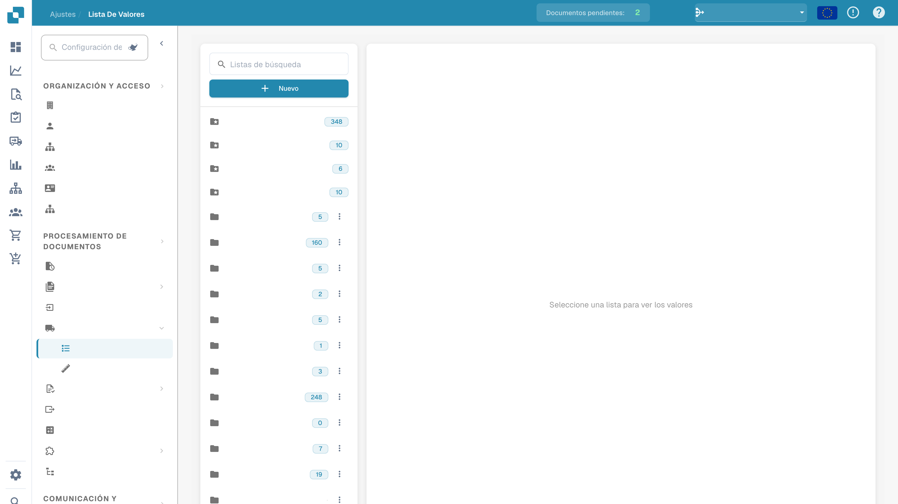

# Listas de valores

Las listas de valores contienen opciones predefinidas para los campos del documento. Un campo puede utilizar una lista durante la validación. Las etiquetas se pueden traducir; el valor técnico permanece igual en todos los idiomas.

## Abrir las listas

En los ajustes, abrir los datos maestros y las listas de valores. Seleccionar una lista para consultar sus entradas. Los nombres configurados están ocultos en la imagen.

<figure><figcaption>
Listas de valores con los nombres configurados ocultos.
</figcaption></figure>

## Crear una lista

1. Elegir la creación de una nueva lista.
2. Introducir un nombre y, si es necesario, limitarla a una suborganización.
3. Comprobar los datos antes de guardar.

Las listas estándar las proporciona el sistema y no se pueden eliminar. Antes de eliminar una lista personalizada, comprobar qué campos la utilizan: la acción puede tener efecto inmediato.

## Añadir y editar entradas

Abrir la lista prevista y añadir una fila. Comprobar las propiedades de cada entrada:

| Propiedad | Significado |
| --- | --- |
| Valor | Valor técnico almacenado por DocBits, igual en todos los idiomas. |
| Etiqueta | Texto mostrado en el idioma seleccionado. Si no existe una etiqueta para el idioma activo, se muestra el valor técnico. |
| Idioma | Idioma de la etiqueta. |
| Suborganizaciones | Ámbito de disponibilidad de la entrada; sin restricciones, se aplica a todas las suborganizaciones. |
| Sinónimos | Variantes asociadas al valor, por ejemplo EURO y € para EUR. Confirmar cada sinónimo en el campo correspondiente. |

Comprobar todas las propiedades antes de guardar. Las acciones de edición y eliminación dependen de los permisos y de la entrada seleccionada. Las entradas del sistema no se pueden eliminar.

## Importar un archivo CSV

Abrir las acciones de la lista prevista y la importación CSV. Seleccionar el archivo y el delimitador correcto, por ejemplo `;` o `,`. Comprobar la estructura y el contenido antes de iniciar la importación.

## Añadir traducciones

Para una entrada, añadir un idioma e introducir la etiqueta prevista. Repetir para los demás idiomas necesarios, comprobar y guardar. Las entradas del sistema pueden recibir etiquetas traducidas aunque no se puedan eliminar.

Traducir la etiqueta no cambia el valor técnico. Después de las modificaciones previstas, comprobar el campo durante la validación en el idioma deseado. La imagen muestra la consulta de las listas, no cambios guardados ni una importación ejecutada.
