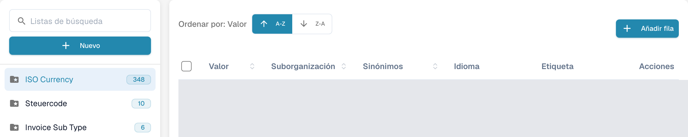
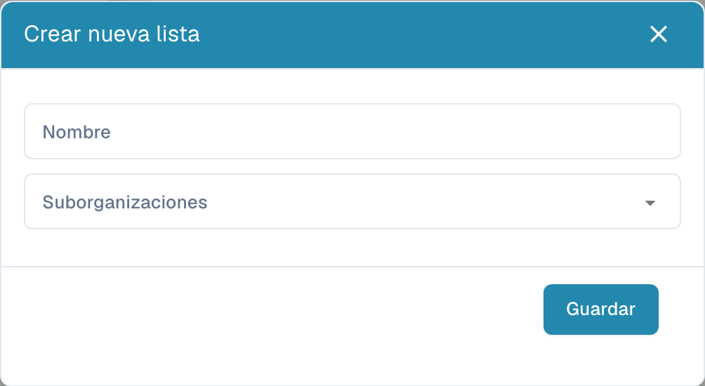
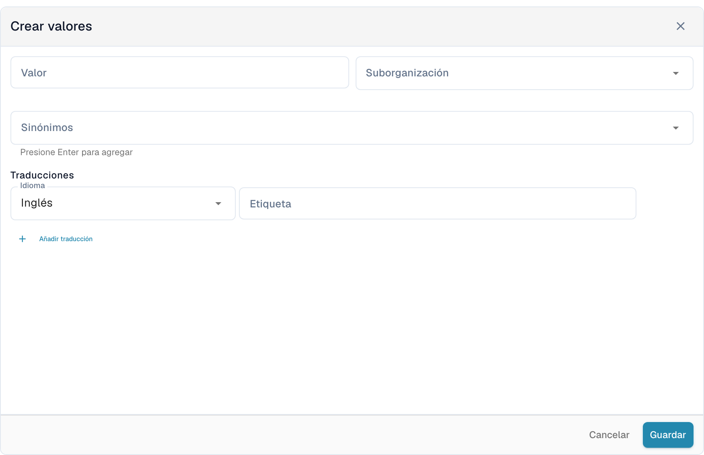

# Listas de valores

## Tutorial en vídeo: Datos maestros y listas de valores


Fuentes de datos maestros, listas de valores y ajustes de datos maestros en DocBits


El vídeo muestra las fuentes de datos maestros, las listas de valores y los ajustes de datos maestros de un tipo de documento.

Las listas de valores contienen opciones predefinidas para los campos del documento. Un campo puede utilizar una lista durante la validación. Las etiquetas se pueden traducir; el valor técnico permanece igual en todos los idiomas.

## Abrir las listas

En los ajustes, abra la consulta de datos maestros y seleccione las listas de valores. Use el campo **Listas de búsqueda** del panel izquierdo para encontrar una lista. Seleccione su nombre para abrir las entradas a la derecha. La carpeta con estrella identifica una lista del sistema; el número junto a su nombre muestra la cantidad de entradas cargadas.

<figure><figcaption>
Listas de valores con los nombres configurados ocultos.
</figcaption></figure>

<figure><figcaption>
La lista del sistema seleccionada abre la tabla de entradas. A-Z y Z-A ordenan por valor; Añadir fila abre el formulario. Los valores y nombres personalizados están ocultos; los nombres de las listas del sistema, como ISO Currency, son datos existentes.
</figcaption></figure>

## Crear una lista

1. Seleccione **Nuevo** encima de los nombres de las listas.
2. Introduzca el **Nombre** y, si necesita limitar el ámbito, seleccione las **Suborganizaciones**.
3. **Guardar** crea la lista. La **X** cierra el diálogo sin crear una lista nueva.

<figure><figcaption>
Nuevo abre el diálogo vacío Crear nueva lista con Nombre, Suborganizaciones, X y Guardar. Esta vista no muestra una lista guardada.
</figcaption></figure>

Para eliminar una lista propia, utilice la opción de eliminación del menú de tres puntos junto a su nombre y confirme únicamente la lista prevista. Las listas del sistema no ofrecen ese menú de eliminación y no se pueden eliminar.

## Añadir y editar entradas

1. Seleccione la lista a la izquierda y pulse **Añadir fila** encima de la tabla.
2. Introduzca el **Valor** almacenado y, si corresponde, su **Suborganización**.
3. Añada los **Sinónimos** necesarios. Confirme cada uno con **Enter** para que quede añadido al campo.
4. En **Traducciones**, seleccione un **Idioma** e introduzca una **Etiqueta** no vacía. Una entrada nueva necesita al menos una traducción completa.
5. **Guardar** crea la entrada. **Cancelar** o la **X** cierra el formulario sin guardarla.

<figure><figcaption>
Añadir fila abre Crear valores debajo de la tabla: Valor, Suborganización, Sinónimos, Idioma, Etiqueta y Añadir traducción. Guardar crea la entrada; Cancelar descarta el borrador sin guardar.
</figcaption></figure>

Para editar, seleccione una fila o su opción de edición en **Acciones**. Los campos protegidos permanecen de solo lectura; el valor almacenado también puede estar bloqueado cuando ya hay traducciones. **Cancelar** descarta los cambios sin guardar.

La opción de duplicación del menú de la fila crea otra entrada. Para varias entradas, seleccione sus casillas y use el control de copia encima de la tabla. La eliminación está disponible para las entradas propias y elimina la entrada seleccionada; las entradas del sistema no ofrecen esta acción. Una lista del sistema puede contener tanto entradas protegidas como entradas propias.

## Importar un archivo CSV

Esta interfaz no incluye el antiguo comando **Acciones → Cargar CSV**. Los pasos antiguos de carga CSV no se aplican a esta pantalla; utilice **Añadir fila** para introducir valores aquí.

## Añadir traducciones

En el formulario de la entrada, seleccione **Idioma** e introduzca la **Etiqueta**. Use **Añadir traducción** para añadir otro idioma y etiqueta. Complete o quite las filas de traducción vacías antes de guardar. Cuando una fila de traducción se puede quitar, su papelera la elimina primero del formulario; guarde para aplicar el cambio.

La etiqueta puede variar por idioma, pero el valor técnico permanece igual. Si no hay etiqueta para el idioma activo, se muestra el valor técnico. Las entradas del sistema y las traducciones heredadas pueden tener campos protegidos; modifique únicamente los datos propios que permiten edición.
