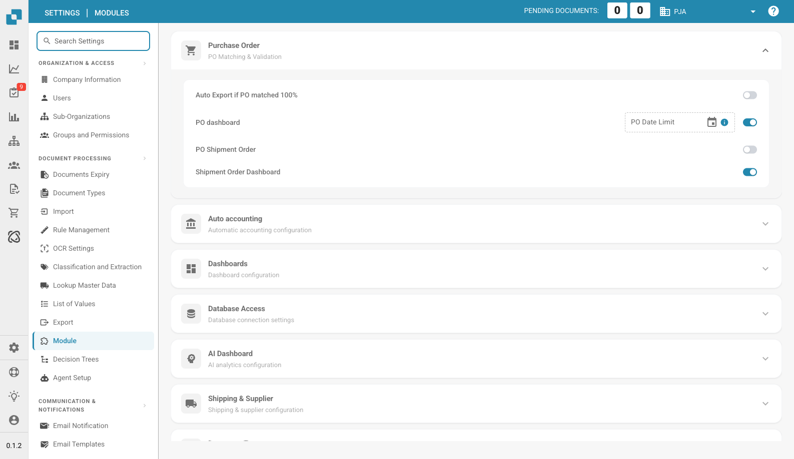

# Module

<figure><figcaption>
Página Module Settings
</figcaption></figure>

La página Module le permite activar o desactivar funciones opcionales de DocBits. Cada sección agrupa módulos relacionados que pueden activarse o desactivarse.

## Purchase Order

Ajustes de PO Matching y validación.

| Ajuste | Descripción |
|---------|-------------|
| **Auto Export if PO matched 100%** | Exporta automáticamente el documento cuando el PO matching alcanza el 100 %. |
| **PO Dashboard** | Activa el panel de pedidos de compra (Purchase Order). Incluye un campo **PO Date Limit** para restringir los datos de pedidos por fecha. |
| **PO Shipment Order** | Activa el procesamiento de órdenes de envío vinculadas a pedidos de compra. |
| **Shipment Order Dashboard** | Activa un panel específico para órdenes de envío. |

## Auto Accounting

| Ajuste | Descripción |
|---------|-------------|
| **Auto Accounting** | Activa la contabilización automática de documentos. Seleccione el tipo de ERP (por ejemplo, LN, M3). |

## Dashboards

| Ajuste | Descripción |
|---------|-------------|
| **Advance Shipment Dashboard** | Panel para supervisar actividades de envío avanzadas. |
| **Invoice Dashboard** | Panel para la supervisión y el análisis de facturas. |
| **Full Text Search** | Activa la búsqueda de texto completo en los documentos. |
| **Analytics Dashboard** | Activa el panel de resumen analítico. |

## Database Access

| Ajuste | Descripción |
|---------|-------------|
| **DB Access** | Activa el acceso directo a la base de datos para la organización. |

## AI Dashboard

| Ajuste | Descripción |
|---------|-------------|
| **AI Document Warehouse** | Análisis del almacén de documentos basado en IA. |
| **Dashboard v2** | Panel actualizado con funciones mejoradas. |
| **Clickhouse Direct Access** | Activa el acceso directo a la base de datos Clickhouse. |
| **Supplier Statistics** | Activa las estadísticas e informes a nivel de proveedor. |

## Shipping & Supplier

| Ajuste | Descripción |
|---------|-------------|
| **Supplier Portal** | Activa el portal de proveedores para la colaboración con proveedores. |

## Document Type

| Ajuste | Descripción |
|---------|-------------|
| **Workflow Builder** | Cree y personalice flujos de trabajo de procesamiento de documentos. |
| **Annotation Mode** | Permite a los usuarios anotar documentos en la vista de validación. |
| **Show Report** | Activa la generación de informes para documentos. |
| **Inbound Emails** | Activa la gestión de correos electrónicos entrantes por tipo de documento. |
| **Models & Labels** | Gestione modelos de IA y etiquetas para el reconocimiento de documentos. |
| **Document Script** | Activa los scripts personalizados para el procesamiento de documentos. |
| **Document Scan** | Activa la funcionalidad de escaneo de documentos. |
| **Bar-Code/QR Code Extraction** | Extrae datos de códigos de barras y códigos QR de los documentos. Seleccione los tipos de código admitidos. |
| **Custom Master Data** | Activa los campos de datos maestros personalizados. |
| **Tasks & Notifications** | Activa la gestión de tareas y las funciones de notificación. Incluye el interruptor **Dashboard Tasks Count**. |
| **DocBits Operator** | Activa la función de automatización del navegador DocBits Operator. |
| **DocNet** | Activa la red de documentos DocNet. |
| **IDM ACL Updater** | Actualiza las listas de control de acceso de Infor Document Management. Cargue un archivo ION-Mapping y configure las asignaciones de Infor-Doctype a ACL. |
| **Barcode Assignment** | Activa la asignación de códigos de barras a documentos. |
| **Set Negative Sign For Credit Notes** | Aplica automáticamente signos negativos a los importes de las notas de crédito. |

## BOD Connection Stream

| Ajuste | Descripción |
|---------|-------------|
| **BOD Connection Stream** | Activa la integración BOD (Business Object Document). Muestra el **Stream Name** utilizado para la conexión. |

## Analytics

| Ajuste | Descripción |
|---------|-------------|
| **Use PostgreSQL for Quality Analytics** | Alterna entre Prometheus (en tiempo real, se reinicia con cada despliegue) y PostgreSQL (persistente durante 90 días, análisis de tendencias, campos con peor rendimiento). |

## Vertex Tax Integration

| Ajuste | Descripción |
|---------|-------------|
| **Vertex Tax Integration** | Activa el cálculo de impuestos de Vertex. Configure **Base URL**, **Client ID** y **Client Secret**. Utilice **Test Connection** para verificarlo. |
