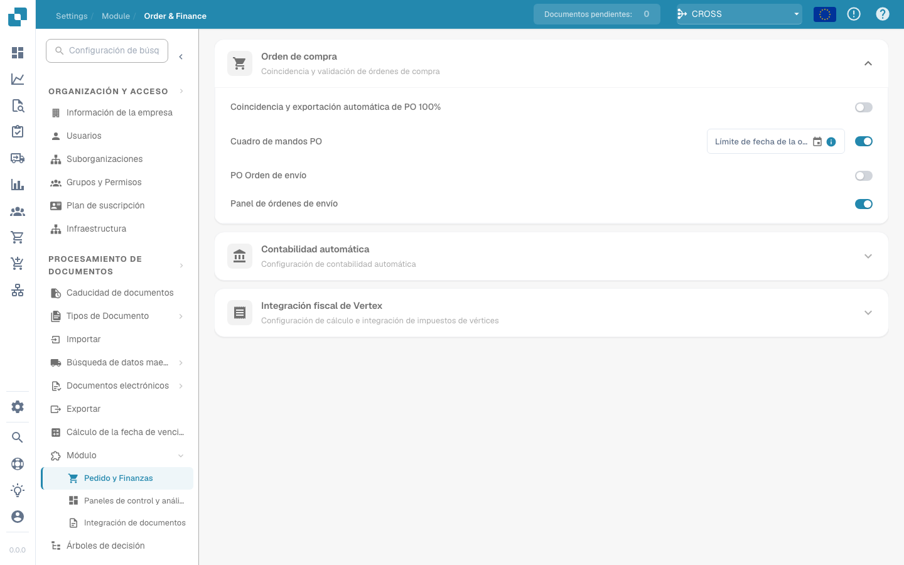

# IDM ACL Updater

## Descripción general

El módulo ACL-Updater es responsable de actualizar y administrar las Listas de control de acceso (ACL) dentro de DocBits. Esto garantiza que existan los permisos y las medidas de seguridad adecuados para el acceso y la manipulación de documentos.

## Instrucciones de activación

Para activar el módulo ACL-Updater, sigue estos pasos:

1. Navegue hasta **Configuración**.
2. Seleccione **Procesamiento de documentos**.
3. Select **Module**.
4. Vaya a **Tipo de documento**.
5. Active el **IDM ACL-Updater** habilitando el control deslizante correspondiente.

Una vez activado el módulo, puede seleccionar un **ION Archivo de mapeo** para usar.

<figure><figcaption></figcaption></figure>

### Añadir información de ACL

Para agregar información de ACL, haga clic en el botón **Agregar**. Luego puede especificar los siguientes detalles:

* **IDM Document Type**
* **Current IDM ACL Status**
* **New IDM ACL Status**

<figure><figcaption></figcaption></figure>

