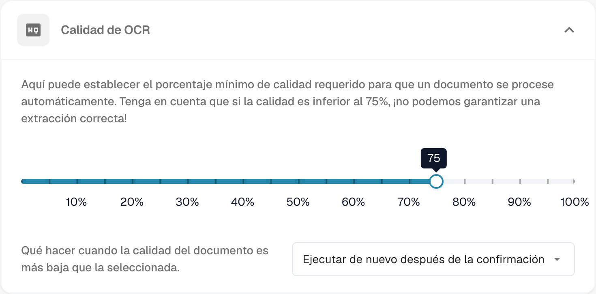
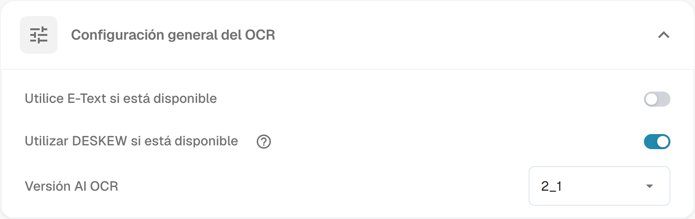
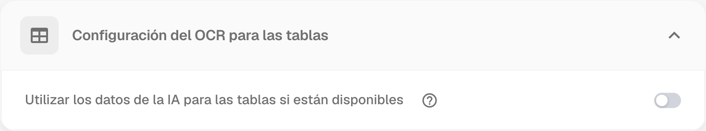
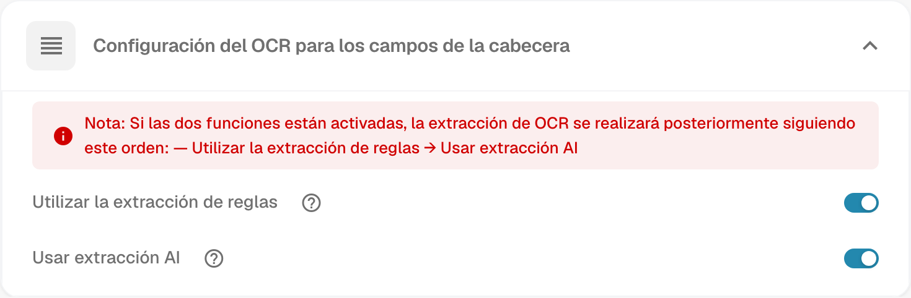

# Configuración de OCR


DocBits OCR y texto electrónico explicados: configuración, calidad y extracción de encabezados


## Descripción general

En la configuración de **OCR (reconocimiento óptico de caracteres)**, puede configurar cómo se aplica OCR durante el procesamiento de documentos. Esto incluye especificar la calidad mínima requerida, elegir si se utiliza texto incrustado (texto electrónico), seleccionar la versión OCR y más. Esta página proporciona una explicación de las configuraciones disponibles.

## Cómo acceder a la configuración de OCR

Navegue a: **Configuración → Procesamiento de documentos → Configuración de OCR**.

## Calidad de OCR

En esta sección, puede establecer la calidad mínima del documento requerida para el procesamiento OCR ajustando el control deslizante de calidad. Mueva el control deslizante hacia la izquierda o hacia la derecha para disminuir o aumentar el umbral de calidad, respectivamente.

Si un documento no cumple con el nivel de calidad definido, puede elegir cómo continuar:

* **Procesarlo de todos modos**: el documento se procesa independientemente de su calidad.
* **Ejecutar de nuevo después de la confirmación**: DocBits hace una pausa y solicita confirmación para continuar con el procesamiento. Esta es la opción seleccionada en el ejemplo.
* **Detenerlo con un error**: el procesamiento se detiene y se muestra un error porque el documento no cumple el umbral de calidad requerido.

El umbral mostrado es un ejemplo; compruebe los resultados de extracción con documentos representativos de su proceso.

<figure><figcaption>
Calidad de OCR: umbral mínimo y opción de volver a ejecutar después de la confirmación. El valor mostrado es un ejemplo de configuración.
</figcaption></figure>

## Configuración general de OCR

* **Utilice E-Text si está disponible**: si esta opción está activada y el documento contiene texto electrónico incrustado, DocBits utiliza ese texto en lugar de realizar OCR. Compruebe que el texto incrustado y los campos extraídos contienen los datos esperados; la disponibilidad de texto electrónico no garantiza una mayor precisión en todos los documentos.
* **Utilizar DESKEW si está disponible**: corrige la inclinación de los documentos escaneados. Compruebe su efecto en el reconocimiento con documentos representativos.
* **Versión AI OCR**: permite seleccionar una versión del motor OCR basado en IA. Puede resultar útil revisar esta selección si no está logrando los resultados deseados o si está investigando problemas de rendimiento o precisión. Compare los resultados antes de cambiar la versión utilizada en su proceso.

<figure><figcaption>
Configuración general del OCR: opciones de E-Text y DESKEW y versión del motor OCR. Los estados mostrados son ejemplos de configuración.
</figcaption></figure>

## Configuración de OCR para tablas

* **Utilizar los datos de la IA para las tablas si están disponibles**: si esta opción está activada y los datos están disponibles, DocBits utiliza los datos OCR para las tablas en lugar del texto electrónico incrustado, incluso si también está activada la opción **Utilice E-Text si está disponible**. Compruebe las filas, columnas y valores extraídos en sus documentos de ejemplo.

<figure><figcaption>
Configuración del OCR para tablas: opción de utilizar los datos de la IA cuando están disponibles. El estado mostrado es un ejemplo de configuración.
</figcaption></figure>

## Configuración de OCR para campos de cabecera

* **Utilizar la extracción de reglas**: DocBits aplica las reglas de extracción configuradas para identificar los campos de cabecera.
* **Usar extracción AI**: DocBits utiliza IA para detectar y extraer los campos de cabecera.

**Orden de ejecución:** si ambas opciones están activadas, DocBits realiza la extracción en este orden: **extracción por reglas → extracción con IA**.

Seleccione los métodos según los documentos y las reglas de su organización. Si utiliza ambos, compruebe los valores finales después de la extracción; los estados de los interruptores de la imagen no son una recomendación general para todos los procesos.

<figure><figcaption>
Configuración del OCR para los campos de cabecera: extracción por reglas y extracción con IA. Los estados mostrados son ejemplos de configuración.
</figcaption></figure>
