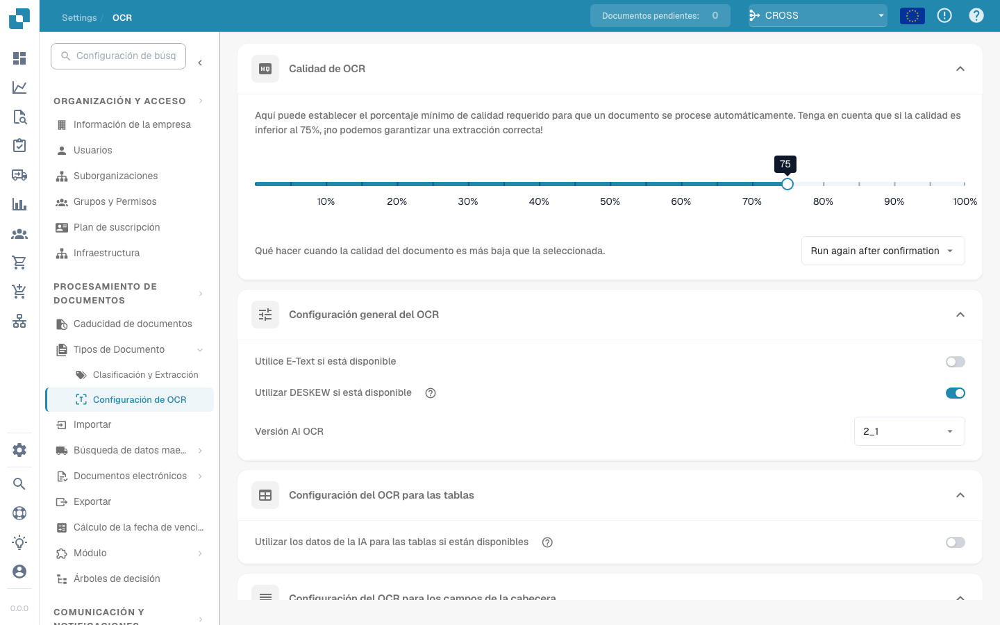

# Configuración de OCR


DocBits OCR y texto electrónico explicados: configuración, calidad y extracción de encabezados


## Descripción general

En la configuración de **OCR (reconocimiento óptico de caracteres)**, puede configurar cómo se aplica OCR durante el procesamiento de documentos. Esto incluye especificar la calidad mínima requerida, elegir si se utiliza texto incrustado (texto electrónico), seleccionar la versión OCR y más. Esta página proporciona una explicación detallada de todas las configuraciones disponibles.

## Cómo acceder a la configuración de OCR

Para acceder a la configuración de OCR:

*   Navegue a: **Configuración** → **Procesamiento de documentos** → **OCR Configuración**

    <figure><figcaption></figcaption></figure>

## Calidad de OCR

En esta sección, puede establecer la calidad mínima del documento requerida para el procesamiento OCR ajustando el control deslizante de calidad. Mueva el control deslizante hacia la izquierda o hacia la derecha para disminuir o aumentar el umbral de calidad, respectivamente.

Si un documento no cumple con el nivel de calidad definido, DocBits proporciona tres opciones para manejarlo:

* **Run Anyway**\
  El documento será procesado independientemente de su calidad.
* **Ejecutar nuevamente después de la confirmación**\
  **DocBits** hará una pausa y le pedirá que confirme si desea continuar con el procesamiento.
* **Throw Error**\
  El procesamiento del documento se detendrá por completo y se mostrará un mensaje de error que indica que el documento no cumplió con el umbral de calidad requerido.

<figure><figcaption></figcaption></figure>

## Configuración general de OCR

* **Usar texto electrónico si está disponible**\
  Cuando esté habilitado, **DocBits** utilizará texto electrónico incrustado (por ejemplo, de archivos PDF) en lugar de realizar OCR. Esto mejora tanto la velocidad como la precisión, ya que el texto se extrae directamente sin requerir procesamiento OCR.
* **Utilice DESKEW si está disponible**\
  Esta opción corrige automáticamente la alineación de los documentos escaneados. Enderezar imágenes torcidas ayuda a mejorar la precisión de OCR.
*   **AI OCR Version**\
    Le permite seleccionar una versión específica del motor OCR basado en AI.\
    Esto puede resultar útil si:

    * No está logrando los resultados deseados con la versión seleccionada actualmente.
    * Está solucionando problemas relacionados con el rendimiento o la precisión de OCR.

    <figure><figcaption></figcaption></figure>

## Configuración de OCR para tablas

* **Utilice AI Datos para tablas si están disponibles**\
  Cuando está habilitado, DocBits usará datos OCR para tablas en lugar de texto electrónico incrustado (Texto electrónico), incluso si la configuración **Usar texto electrónico si está disponible** está activada.

## Configuración de OCR para campos de cabecera

* **Usar extracción de reglas**\
  DocBits aplicará sus reglas de extracción predefinidas para identificar los campos de encabezado.
* **Use AI Extraction**\
  DocBits utilizará AI para detectar y extraer automáticamente los campos de encabezado.

**Execution Order:**\
Si ambas opciones están habilitadas, **DocBits** realizará la extracción en el siguiente orden:\
**Extracción de reglas → AI Extracción**\
\
<mark style="color:red;">**Nota**</mark>: Para obtener mejores resultados y un comportamiento consistente, habilite ambas opciones. Esto permite que **DocBits** utilice métodos basados ​​en reglas y métodos basados ​​en AI en combinación durante la extracción de encabezados.
