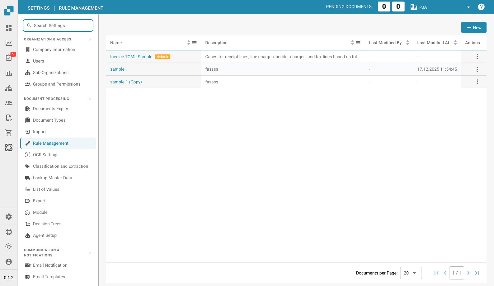

# Rule Management

<figure><figcaption>
Página Rule Management
</figcaption></figure>

Rule Management le permite crear y gestionar reglas de resolución de conflictos basadas en TOML que se utilizan durante el PO matching y la exportación de documentos. Cada conjunto de reglas define cómo gestiona DocBits las discrepancias entre los datos de la factura y los datos del pedido de compra.

## Lista de reglas

La tabla principal muestra todas las configuraciones de reglas:

| Columna | Descripción |
|--------|-------------|
| **Name** | El nombre del conjunto de reglas. Los elementos etiquetados como **default** son plantillas proporcionadas por el sistema. |
| **Description** | Un resumen de lo que gestiona el conjunto de reglas. |
| **Last Modified By** | El usuario que editó por última vez este conjunto de reglas. |
| **Last Modified At** | Marca de tiempo del último cambio. |
| **Actions** | Menú de tres puntos para editar, copiar o eliminar. |

Haga clic en **+ New** para crear un nuevo conjunto de reglas o haga clic en un nombre existente para abrir el editor de reglas.

---

## Referencia de la estructura de reglas

Esta sección ofrece una explicación detallada de las reglas de resolución de conflictos utilizadas en el sistema de facturación de DocBits. Estas reglas están diseñadas para gestionar automáticamente las discrepancias entre los detalles de la factura y los datos del pedido de compra (PO), con el fin de garantizar una conciliación financiera precisa. El sistema aplica estas reglas para procesar las líneas de factura, los cargos y los impuestos, y genera los ajustes o notas adecuados cuando es necesario.

## Estructura de las reglas

### 1. Metadatos

• version: identifica la versión del archivo de mapeo.

• revision: número de revisión para el seguimiento de los cambios.

• author: indica el creador del archivo de mapeo.

• description: una breve descripción de la finalidad del archivo.

• created_at & updated_at: marcas de tiempo de cuándo se creó y se actualizó por última vez el archivo.

### 2. Configuración de exportación

La sección de configuración de exportación define el mapeo entre los campos de datos del sistema y los campos correspondientes de los archivos de exportación.

• Header: define los campos de cabecera de los datos de factura exportados.

• Tax Lines: especifica los campos de las líneas de impuestos en la exportación.

• Order Header Charges: mapea los campos relacionados con cargos adicionales a nivel de cabecera del pedido.

• Receipt Lines: mapea los campos de las líneas individuales de un albarán de recepción.

• Order Line Charges: define los campos de los cargos relacionados con líneas de pedido específicas.

• Cost Lines: especifica los campos de las líneas de reparto de costes.

• Debit Note & Credit Note: define los campos para generar notas de débito y de crédito en caso de discrepancias.

### 3. Reglas de resolución de conflictos

Estas reglas gestionan las discrepancias entre los datos de la factura y los datos correspondientes del pedido de compra. Cada regla se compone de varios elementos:

• Name: el nombre descriptivo de la regla, que indica el tipo de discrepancia que aborda.

• Section: indica a qué parte de la factura (por ejemplo, receipt_lines, line_charges) se aplica la regla.

• Active: valor booleano (true o false) que indica si la regla está activa actualmente.

• Match Criteria: condiciones que activan la regla en función de comparaciones entre los datos reales de la factura y los datos esperados del pedido de compra.

• Actions: define lo que debe hacer el sistema cuando se activa la regla, como ajustar valores, aplicar cargos o generar notas de crédito/débito.

## Elementos comunes en las reglas

### Operadores de comparación

Estos operadores definen cómo se comparan los valores reales de la factura con los valores esperados del pedido de compra:

• equal (igual)

• greater than (mayor que)

• greater than or equal to (mayor o igual que)

• less than (menor que)

• less than or equal to (menor o igual que)

• within tolerance (dentro de la tolerancia)

• outside tolerance (fuera de la tolerancia)

### Estado de aprobación

Indica si una discrepancia está aprobada o no:

• approved (aprobada)

• rejected (rechazada)

• any (cualquiera)

### Tipos de acción

Define las acciones específicas que deben realizarse cuando se detecta una discrepancia:

• receipt line

• cost line

• header charge

• line charge

• tax line

• debit note receipt line

• debit note cost line

• debit note header charge

• debit note line charge

• credit note receipt line

• credit note cost line

• credit note header charge

• credit note line charge

• credit note tax line

### Ejemplos de reglas

#### [Caso 1, 2, 3: cantidad y precio unitario dentro de la tolerancia](transactionconfig-pro-template/case-1-2-3-quantity-and-unit-price-within-tolerance.md)

• Finalidad: gestiona los escenarios en los que tanto la cantidad como el precio unitario de la factura están dentro de los límites de tolerancia aceptados en comparación con el pedido de compra.

• Acción: el sistema acepta los valores de la factura y calcula el importe total.

#### [Caso 4, 5: cantidad dentro de la tolerancia, precio unitario fuera de la tolerancia (aprobado)](./#caso-4-5-cantidad-dentro-de-la-tolerancia-precio-unitario-fuera-de-la-tolerancia-aprobado)

• Finalidad: se aplica cuando la cantidad está dentro de la tolerancia, pero el precio unitario está fuera de la tolerancia y ha sido aprobado.

• Acción: el sistema ajusta el precio unitario para que coincida con el del pedido de compra y aplica los cargos de línea necesarios.

#### [Caso 6: cantidad dentro de la tolerancia, precio unitario fuera de la tolerancia negativa (rechazado)](transactionconfig-pro-template/case-6-quantity-within-tolerance-unit-price-outside-negative-tolerance-rejected.md)

• Finalidad: trata los casos en los que el precio unitario es inferior al esperado y está fuera del rango de tolerancia, lo que provoca el rechazo.

• Acción: el sistema ajusta el precio unitario para que coincida con el del pedido de compra, genera una nota de crédito por la diferencia y aplica cargos de cabecera según sea necesario.

### Gestión de cargos e impuestos

### Tolerancia de cargo por unidad

• Las reglas de esta categoría gestionan las discrepancias en los cargos por unidad, con acciones específicas según si el cargo está dentro o fuera de la tolerancia y si está aprobado o rechazado.

### Ajustes de líneas de impuestos

• Estas reglas gestionan las discrepancias fiscales ajustando las líneas de impuestos o generando las notas de crédito o de débito correspondientes en función de las diferencias entre los datos fiscales de la factura y los del pedido de compra.

### Enumeraciones y opciones

• Enums: listas predefinidas de valores que garantizan la coherencia entre las reglas (por ejemplo, operadores de comparación, tipos de aprobación).

• Options: opciones predefinidas para el tratamiento de cantidades o precios unitarios, que ofrecen flexibilidad en la definición de las reglas.

## Explicación de las capturas de pantalla

### Captura de pantalla 1: interfaz de Rule Management

<figure><figcaption></figcaption></figure>

Esta captura de pantalla muestra la interfaz de Rule Management, donde los administradores pueden ver y gestionar todas las reglas de resolución de conflictos. Los elementos clave son:

• Add Rule Button: permite añadir nuevas reglas.

• List of Rules: muestra todas las reglas activas con detalles como el nombre, la sección y el estado activo.

• Section Dropdown: filtra las reglas según la sección a la que se aplican (por ejemplo, Receipt Lines, Line Charges).

### Captura de pantalla 2: edición detallada de reglas

<figure><figcaption></figcaption></figure>

Esta captura de pantalla ilustra la vista detallada de una regla específica en edición. Los elementos clave son:

• Criteria Section: define las condiciones en las que se activa la regla. Por ejemplo, los criterios podrían especificar que, si la cantidad y el precio unitario difieren del pedido de compra pero están dentro de la tolerancia, debe aplicarse la regla.

• Actions Section: especifica qué acciones deben realizarse cuando se cumplen los criterios. Esto puede incluir ajustar las líneas de factura, generar notas de crédito o de débito, o aplicar cargos adicionales.

• Document Type and Costing Elements: permite al administrador asignar acciones específicas a tipos de documento y elementos de costes, lo que ofrece flexibilidad para gestionar distintos escenarios.
