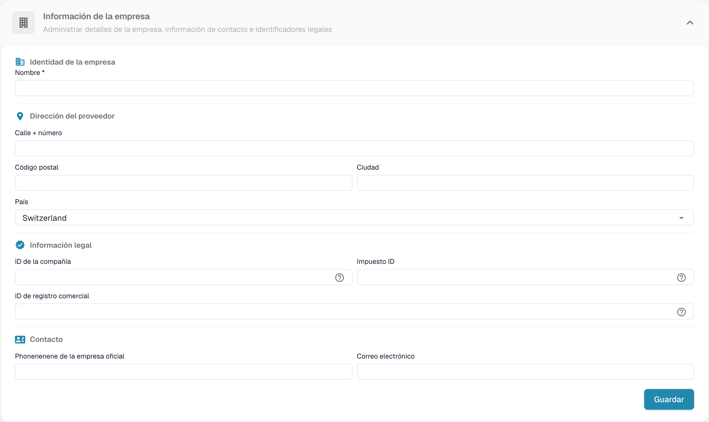
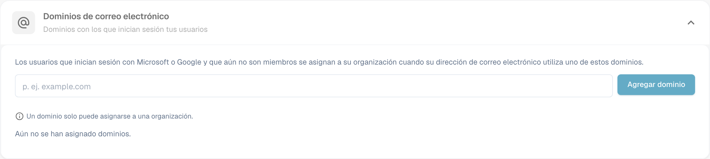

# Información de la empresa

<figure><figcaption>
Información de la empresa con los valores de la organización ocultos.
</figcaption></figure>

La página Company Information le permite gestionar el perfil de su empresa, las preferencias y los detalles de la suscripción. Está organizada en las siguientes secciones:

## Company Information

Esta sección contiene los datos principales de su empresa, agrupados en cuatro áreas:

### Company Identity

* **Nombre** *(obligatorio)*: el nombre legal de su empresa.

### Address

* **Calle + número**: la dirección postal de su empresa.
* **Código postal**: código postal.
* **Ciudad**: nombre de la ciudad.
* **País**: seleccione su país en la lista desplegable.

### Legal Information

* **ID de la compañía**: un identificador único de su empresa, utilizado para integraciones y como referencia interna.
* **Impuesto ID**: su número de identificación fiscal para la elaboración de informes financieros.
* **ID de registro comercial**: su número de registro mercantil para la documentación legal.

### Contact

* **Teléfono oficial de la empresa**: el número de teléfono principal de su empresa.
* **Correo electrónico**: la dirección de correo electrónico principal utilizada para las comunicaciones oficiales.

Después de introducir o actualizar cualquier campo, haga clic en **Guardar** para aplicar los cambios. Los iconos **?** junto a los identificadores legales muestran orientación adicional sobre el campo. Seleccione el encabezado de la sección para expandir o contraer el formulario.

## E-mail domains

Los administradores de la organización pueden abrir **Ajustes → Información de la empresa → Dominios de correo electrónico** para gestionar los dominios utilizados para la asignación automática de organización. Cuando una persona inicia sesión con Microsoft o Google y todavía no es miembro de una organización, DocBits puede asignarla a esta organización si su dirección de correo electrónico utiliza uno de los dominios indicados. Un dominio solo puede pertenecer a una organización.

<figure><figcaption>
Configuración de dominios de correo de la empresa.
</figcaption></figure>

Introduzca únicamente el dominio, por ejemplo `example.com`, en el campo de entrada y seleccione **Agregar dominio** o pulse Intro. El primer dominio se convierte en el dominio principal. Si hay más dominios en la lista, utilice **Hacer primario** en otra fila para cambiarlo, o el icono de la papelera para eliminar un dominio. Los errores, como un dominio no válido, un proveedor de correo electrónico personal o un dominio ya asignado a otra organización, aparecen debajo del campo de entrada. **Todavía no hay dominios asignados** significa que esta organización no tiene ninguna regla de dominio.

Antes de añadir un dominio, compruebe qué organización debe recibir los nuevos inicios de sesión. Para gestionar las pertenencias existentes, continúe con [Users](../groups-users-and-permissions/users/README.md).

## Company Preferences

Configure los ajustes predeterminados de toda la empresa:

* **Patrón de fecha**: elija cómo se muestran las fechas en todo DocBits (por ejemplo, `%m/%d/%Y`, `%d.%m.%Y`).
* **Formato de cantidad**: seleccione el formato numérico de los importes (por ejemplo, Deutsch para `1.000,00`, English para `1,000.00`).
* **Nuevo cuadro de diálogo de información sobre la versión**: active o desactive si los usuarios ven una notificación cuando se publica una nueva versión de DocBits.

Haga clic en **Guardar** después de realizar los cambios.

## App-Color

Personalice el color principal de la interfaz de DocBits. Resulta útil para distinguir visualmente entornos diferentes (por ejemplo, dev frente a producción).

* **Color**: introduzca un código de color hexadecimal (por ejemplo, `#2388AE`) o utilice el selector de color.
* Haga clic en **Guardar** para aplicarlo o en **Restablecer** para restaurar el color predeterminado.

## Subscription Plan

Consulte sus planes de suscripción activos y sus detalles:

* **Nombre del plan**: el nombre de cada plan activo (por ejemplo, DocBits, DocFlow Users, DocSearch).
* **días restantes**: cuántos días quedan hasta que caduque el plan.
* **Start Date / End Date**: el período de la suscripción.
* **Número de usuarios**: número total de usuarios de su organización.
* **Número de suborganizaciones**: número de suborganizaciones configuradas.
* **Número de proveedores**: número de proveedores registrados.

## Subscription Usage

Supervise su consumo mensual de tokens y de flujos de trabajo:

| Columna | Descripción |
|--------|-------------|
| **Tipo** | El tipo de uso (Document o Workflow). |
| **From / To** | Las fechas del período de facturación. |
| **Tokens utilizados** | Número de tokens consumidos en el período actual. |
| **Tokens restantes** | Tokens que aún están disponibles en el período actual. |

Utilice el botón **Seleccionar** para filtrar por intervalos de fechas específicos.
