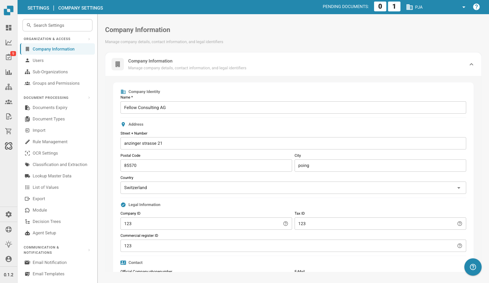
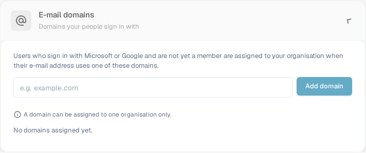

# Company Information

<figure><figcaption>
Company Information: edite el nombre de la organización, la dirección, los identificadores legales y los datos de contacto y, a continuación, seleccione Save.
</figcaption></figure>

La página Company Information le permite gestionar el perfil de su empresa, las preferencias y los detalles de la suscripción. Está organizada en las siguientes secciones:

## Company Information

Esta sección contiene los datos principales de su empresa, agrupados en cuatro áreas:

### Company Identity

* **Name** *(obligatorio)*: el nombre legal de su empresa.

### Address

* **Street + Number**: la dirección postal de su empresa.
* **Postal Code**: código postal.
* **City**: nombre de la ciudad.
* **Country**: seleccione su país en la lista desplegable.

### Legal Information

* **Company ID**: un identificador único de su empresa, utilizado para integraciones y como referencia interna.
* **Tax ID**: su número de identificación fiscal para la elaboración de informes financieros.
* **Commercial Register ID**: su número de registro mercantil para la documentación legal.

### Contact

* **Official Company Phone Number**: el número de teléfono principal de su empresa.
* **E-Mail**: la dirección de correo electrónico principal utilizada para las comunicaciones oficiales.

Después de introducir o actualizar cualquier campo, haga clic en **Save** para aplicar los cambios. Los iconos **?** junto a los identificadores legales muestran orientación adicional sobre el campo. Seleccione el encabezado de la sección para expandir o contraer el formulario.

## E-mail domains

Los administradores de la organización pueden abrir **Settings → Company Information → E-mail domains** para gestionar los dominios utilizados para la asignación automática de organización. Cuando una persona inicia sesión con Microsoft o Google y todavía no es miembro de una organización, DocBits puede asignarla a esta organización si su dirección de correo electrónico utiliza uno de los dominios indicados. Un dominio solo puede pertenecer a una organización.

<figure><figcaption>
La sección E-mail domains en inglés antes de añadir un dominio. Introduzca un dominio de empresa y, a continuación, seleccione Add domain.
</figcaption></figure>

Introduzca únicamente el dominio, por ejemplo `example.com`, en el campo de entrada y seleccione **Add domain** o pulse Intro. El primer dominio se convierte en el dominio principal. Si hay más dominios en la lista, utilice **Make primary** en otra fila para cambiarlo, o el icono de la papelera para eliminar un dominio. Los errores, como un dominio no válido, un proveedor de correo electrónico personal o un dominio ya asignado a otra organización, aparecen debajo del campo de entrada. **No domains assigned yet** significa que esta organización no tiene ninguna regla de dominio.

Antes de añadir un dominio, compruebe qué organización debe recibir los nuevos inicios de sesión. Para gestionar las pertenencias existentes, continúe con [Users](../groups-users-and-permissions/users/README.md).

## Company Preferences

Configure los ajustes predeterminados de toda la empresa:

* **Date Pattern**: elija cómo se muestran las fechas en todo DocBits (por ejemplo, `%m/%d/%Y`, `%d.%m.%Y`).
* **Amount Formatting**: seleccione el formato numérico de los importes (por ejemplo, Deutsch para `1.000,00`, English para `1,000.00`).
* **New Version Info Dialog**: active o desactive si los usuarios ven una notificación cuando se publica una nueva versión de DocBits.

Haga clic en **Save** después de realizar los cambios.

## App-Color

Personalice el color principal de la interfaz de DocBits. Resulta útil para distinguir visualmente entornos diferentes (por ejemplo, dev frente a producción).

* **Color**: introduzca un código de color hexadecimal (por ejemplo, `#2388AE`) o utilice el selector de color.
* Haga clic en **Save** para aplicarlo o en **Reset** para restaurar el color predeterminado.

## Subscription Plan

Consulte sus planes de suscripción activos y sus detalles:

* **Plan Name**: el nombre de cada plan activo (por ejemplo, DocBits, DocFlow Users, DocSearch).
* **Days Left**: cuántos días quedan hasta que caduque el plan.
* **Start Date / End Date**: el período de la suscripción.
* **Users Count**: número total de usuarios de su organización.
* **Sub Organizations Count**: número de suborganizaciones configuradas.
* **Suppliers Count**: número de proveedores registrados.

## Subscription Usage

Supervise su consumo mensual de tokens y de flujos de trabajo:

| Columna | Descripción |
|--------|-------------|
| **Type** | El tipo de uso (Document o Workflow). |
| **From / To** | Las fechas del período de facturación. |
| **Tokens Used** | Número de tokens consumidos en el período actual. |
| **Remaining Tokens** | Tokens que aún están disponibles en el período actual. |

Utilice el botón **Select** para filtrar por intervalos de fechas específicos.
