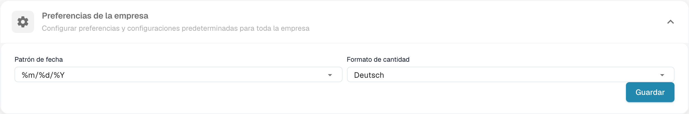
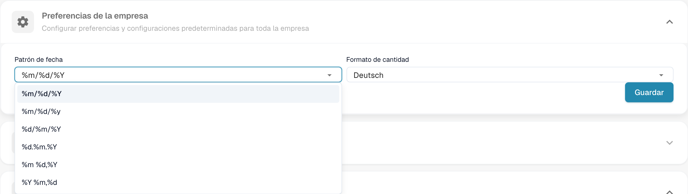

# Preferencias de la empresa

## Tutorial en vídeo: Empresa, suscripción y auditoría


Información de la empresa, plan de suscripción y registros de auditoría en DocBits


El vídeo muestra la información y las preferencias de la empresa, el plan de suscripción, la actividad de inicio de sesión y los registros de auditoría.

Abra **Ajustes → Información de la empresa** y expanda **Preferencias de la empresa**. Configure el patrón de fecha y el formato de importe previstos para su organización.

<figure><figcaption>
Preferencias de la empresa y formato de importes y fechas.
</figcaption></figure>

## Patrón de fecha

Seleccione un patrón compatible con sus documentos. Los símbolos como `%d`, `%m` y `%Y` son códigos técnicos del formato.

<figure><figcaption>
Selección del patrón de fecha en las preferencias de la empresa.
</figcaption></figure>

El formato de importe es una configuración independiente; el valor configurado puede conservar su nombre original. Revise ambos formatos antes de guardar. El antiguo diálogo de notificación de versión no forma parte de esta vista actual. No se modificó ninguna preferencia para obtener estas imágenes.


