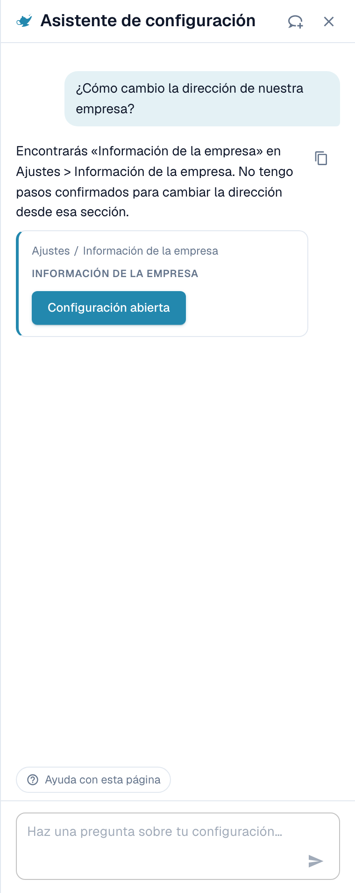
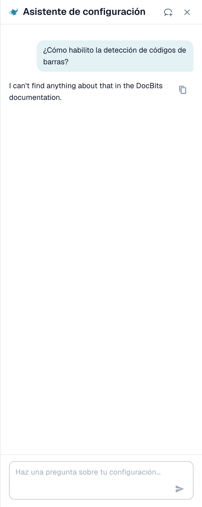
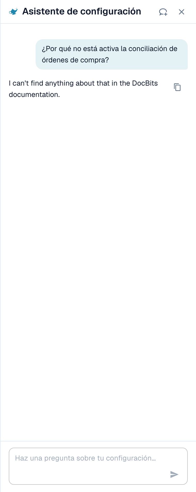
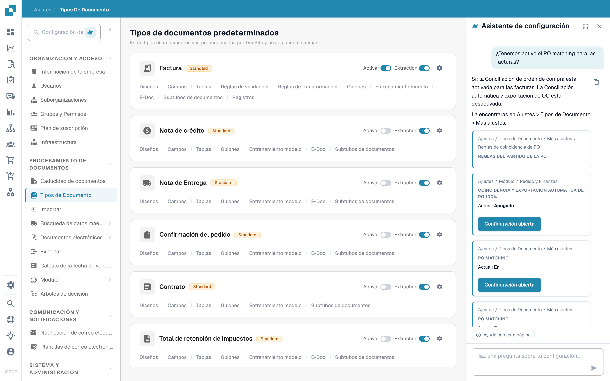
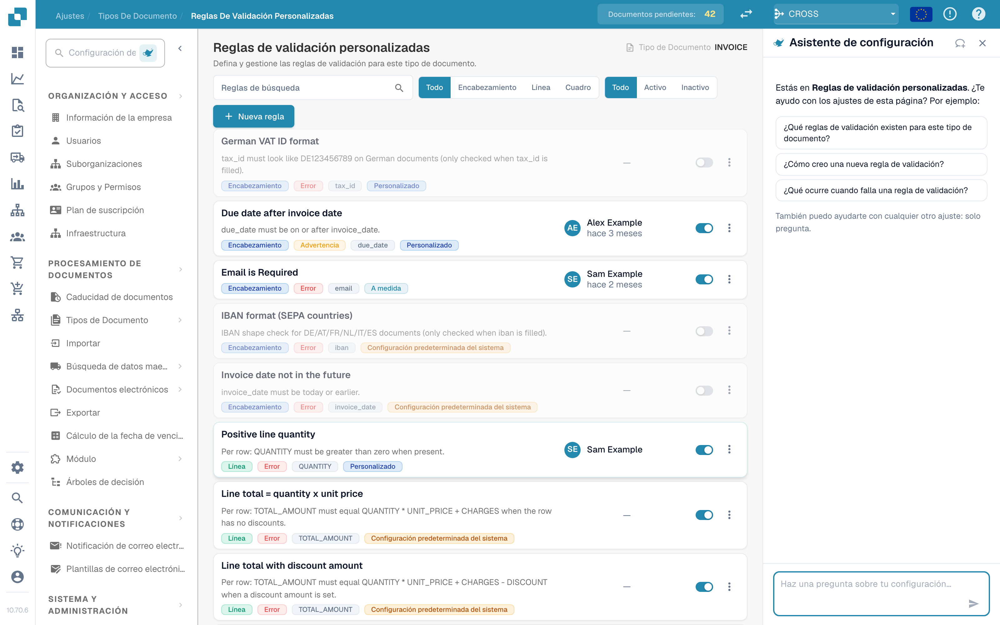
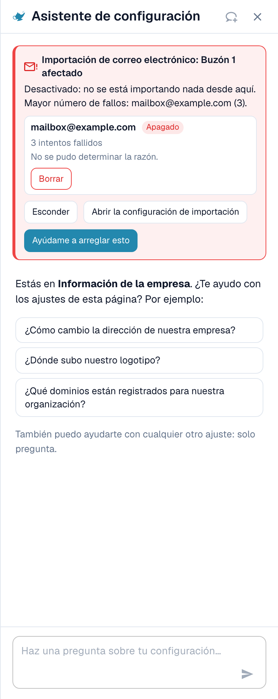

# Asistente de configuración: qué puede hacer el chat

## Descripción general

El chat del **Settings Assistant** responde a preguntas sobre sus ajustes, le avisa cuando una importación deja de funcionar y, con su confirmación, cambia un ajuste por usted. Antes de usarlo, un administrador tiene que [Settings Assistant: cómo activarlo](settings-assistant.md).

### Qué puede hacer

| Usted quiere… | Ejemplo | Qué obtiene |
| --- | --- | --- |
| Encontrar un ajuste | "¿Dónde encuentro los ajustes de importación por correo electrónico?" | La ruta (por ejemplo Settings / Import) y un botón **Open setting** que salta al ajuste y lo resalta |
| Entender un ajuste | "¿Cómo activo la detección de códigos de barras?" | Una breve explicación de cada ajuste coincidente: cuándo activarlo y cuándo dejarlo desactivado |
| Comprobar su configuración | "¿Por qué no está activa la coincidencia con la OC?" | El valor actual de cada ajuste relacionado en su organización (**Current: On** o **Current: Off**) y cuál le bloquea |
| Detectar una importación averiada | Una tarjeta roja en la parte superior del panel | Qué buzón o conexión FTP falla, con qué frecuencia y un posible motivo |
| Cambiar un ajuste de forma segura | **Switch off** en un buzón con fallos de una tarjeta de aviso | Una vista previa del cambio. No se guarda nada hasta que usted confirme. Todos los cambios se pueden deshacer. |
| Aprender una página | **Watch video explanation** | Un breve vídeo de la página en la que está (disponible para páginas seleccionadas) |


El asistente funciona con el nivel de IA **Fast**. No existe ningún ajuste de la organización para elegir otro modelo.


## Hacer preguntas

Escriba una pregunta en el campo de la parte inferior ("Ask a question about your settings…") y pulse **Enter**. El asistente muestra lo que está haciendo ("Reading configuration…", "Searching documentation…", "Writing answer…") y puede detenerlo en cualquier momento con **Stop**.

### El panel sabe en qué página está

Cuando abre el panel en una página de ajustes, le saluda para **esa página** y ofrece tres preguntas que encajan con ella. Son ejemplos reales:

| Página | Preguntas de ejemplo |
| --- | --- |
| Información de la empresa | "¿Cómo cambio la dirección de nuestra empresa?", "¿Dónde subo nuestro logotipo?", "¿Qué dominios están registrados para nuestra organización?" |
| Importación | "¿Tenemos activada la importación por correo electrónico?", "¿A qué dirección de correo electrónico enviamos los documentos?", "¿Cómo configuro una importación por FTP o SFTP?" |
| Clasificación y extracción | "¿Qué modelo de IA se utiliza para la extracción?", "¿Tenemos activada la división de documentos por códigos de barras?", "¿Puedo utilizar otro modelo de IA para un proveedor?" |
| Usuarios | "¿Cómo invito a un nuevo usuario?", "¿Cómo convierto a un usuario en administrador?", "¿Cómo desactivo a un usuario?" |
| Resumen de ajustes | "¿Cómo activo la detección de códigos de barras?", "¿Por qué no está activo el cotejo de pedidos?", "¿Dónde encuentro los ajustes de importación por correo electrónico?" |

Haga clic en una pregunta y se envía de inmediato. Debajo de las tres preguntas, el panel dice *I can also help with any other setting — just ask.* (también puedo ayudarle con cualquier otro ajuste, solo pregunte). Durante una conversación, el chip **Help with this page** permanece en la parte inferior y pregunta "What can I configure on this page?".

### Ejemplo 1: Encontrar un ajuste

Usted pregunta **"¿Cómo cambio la dirección de nuestra empresa?"**

<figure><figcaption>
La respuesta nombra el lugar, y la tarjeta le da la ruta exacta y un botón <strong>Open setting</strong>.
</figcaption></figure>

La respuesta indica dónde está la dirección. La tarjeta de debajo muestra la ruta (**Settings / Company Settings**) y el botón **Open setting**. Haga clic en él: DocBits abre la página, se desplaza hasta el ajuste y lo resalta durante unos segundos.

### Ejemplo 2: Entender un ajuste que tiene varios nombres

Usted pregunta **"¿Cómo activo la detección de códigos de barras?"**

<figure><figcaption>
Cuando una palabra encaja con varios ajustes, el asistente enumera cada uno con <strong>Enable when</strong> y <strong>Leave off when</strong>.
</figcaption></figure>

"Detección de códigos de barras" puede significar tres ajustes distintos, por lo que el asistente pregunta *Did you mean: QR Code Extraction, Barcode Assignment, or Split Document on Barcode?* y explica cada uno:

* **QR Code Extraction**: lee automáticamente códigos de barras y códigos QR compatibles durante el procesamiento. Actívelo cuando sus documentos lleven códigos útiles.
* **Barcode Assignment**: permite que un revisor asigne a mano los valores de códigos de barras decodificados a campos durante la validación. Necesita que la extracción detecte primero el código y no hace que el procesamiento sea touchless.
* **Split Document on Barcode**: divide un archivo cargado en documentos separados en las páginas separadoras. Úselo solo cuando los códigos separadores sean fiables.

### Ejemplo 3: Averiguar por qué algo no ocurre

Usted pregunta **"¿Por qué no está activo el cotejo de pedidos?"**

<figure><figcaption>
Ante una pregunta de "por qué", el asistente lee su configuración y muestra cada ajuste con su valor <strong>Current</strong>.
</figcaption></figure>

El asistente lee los ajustes de su organización e informa de lo que encontró. En este ejemplo, PO Matching está en **On** para los cuatro tipos de documento, y el ajuste **Auto export if PO matched 100%** está en **Off**, por lo que la coincidencia y la exportación automáticas no se ejecutan. Cada tarjeta muestra **Current: On / Off** y un botón **Open setting**, de modo que puede corregirlo de inmediato.

### Ejemplo 4: Coincidencia con la OC

Usted abre **Settings → Document Types** y pregunta **"Is PO matching active for invoices?"** (esta pregunta también es una de las tres sugerencias de esa página).

<figure><figcaption>
La página <strong>Document Types</strong> con el asistente a la derecha. La respuesta dice <strong>PO Matching is active for invoices in your organisation</strong> y muestra tres ajustes relacionados: <strong>PO Matching</strong> (Current: On), las <strong>PO match rules</strong> y <strong>Auto export if PO matched 100%</strong> (Current: Off).
</figcaption></figure>

El asistente lee el ajuste del tipo de documento y añade los ajustes que pertenecen a él. En este ejemplo, la coincidencia está activada, pero la exportación automática tras una coincidencia del 100 % está desactivada, así que las facturas coincidentes siguen esperando a una persona. Cada tarjeta tiene un botón **Open setting**.

* Para las **reglas de coincidencia y las tolerancias**, utilice la página [Reglas de Coincidencia de Órdenes de Compra](../document-types/more-settings/purchase-order/purchase-order-matching-rules.md).
* Para ver **por qué los documentos de un proveedor no coinciden**, abra [Touchless Intelligence: Diagnóstico de la coincidencia con la OC](../../../touchless-po-matching-diagnosis.md). Muestra el motivo, los documentos afectados y el flujo de decisión.

### Ejemplo 5: Validación de campos (reglas de validación personalizadas)

En la página **Settings → Document Types → Custom Validation Rules**, el panel le saluda para esta página y sugiere tres preguntas.

<figure><figcaption>
La página <strong>Custom Validation Rules</strong> con el asistente a la derecha. La lista de reglas está en el centro; las tres sugerencias del panel son: <strong>Which validation rules exist for this document type?</strong>, <strong>How do I create a new validation rule?</strong> y <strong>What happens when a validation rule fails?</strong>
</figcaption></figure>

Utilice aquí el asistente para **encontrar** el ajuste correcto y para saber qué hace una regla. Para **crear o cambiar** una regla, trabaje en la propia página: véase [Custom Validation Rules](../document-types/custom-validation-rules.md) y [Duplicate a Custom Validation Rule](../document-types/duplicate-a-custom-validation-rule.md). Si el asistente crea una regla por usted, la regla siempre se crea **inactiva** y la activa usted mismo.


No confunda **Custom Validation Rules** (reglas para los campos de un tipo de documento) con **E-Invoice Validation** (la comprobación de archivos XRechnung, ZUGFeRD y Factur-X). Son dos páginas distintas.


### Ejemplo 6: Más preguntas para probar

* "¿Qué modelo de IA se utiliza para la extracción?"
* "¿Tenemos activada la división de documentos por códigos de barras?"
* "¿Cómo desactivo a un usuario?"
* "Where do I set how long documents are kept?"
* "Which settings affect the touchless rate?"
* "Show me a screenshot of the supplier portal settings."


Si una pregunta queda fuera del área de ajustes, o el asistente no encuentra nada sobre ella en la información de DocBits de que dispone, lo indica. Por ejemplo, una pregunta sobre algo que no es un ajuste devuelve *I can't find anything about … in the DocBits information available here* junto con un enlace a la página más cercana. No adivina.


### Enlaces y capturas de pantalla en las respuestas

* Las respuestas pueden contener enlaces **View documentation**. Solo apuntan a docs.docbits.com y se abren en una pestaña nueva. Los enlaces a la documentación aparecen cuando la búsqueda en la documentación está disponible para su entorno.
* Las respuestas pueden mostrar **capturas de pantalla** de la documentación. Haga clic en una miniatura para ampliarla.
* **Copy answer** (el pequeño icono de copiar junto a una respuesta) copia el texto.

## Findings: el asistente le avisa

Cuando algo de su configuración ha dejado de funcionar, aparece una **tarjeta roja** en la parte superior del panel. No tiene que preguntar. El asistente vuelve a comprobarlo cada vez que abre el panel y cada vez que vuelve a la pestaña del navegador.

<figure><figcaption>
Un aviso expandido: el buzón, su estado (<strong>Switched off</strong>), el número de intentos fallidos y el motivo.
</figcaption></figure>

Actualmente hay dos comprobaciones:

| Comprobación | Título de la tarjeta | Qué cuenta |
| --- | --- | --- |
| Importación de correo electrónico | "Email import: 1 mailbox affected" / "Email import: 3 mailboxes affected" | Buzones con inicios de sesión fallidos |
| Importación FTP | "FTP import: 1 connection affected" / "FTP import: 2 connections affected" | Conexiones con intentos fallidos de conexión o de inicio de sesión |

Cada tarjeta tiene tres botones:

* **Show errors** (después **Hide**): enumera los buzones o conexiones afectados, hasta diez, con el estado (**Switched off** o **Retrying**), el número de intentos fallidos y el motivo.
* **Open import settings**: abre **Settings → Import**.
* **Help me fix this**: inicia un chat. El asistente se pregunta a sí mismo "My email import has stopped working. Can you help me fix it?" y le guía por el motivo.

La línea de resumen le indica la gravedad:

| Línea de resumen | Significado |
| --- | --- |
| *Switched off: nothing is being imported from here.* | Todos los buzones afectados están desactivados. No llega nada. |
| *Still being retried, but imports are probably failing.* | DocBits sigue intentándolo, pero el inicio de sesión no funciona. |
| *1 switched off, 2 still being retried.* | Una mezcla de ambos. |

### Motivos que puede ver

El asistente traduce el error técnico a uno de estos motivos:

| Motivo mostrado | Qué hacer |
| --- | --- |
| Sign-in blocked by policy (e.g. basic authentication disabled, or an app password/MFA is required) | Pida a su administrador de correo una contraseña de aplicación o cambie el buzón a autenticación moderna |
| Sign-in rejected (check username and password) | La contraseña cambió. Introduzca la nueva en los ajustes de importación |
| Mailbox or path not found | El buzón se renombró o se eliminó. Compruebe la dirección o la carpeta |
| Server not reachable | Compruebe el nombre del servidor y su cortafuegos |
| Timeout while connecting | El servidor es lento o está bloqueado. Inténtelo de nuevo más tarde |
| Certificate or TLS connection failed | Compruebe el ajuste de cifrado y el certificado del servidor |
| Reason could not be determined | Abra los ajustes de importación y pruebe la conexión |

### Desactivar o eliminar una conexión con fallos

En una fila expandida puede usar **Switch off** (solo se muestra si todavía está activada) o **Delete**. Ambos siguen el mismo flujo seguro:

1. Usted hace clic en el botón. El asistente pregunta *Switch off (name)? Nothing will be imported from this mailbox until it is switched on again.* o *Delete (name)? It is removed permanently and cannot be undone.*
2. Usted confirma con **Yes, switch off** o **Yes, delete**, o hace clic en **Cancel**.
3. Aparece la línea de resultado: *(name) was switched off.* con un botón **Undo**. Una conexión eliminada no tiene **Undo**, porque eliminar es permanente.

Si otra persona modificó el buzón entretanto, verá *This mailbox was changed in the meantime. Please check it and try again.* No se cambia nada.

## Cambiar ajustes de forma segura

El asistente nunca cambia nada por sí solo. Cada cambio sigue los mismos cuatro pasos:

1. **Preview**: ve el ajuste, su alcance (**Organization**) y el valor **current → proposed**. Todavía no se guarda nada.
2. **Su confirmación**: hace clic en **Confirm** (o **Yes**). Solo un administrador de la organización puede hacerlo.
3. **Línea de resultado**: el chat muestra **Changed: (setting) → (value)**.
4. **Undo**: un botón con cuenta atrás ("14 min left") le permite revertir el cambio. El cambio también queda registrado en el log.

**Ejemplo (ilustrativo).** Una tarjeta de recomendación para un ajuste que el asistente puede escribir muestra un botón **Apply** junto a **Open setting**. Supongamos que la tarjeta trata de **Auto export if PO matched 100%**. Usted hace clic en **Apply**. El diálogo **Apply this change?** muestra *Current: Off → Proposed: On*. Hace clic en **Confirm**. Aparece un mensaje **Setting updated.** con un botón **Undo**. Si nota un error en unos 15 minutos, hace clic en **Undo** y vuelve el valor anterior. Las tarjetas sin botón **Apply** son solo de navegación: utilice **Open setting** y cambie el valor usted mismo.

Si el valor cambió desde que abrió el diálogo, verá *This setting changed since you opened this dialog. Preview it again.* y no se aplica nada.

### Qué puede cambiar el asistente

| Cambio | Ejemplo de solicitud (ilustrativo) |
| --- | --- |
| Un único ajuste de la organización (**Apply** en una recomendación) | "Switch on automatic PO match and export" |
| Activar o desactivar tipos de documento | "Deactivate document type Delivery Note" |
| Renombrar un grupo de acceso | "Rename the group Buyers to Purchasing" |
| Modo de búsqueda de un campo de consulta (Auto o Manual) | "Search suppliers manually instead of automatically" |
| Eliminar un campo | "Delete the field Cost Center" |
| Crear una regla de validación inactiva a partir de un catálogo | Abra la página **Custom Validation Rules** y describa la comprobación |
| Crear una regla de transformación inactiva | "Create a rule that removes dashes from the supplier VAT number" |
| Desactivar o eliminar una conexión de importación | Utilice los botones de la tarjeta de aviso |

### Borradores de reglas

Si pide una **regla de transformación**, el asistente muestra primero una **Rule preview**:

* el nombre de la regla y una frase sencilla ("Remove dashes from the supplier VAT number"),
* el destino (campo de encabezado, columna de una tabla, filas de una tabla, atributo del documento),
* una prueba con documentos de muestra: **Applies to 4 of 5 samples**, con cada documento marcado como **Applies**, **Does not apply** o **Applies, no change**.

Con **Create rule** la guarda. La regla se crea **inactiva**: usted la activa después de comprobarla. Puede deshacer la creación durante **15 minutos**. Pasado ese tiempo, elimine la regla en la lista de reglas. A través del asistente se pueden crear como máximo **10 reglas por hora**.

## Explicaciones en vídeo

En páginas seleccionadas (actualmente **Layouts**, **Users** y **Sub-Organizations**), el asistente ofrece **Watch video explanation**. El vídeo se reproduce en el panel, tiene subtítulos y una transcripción (**Show transcript**), y usa su idioma cuando existe una versión.

## Límites y mensajes

| Mensaje | Significado |
| --- | --- |
| Too many requests. Please wait a moment. | Envió muchas preguntas seguidas. **Retry** se activa tras una breve espera. |
| Available to administrators only. | Su cuenta no es administrador de la organización. |
| The assistant is temporarily unavailable. | Inténtelo de nuevo en unos minutos. |
| The assistant is taking too long to respond. | La respuesta no empezó a tiempo. Haga clic en **Retry**. |
| Something went wrong. Please try again. | Un error general. El **Error ID** se puede copiar para el soporte. |
| The assistant is being set up | La función todavía no está disponible en su entorno. |
| You've switched organizations — this response no longer applies here. | Cambió de organización mientras había una respuesta o un cambio abierto. |

Una conversación conserva los últimos 50 turnos en su navegador. Una pregunta puede tener hasta 4000 caracteres.

## Consejos

* Pregunte **una cosa cada vez**. "Where is the email import and is it on?" funciona mejor como dos preguntas.
* Utilice el **saludo de la página**. Las tres preguntas están escritas para la página en la que está y son el inicio más rápido.
* Diga **lo que quiere lograr**, no el nombre de un ajuste. "I want invoices to be exported without anyone looking at them" encuentra los ajustes correctos.
* Revise la **vista previa** antes de confirmar, sobre todo los valores **current → proposed**.
* ¿No está seguro? Utilice **Open setting** y mire la página. El asistente nunca oculta dónde está un ajuste.

## Páginas relacionadas

* [Settings Assistant: cómo activarlo](settings-assistant.md)
* [Panel de Análisis](../../../analytics-dashboard.md)
* [DocBits MCP](../../../../advanced-functions-and-tools/docbits-mcp/README.md)

<!-- Source notes (not shown): the assistant answers for custom validation rules and for PO tolerance / "why not matched" questions are weak on dev (tracked in the CORE project, CORE-6433), so this page shows only the greeting for validation and the PO matching status answer. Re-test and add answer screenshots after the fix. facts read from the doc2app code on dev (SettingsAssistant, AssistantChat components) and checked in the dev UI on 14 Oct 2026. "Fast tier, no organisation switch" and "documentation search not configured on Sandbox yet" come from the feature team (CORE-6379). Strings for the apply/action cards not verified in the UI are described, not quoted. -->
