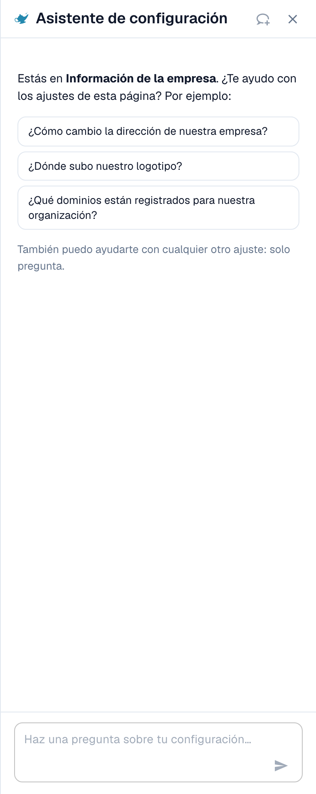
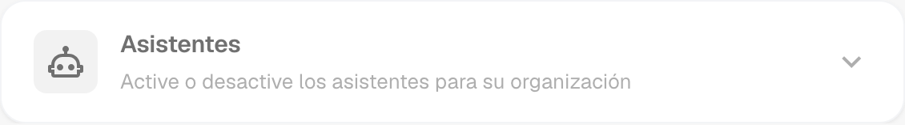
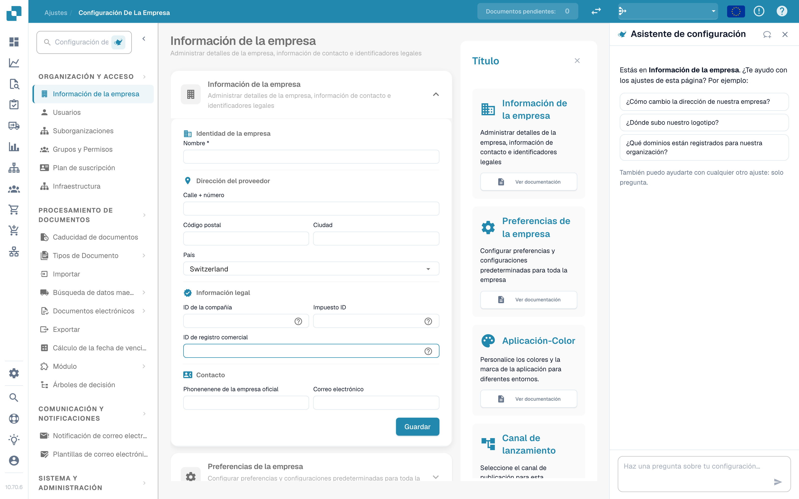

# Settings Assistant

El **Settings Assistant** es un panel de chat dentro del área de Settings. Usted hace una pregunta en lenguaje natural, y el asistente lee la configuración de su organización, responde y le lleva directamente al ajuste correcto. También puede avisarle cuando algo de su configuración ha dejado de funcionar y, con su confirmación, cambiar un ajuste por usted.

Es más útil cuando sabe **qué** quiere ("dejar de dividir documentos por códigos de barras") pero no **dónde** está el ajuste, o cuando se pregunta **por qué** algo no ocurre ("¿Por qué no está activa la coincidencia con la OC?").

<figure><figcaption>
El Settings Assistant en la página Company Information: un saludo para la página actual, tres preguntas de ejemplo y el campo de pregunta. Una tarjeta de aviso aparece encima del saludo cuando una importación ha dejado de funcionar (véase <a href="settings-assistant-chat.md#findings-el-asistente-le-avisa">Findings</a>).
</figcaption></figure>

El asistente está **desactivado por defecto**. Esta página muestra dónde activarlo y cómo abrirlo. Lo que puede preguntarle y lo que puede cambiar se describe en la página [Settings Assistant: qué puede hacer el chat](settings-assistant-chat.md).

## Quién puede usarlo

* El **administrador de la organización** activa o desactiva el asistente para toda la organización.
* Una vez activado, todo administrador que pueda abrir **Settings** puede mostrar u ocultar el panel para sí mismo.
* Los cambios (aplicar una recomendación, desactivar o eliminar una conexión de importación, crear una regla) están limitados a los **administradores de la organización**. Los demás usuarios reciben el mensaje *Available to administrators only.* (disponible solo para administradores).

## Activarlo

1. Vaya a **Settings → Global Settings → Company Information**. El encabezado de la página muestra **Company Settings**.
2. Abra la sección **Assistants**.
3. Active **Enable the settings assistant**.

<figure><figcaption>
La sección Assistants. El settings assistant tiene su propio interruptor. El validation assistant y la locución del explainer son funciones independientes.
</figcaption></figure>

Un breve mensaje confirma **Settings assistant enabled**. El ajuste está desactivado por defecto. Mientras esté desactivado, el panel y su botón no aparecen en ningún lugar.


El **Validation assistant** de la misma sección es una función distinta. Explica los campos que bloquean dentro de un documento y no puede cambiar ningún ajuste. Activar o desactivar uno de los dos no afecta al otro.


## Abrir y cerrar el panel

En todas las páginas del área de Settings encontrará un pequeño **botón con una lámpara de genio** junto al campo de búsqueda de ajustes. Haga clic en él para **mostrar** u **ocultar** el asistente.

<figure><figcaption>
El asistente se encuentra en el <strong>lado derecho</strong> de cada página de Settings: la navegación a la izquierda, la página en el centro y el asistente junto a ella. Aquí en <strong>Company Settings → Company Information</strong>. El botón para mostrarlo u ocultarlo es el icono de la lámpara junto a <strong>Search Settings</strong>, en la parte superior de la navegación.
</figcaption></figure>

* El panel recuerda su elección por usuario, por lo que seguirá abierto la próxima vez que vuelva.
* En una pantalla ancha (1280 píxeles o más) se sitúa junto a la página. Puede arrastrar su borde para cambiar el ancho.
* En una pantalla estrecha se abre como una superposición. **Esc** o un clic fuera lo cierra.
* **New chat** (el icono de globo de diálogo del encabezado) borra la conversación. La conversación también sobrevive a una recarga de la página, pero no al cierre de la pestaña del navegador.

## Qué hacer a continuación

* Haga su primera pregunta: véase [Settings Assistant: qué puede hacer el chat](settings-assistant-chat.md).
* El asistente funciona con el nivel de IA **Fast**. No existe ningún ajuste de la organización para elegir otro modelo.

## Solución de problemas

| Problema | Causa y solución |
| --- | --- |
| No hay botón con lámpara de genio en el área de Settings | El interruptor de la organización está desactivado. Un administrador de la organización lo activa en **Company Information → Assistants** |
| Falta la sección **Assistants** en Company Information | Solo la ven los administradores de la organización |
| El panel dice **The assistant is being set up** | La función todavía no está disponible en su entorno |
| El panel está ahí, pero las respuestas dicen *Available to administrators only.* | Su cuenta no es administrador de la organización |

## Páginas relacionadas

* [Settings Assistant: qué puede hacer el chat](settings-assistant-chat.md)
* [Preferencias de la empresa](company-preferences.md)
