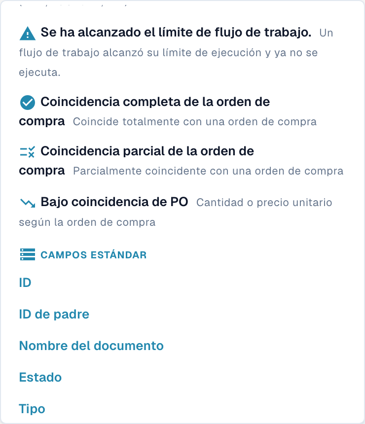

# Personalizar filtros

La búsqueda del **Panel** filtra documentos. La configuración administrativa del panel permite ajustar la presentación de los filtros de estado.

## Buscar documentos con filtros rápidos

En el Panel, sitúe el cursor en la búsqueda y pulse la flecha abajo para abrir el menú. Elija un filtro rápido o un campo y complete el criterio que solicite la interfaz. La imagen muestra la parte inferior del menú, desplazada hasta las últimas opciones.

<figure><figcaption>
Parte inferior del menú real de filtros rápidos, desplazada hasta las últimas opciones. Se muestran filtros de conciliación de pedidos y campos estándar. «Bajo coincidencia de PO» es una etiqueta defectuosa. No se seleccionó ningún filtro ni se introdujo una consulta.
</figcaption></figure>

Revise la consulta y los resultados cuando termine la carga. Compruebe que los documentos mostrados cumplen los criterios deseados. Las etiquetas del menú no acreditan por sí solas que se haya ejecutado una conciliación o que un documento haya alcanzado un estado concreto.

## Configurar los filtros de estado del panel

Abra **Ajustes → Panel** y despliegue **Filtros**. Revise **Estilo de filtro de estado** y, cuando corresponda, **Filtro de estado personalizado**. La opción Custom sigue en inglés y significa personalizado.

<figure><figcaption>
Configuración actual de los filtros de estado del panel. La opción fija Custom sigue en inglés y significa personalizado. No se modificó el estilo ni se pulsó Aplicar.
</figcaption></figure>

El botón **Aplicar** guarda un cambio deliberado de esta configuración administrativa. Para estas imágenes no se modificó el estilo ni la selección de estados, no se pulsó Aplicar y no se seleccionó un filtro en la búsqueda de documentos.
