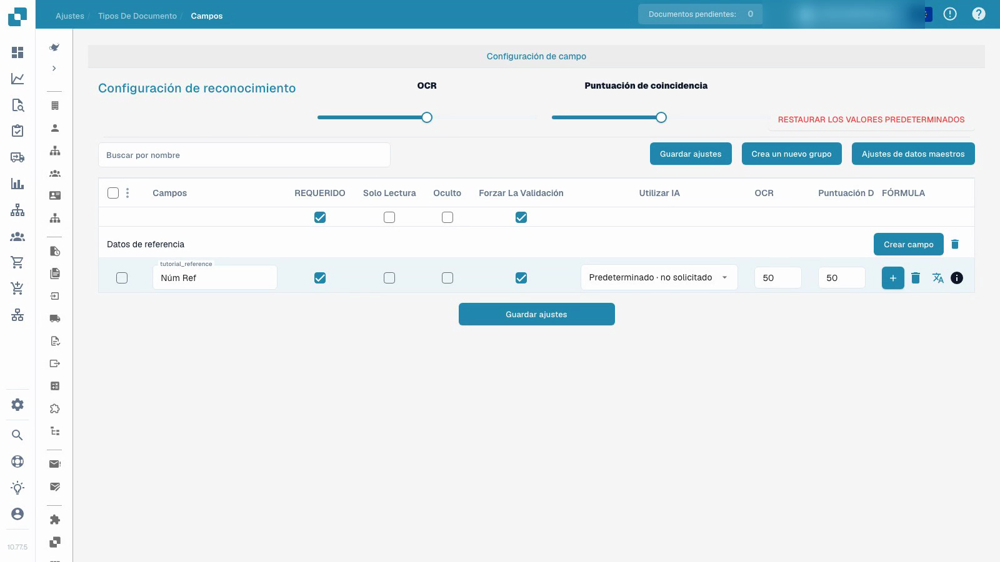

# Tipos de documentos

El video demuestra la configuración de campos en un tipo de documento de prueba personalizado y aislado.


Tipos de documentos


[Ver con subtítulos](https://docbits-videos.fra1.cdn.digitaloceanspaces.com/settings-assistant/document-types-fields-admin/v1/es.html)

Nota: Es posible que algunas etiquetas de productos nativos no estén traducidas. La grabación conserva la interfaz de usuario real.

## Resumen

Los tipos de documentos definen la configuración utilizada para diferentes tipos de documentos. DocBits proporciona tipos estándar como facturas y notas de crédito. Los tipos personalizados permiten a un administrador configurar otra categoría de documentos empresariales. Los tipos estándar no se pueden eliminar; administre los tipos personalizados dentro de los permisos de la organización.

## Controles en una tarjeta de tipo de documento

| Control | Propósito |
| --- | --- |
| Activar | Habilite o deshabilite el tipo de documento para su procesamiento. |
| Extraction | Elija el modo de extracción mostrado por el control de la interfaz: Flex o Fix. Esta es una selección de modo, separada del interruptor Activar. |
| Configuración, mostrada como un engranaje | Abra una configuración adicional para ese tipo de documento. |

Los enlaces disponibles dependen del tipo, los permisos y los módulos habilitados. La interfaz actual puede ofrecer diseños, campos, tablas, scripts, entrenamiento de modelos y subtipos de documentos. Las reglas de transformación, las reglas de validación y la configuración de documentos electrónicos están disponibles donde se aplican sus respectivas características. Otras opciones de configuración pueden estar dentro de la configuración del tipo de documento en lugar de una pestaña separada debajo de cada tarjeta.

## Configurar campos e información requerida

El video utiliza un tipo de documento de prueba personalizado y aislado y ya creado. Cambia el campo de referencia de ese tipo; no cambia la configuración de factura existente.

1. Abra el tipo de documento y seleccione sus campos.
2. Verifique el grupo de campos y el nombre técnico estable del campo. Una etiqueta de visualización legible es una configuración separada; cambiarla no crea un nuevo ID de campo.
3. Haga que el campo de referencia sea obligatorio mientras lo mantiene visible y editable. Se debe proporcionar la información requerida; la configuración no inventa un valor faltante ni garantiza una extracción correcta.
4. Configure la revisión explícita de campos por separado del valor requerido. Solo lectura, oculto, los umbrales de OCR y los umbrales de Match Score tienen sus propios efectos; no son interruptores intercambiables.
5. Guarde la configuración, vuelva a abrirla y verifique la etiqueta de visualización y los indicadores almacenados.

<figure><figcaption>
Campos guardados en un tipo de documento de prueba aislado.
</figcaption></figure>

El resultado demostrado prueba que la configuración del campo se guardó y se volvió a cargar. No constituye entrenamiento de modelos, aprobación de facturas, exportación o una prueba de validación posterior. Antes de usar una configuración en producción, pruebe documentos representativos y el flujo de trabajo previsto para usuarios ordinarios.

## Reglas de validación personalizadas

Donde esta función esté disponible, abra las reglas de validación del tipo de documento. Para reutilizar una regla existente, siga [Duplicar una regla de validación personalizada](duplicate-a-custom-validation-rule.md). Esto es independiente de los indicadores de campo individuales que se muestran en el video.

## Crear un tipo de documento personalizado

Abra la sección de tipos de documentos personalizados, elija Nuevo e ingrese un nombre claro. Complete los pasos de configuración ofrecidos para el modo de extracción previsto, los campos, los grupos y cualquier tabla. El entrenamiento del modelo y la configuración de extracción son independientes de simplemente guardar un indicador de campo obligatorio.


Consulte [Configurar un tipo de documento](../../../setup/document-types/) para conocer el procedimiento de configuración.


## Grabación adicional


Tipos de documentos

