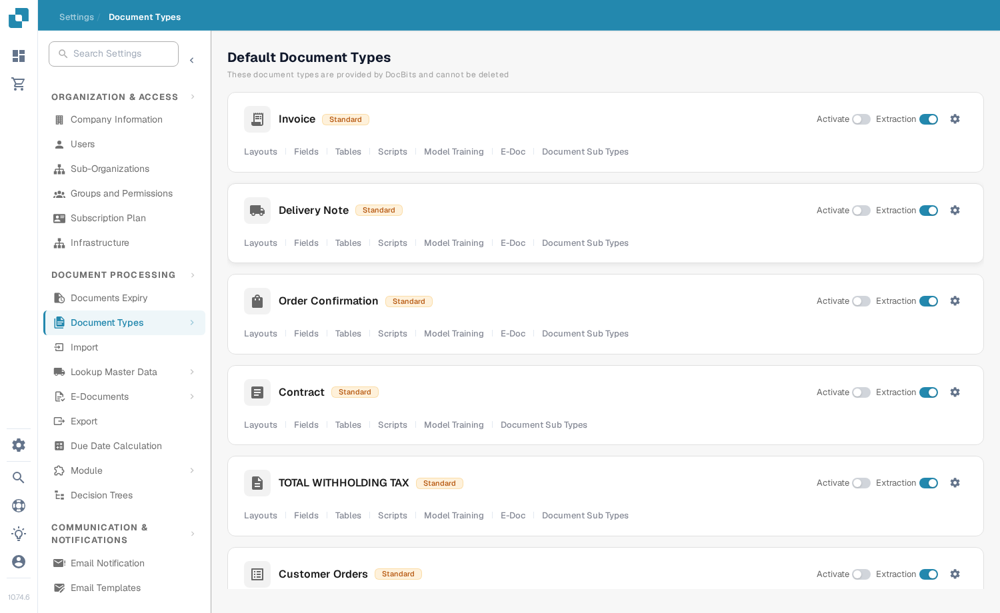

# Activar o desactivar un tipo de documento

Los administradores pueden elegir qué tipos de documento están disponibles para su organización. Puede cambiarlo en la página **Document Types** sin eliminar el tipo ni su configuración.

1. Abra **Settings → Document Types**.
2. Busque el tipo de documento, por ejemplo **Invoice**, en **Default Document Types** o en **Custom Document Types**.
3. Utilice el interruptor denominado **Activate** en la tarjeta de ese tipo. Un interruptor de color significa que el tipo está activo; un interruptor gris significa que está inactivo. Espere al mensaje de confirmación antes de salir de la página. Este interruptor no tiene un botón Save independiente.

<figure><figcaption>
Cada tipo de documento tiene su propio interruptor Activate en el lado derecho de su tarjeta.
</figcaption></figure>

El interruptor **Extraction** situado junto a **Activate** es un ajuste distinto. Selecciona el modo de extracción (Flex o Fix); no activa ni desactiva el tipo de documento. El icono de engranaje abre más ajustes de ese tipo. Los enlaces situados debajo del nombre del tipo abren sus diseños, campos, tablas, scripts y otras áreas de configuración disponibles.

DocBits proporciona los tipos de documento predeterminados, que no se pueden eliminar. También puede crear y gestionar tipos personalizados. Consulte [Adding and Editing Document Types](adding-editing-document-types.md) para conocer los siguientes pasos de configuración y [Table Columns](table-columns/README.md) para configurar las posiciones extraídas.
