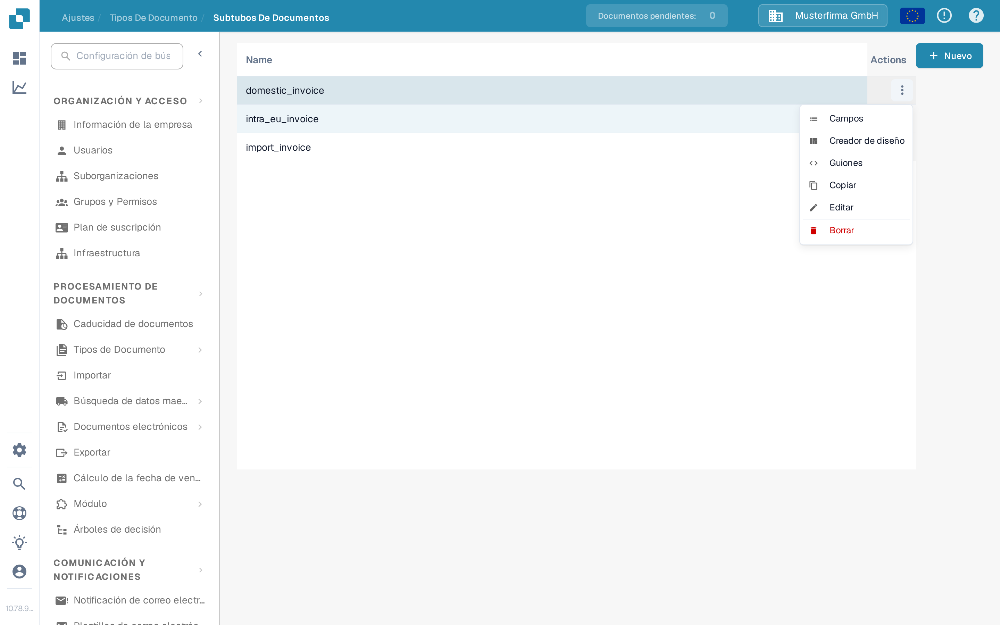
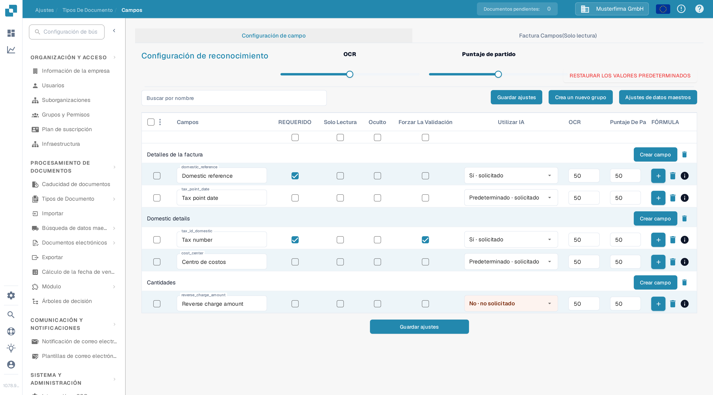
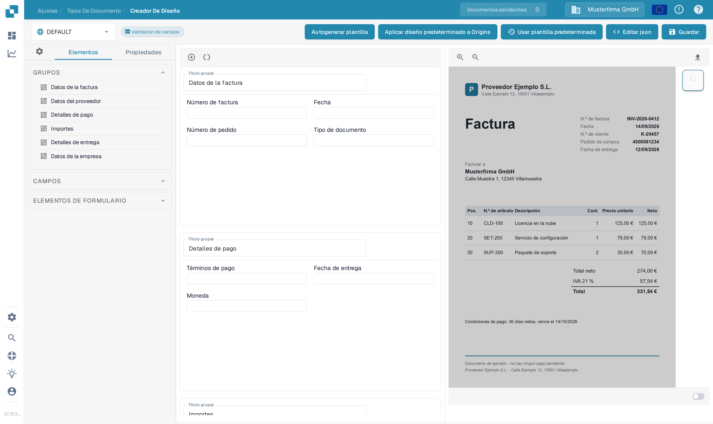
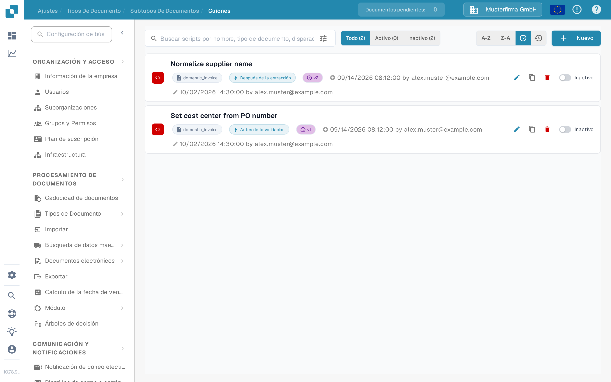

# Configurar subtipos

Use un subtipo de documento cuando facturas del mismo tipo de documento necesiten campos diferentes, un diseño de validación distinto o sus propios scripts de procesamiento. Primero [cree un subtipo](creating-a-new-sub-type.md), después abra **Ajustes → Tipos de Documento**, elija el tipo de documento y abra **Subtipos de Documentos**. En la fila del subtipo, abra **Acciones** (los tres puntos). El menú ofrece **Campos**, **Creador de diseño** y **Guiones**; también contiene [Copiar, Editar y Borrar](using-actions.md).

<figure><figcaption>
Elija la parte del subtipo que desea configurar.
</figcaption></figure>

## Campos

Seleccione **Campos** para decidir qué información ven e introducen los usuarios en este subtipo. Puede crear un campo en un grupo, marcar un campo existente como requerido, de solo lectura u oculto, y ajustar las opciones de reconocimiento. Seleccione **Guardar ajustes** después de hacer cambios. Consulte [Agregar y Editar Campos](fields/adding-and-editing-fields.md) para los pasos, [Configuración de las propiedades de los campos](fields/configuring-field-properties-1.md) para las opciones de columna y [Ajustes de datos maestros](fields/master-data-settings.md) cuando un campo deba usar datos de búsqueda.

<figure><figcaption>
Configuración de campos en la organización de pruebas de la documentación. No se muestran datos de clientes.
</figcaption></figure>

## Creador de diseño

Seleccione **Creador de diseño** para organizar los grupos y campos de la pantalla de validación de documentos. El lado izquierdo muestra los elementos; el lado derecho acepta un documento de ejemplo para la vista previa. Revise el resultado y seleccione **Guardar** cuando el diseño esté listo. La [guía del Creador de Diseño](../../../setup/document-types/layout-builder.md) explica los elementos, la vista previa del documento y cómo guardar un diseño.

<figure><figcaption>
Diseño del subtipo antes de añadir un documento de ejemplo.
</figcaption></figure>

## Guiones

Seleccione **Guiones** para ver los scripts de este subtipo. En una lista vacía, seleccione **Nuevo** o **Crear script** para empezar. La búsqueda y los filtros **Todo**, **Activo** e **Inactivo** ayudan a encontrar scripts existentes. Siga [Creación y edición de scripts](script/creating-and-editing-scripts.md) para crear uno, y [Activación y gestión de scripts](script/script-activation-and-management.md) antes de activarlo para el procesamiento.

<figure><figcaption>
No se han creado scripts en el subtipo de pruebas de la documentación.
</figcaption></figure>

## Hallazgos de traducción de la aplicación

Los rótulos visibles de la interfaz (versión 10.78.9.5) en español muestran algunas traducciones inusuales; se citan tal cual y no se corrigen en la documentación: el menú llama **Guiones** a los scripts y **Creador de diseño** al Layout Builder; en la lista de scripts, la columna de estado muestra **Inactivo** y el filtro **Todo (2)**; en la pantalla de campos, el encabezado **Puntaje de partido** (puntaje de coincidencia) aparece junto a columnas como **REQUERIDO** y **Solo Lectura**. El nombre del subtipo de ejemplo (**domestic_invoice**) y los nombres de grupo **Domestic details** permanecen en inglés en la aplicación.
