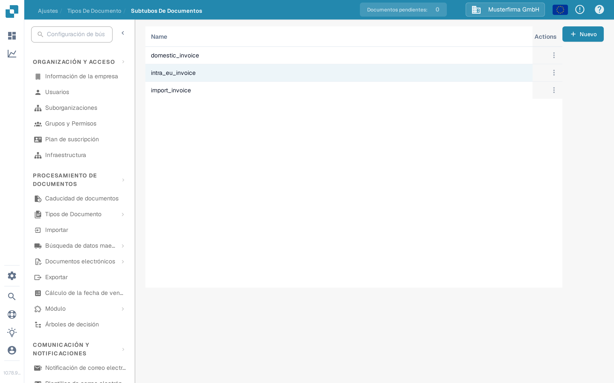
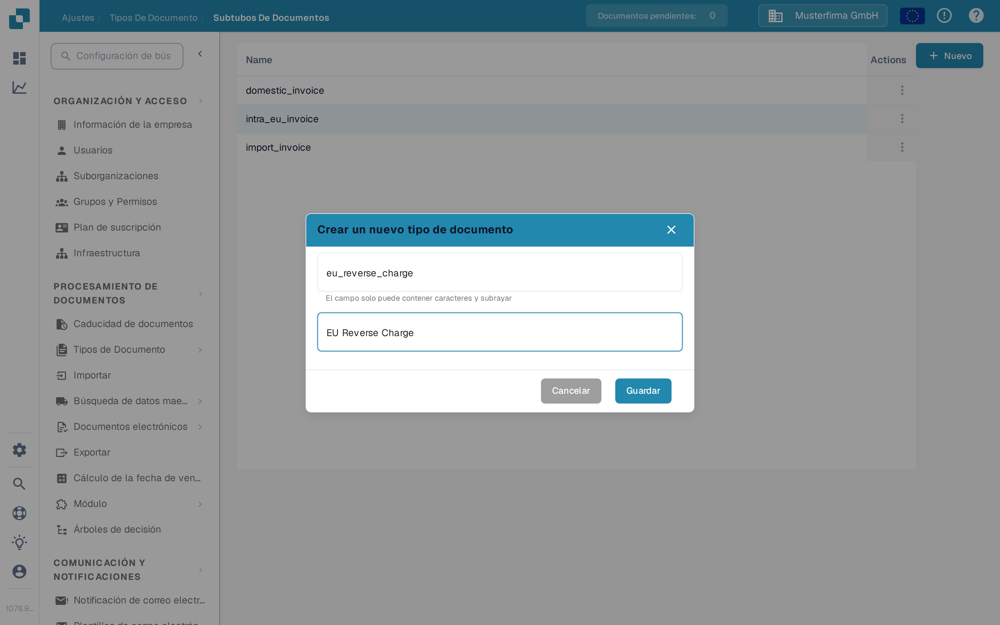

# Crear un nuevo subtipo

Cree un subtipo de documento cuando un tipo de documento necesite sus propios ajustes de campos, su propio diseño de validación o sus propios scripts. Necesita acceso a **Ajustes → Tipos de Documento**.

## 1. Abrir el tipo de documento

Abra **Ajustes → Tipos de Documento**. En la tarjeta del tipo de documento correspondiente, seleccione **Subtipos de documentos**. El ejemplo siguiente utiliza **Factura**; elija el tipo que corresponda a sus documentos. Los demás enlaces de la tarjeta llevan a los ajustes de todo el tipo de documento.

<figure><figcaption>
Abra los subtipos del tipo de documento que desea configurar.
</figcaption></figure>

## 2. Iniciar un nuevo subtipo

En **Subtipos de documentos**, seleccione **+ Nuevo**. Los subtipos existentes aparecen en la lista; el menú **Actions** de tres puntos corresponde a una fila existente. Si **+ Nuevo** no responde al clic del ratón, enfoque el botón con el teclado y pulse **Enter**.

<figure><figcaption>
La organización de prueba de la documentación contiene únicamente subtipos de ejemplo sintéticos.
</figcaption></figure>

## 3. Nombrarlo y guardarlo

Introduzca un **Name** con letras y guiones bajos y, a continuación, introduzca un **Título** descriptivo. Ambos campos son obligatorios. Los nombres de esta captura de pantalla son solo ejemplos. Seleccione **Guardar** para crear el subtipo, o **Cancelar** para salir sin crearlo.

<figure><figcaption>
Solo se introducen Name y Título al crear el subtipo.
</figcaption></figure>

Después de guardar, el nuevo subtipo aparece en la lista. Para definir sus campos, su diseño o sus scripts, abra su menú **Actions** y siga [Configurar subtipos](configure-subtypes.md). Estos ajustes se realizan después de la creación, no en el diálogo **+ Nuevo**. La página [Configurar subtipos](configure-subtypes.md) explica las opciones Campos, Creador de diseño y Guiones de un subtipo existente.

## Hallazgos de traducción de la aplicación

- El encabezado de columna de la lista de subtipos permanece en inglés **Name** en la interfaz española.
- El encabezado del menú de fila permanece en inglés **Actions** en la interfaz española.
- **Extraction** no está traducido en la tarjeta del tipo de documento.
- El diálogo de creación usa **Crear un nuevo tipo de documento**, mientras el título de la página es «Crear un nuevo subtipo»: el diálogo no menciona «subtipo».
- El texto de ayuda del campo muestra **El campo solo puede contener caracteres y subrayar**; «subrayar» es el verbo *subrayar*, no el sustantivo «guion bajo» (*underscore*).
