# Custom Validation Rules



## Descripción general

Las reglas de validación personalizadas permiten a un administrador definir **sus propias comprobaciones** sobre los datos que DocBits extrae de un documento, sin escribir un script y sin esperar a un cambio del producto.

Una regla responde a tres preguntas:

1. **Dónde** se muestra el problema. En un campo de cabecera o en una celda de una fila de tabla.
2. **Cuándo** se aplica la regla. Siempre, o solo para los documentos (o filas) que cumplen una condición; consulte [Rule Conditions (Applies when)](rule-conditions-applies-when.md).
3. **Qué** debe cumplirse. Un campo debe estar rellenado, coincidir con un formato, estar dentro de un rango, coincidir con una lista, compararse correctamente con otro campo o cuadrar.

Cuando la comprobación falla, DocBits marca el campo o la celda en la **pantalla de validación** y muestra su mensaje, exactamente igual que una comprobación integrada. Con la gravedad **Error**, el documento no se puede validar hasta que se corrija el problema; con **Warning**, el usuario solo ve un aviso.

Las reglas se definen por **tipo de documento** y se ejecutan en cada documento de ese tipo: durante el procesamiento y cada vez que se guarda el documento.

### Problemas que resuelven

| Requisito de negocio | Sin reglas personalizadas | Con una regla personalizada |
| --- | --- | --- |
| Las facturas alemanas de más de 250 EUR deben mostrar el número de identificación fiscal del proveedor | un script, o los usuarios deben recordarlo | **Required** en Supplier Tax ID, *applies when* el origen es DE y el importe total es mayor que 250 |
| Los números de factura de un proveedor siempre tienen el aspecto `INV-123456` | los errores tipográficos llegan al ERP | **Pattern** `^INV-\d{6}$` en Invoice Number para ese proveedor |
| Cada línea de artículo necesita una cantidad superior a cero | se exportan líneas con cantidad 0 | **Range** (mínimo 0,01) en la columna Quantity |
| La fecha de vencimiento no debe ser anterior a la fecha de la factura | ejecuciones de pago erróneas | **Compare fields**: Due Date igual o posterior a Invoice Date |
| Las líneas deben sumar el importe neto | solo la comprobación integrada fija | **Formula** `sum(row.NET_AMOUNT) == header.total_net_amount` con su propia tolerancia |
| Solo se permiten las monedas que conoce su ERP | errores de exportación en el ERP | **List of Values** en Currency |
| Avisar a los usuarios de valores inusuales sin bloquearlos | no es posible | cualquier regla con la gravedad **Warning** |

## Activar las reglas de validación personalizadas

Las reglas de validación personalizadas se activan **por tipo de documento**. No existe un interruptor para toda la organización.

1. Vaya a **Settings → Global Settings → Document Types**.
2. En la tarjeta del tipo de documento, haga clic en el icono de **ajustes** (engranaje).
3. Abra la sección **Custom Validation Rules** y active el interruptor.
4. Haga clic en **Manage validation rules** para abrir la lista de reglas.

<figure>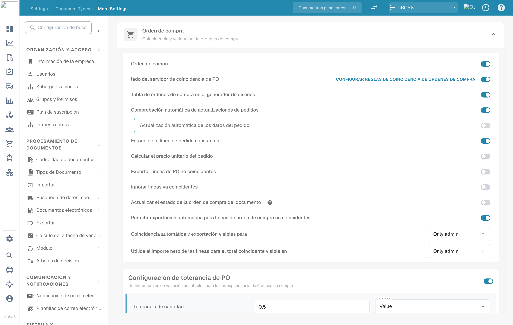<figcaption>
Los interruptores de Manage Layouts, Custom Validation Rules y Transformation Rules
</figcaption></figure>

A partir de ese momento, la tarjeta del tipo de documento también muestra un enlace **Validation Rules** y un enlace **Logs** para los registros de ejecución.

<figure>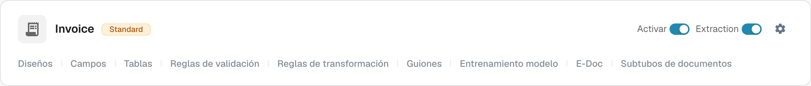<figcaption>
Los enlaces de la tarjeta del tipo de documento
</figcaption></figure>


**El interruptor sustituye las comprobaciones de importes integradas.** Mientras las reglas de validación personalizadas estén activadas para un tipo de documento, las comprobaciones fijas “importe total = importe neto + importe de impuestos” y las comprobaciones de importe de línea / descuento **no** se ejecutan para él; las reglas configurables ocupan su lugar. Recree como reglas las comprobaciones en las que confía (consulte las [recetas](#recetas)) antes de activarlo. Al desactivar el interruptor se restablecen las comprobaciones integradas. El resto de las validaciones de campos (campos obligatorios, formatos, datos maestros) siguen ejecutándose.


## La lista de reglas

**Document Types → (tipo de documento) → Validation Rules** muestra todas las reglas del tipo de documento.

<figure>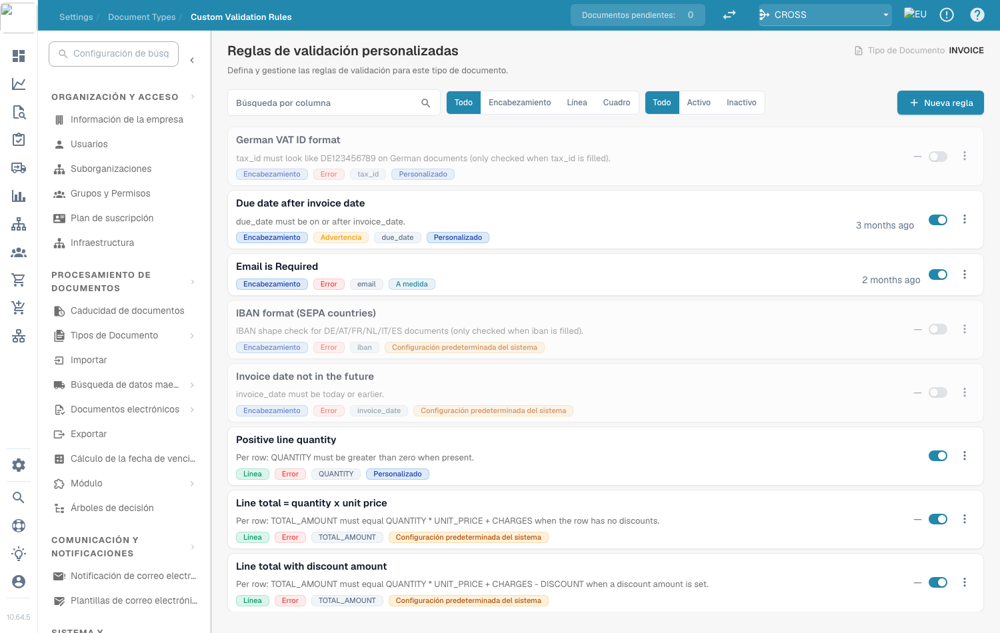<figcaption>
La lista de reglas con el nivel, la gravedad, el campo de destino y el origen de cada regla
</figcaption></figure>

Cada tarjeta muestra el nombre y la descripción de la regla, y las insignias de su **nivel** (Header / Line / Table), **gravedad** (Error / Warning), el **campo** al que se asocia el error y su **origen**. Utilice el interruptor de la derecha para activar o desactivar una regla, y el menú **⋮** para duplicarla o eliminarla. Filtre la lista por nivel (**All / Header / Line / Table**) y por estado (**All / Active / Inactive**), o búsquela.

### Reglas System default, Customized y Custom

| Origen | Qué es | Qué puede hacer |
| --- | --- | --- |
| **System default** | Una regla incluida con DocBits para todas las organizaciones. | No se puede editar directamente: el constructor muestra “This is a system default rule and cannot be edited.” Haga clic en **Customize** para crear su propia copia editable, o desactívela para detenerla en su organización. |
| **Customized** | Una regla System default que su organización ha modificado o desactivado. | Edítela como una regla propia. **Reset to Default** elimina su copia y restaura la original. |
| **Custom** | Una regla creada por su organización. | Editar, **Duplicate**, **Delete**. |

Los cambios en las reglas System default nunca afectan a otras organizaciones.

## Crear una regla

Haga clic en **New rule**. El constructor tiene tres pasos. **Test rule** y **Save** están en la parte superior derecha.

### Paso 1 — Name & scope

<figure>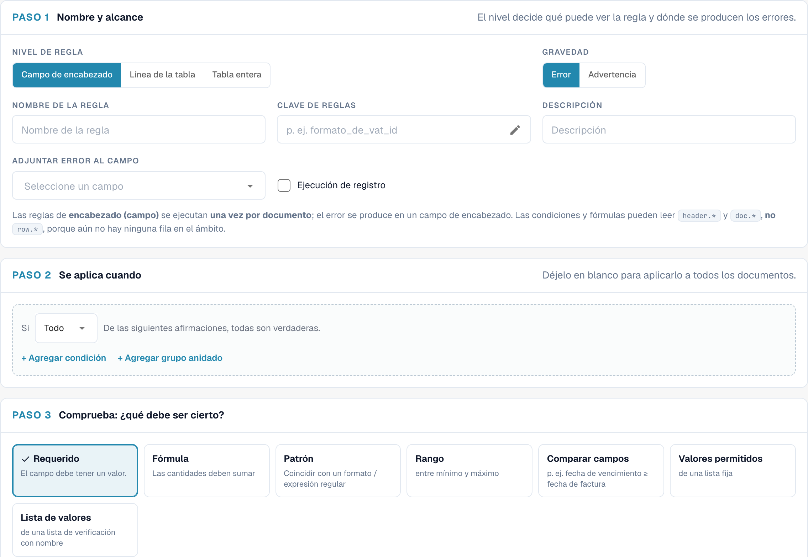<figcaption>
Paso 1 para una regla de campo de cabecera
</figcaption></figure>

| Ajuste | Qué hace |
| --- | --- |
| **Rule level** | Qué examina la regla y dónde se muestra el error; consulte [Niveles de regla](#niveles-de-regla). |
| **Severity** | **Error** marca el campo como no válido y bloquea la validación. **Warning** muestra el mensaje pero nunca bloquea. |
| **Rule Name** | Se muestra en la lista y a los administradores. Haga que describa la regla (“Supplier tax ID required for German invoices”). |
| **Rule key** | Una clave técnica generada a partir del nombre. Se mantiene igual cuando más adelante cambia el nombre de la regla. Haga clic en el lápiz para elegir su propia clave antes del primer guardado; después queda fija. |
| **Description** | Explicación opcional para otros administradores. |
| **Table name** | *Solo Table line.* La tabla cuyas filas se comprueban, por ejemplo `INVOICE_TABLE`. |
| **Attach error to field / column** | El campo (o, en las líneas de tabla, la columna) que muestra el error en la pantalla de validación. |

#### Niveles de regla

| Nivel | Se ejecuta | El error se muestra en | Puede leer | Regla típica |
| --- | --- | --- | --- | --- |
| **Header field** | una vez por documento | un campo de cabecera | `header.*`, `doc.*` | “Supplier tax ID is required for German invoices” |
| **Table line** | una vez por cada fila de la tabla seleccionada | la celda de la fila que falla | `row.*` (la fila actual), `header.*`, `doc.*` | “Quantity must be greater than zero” |
| **Whole table** | una vez por documento, considerando todas las filas conjuntamente | un campo de cabecera | totales de las filas (`sum()`, `count()`, `min()`, `max()`), `header.*`, `doc.*` | “The line net amounts must add up to the net amount” |

<figure>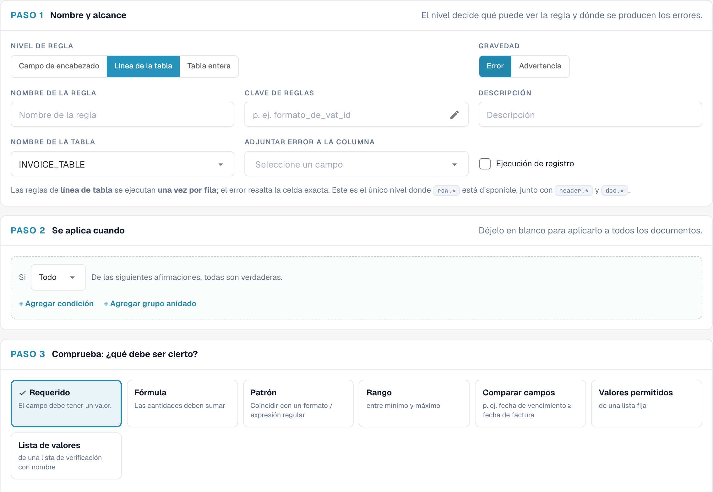<figcaption>
Una regla de línea de tabla: la tabla y la columna que muestra el error
</figcaption></figure>

### Paso 2 — Applies when

Decida si la regla se ejecuta para todos los documentos o solo para algunos. Déjelo vacío para comprobar todos los documentos. En caso contrario, añada líneas de condición (por ejemplo, “Document Origin is Deutsch” y “Total Amount greater than 250”) y combínelas con **All** / **ANY** y grupos anidados.

<figure>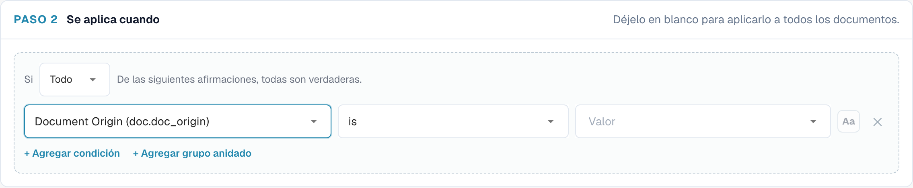<figcaption>
La comprobación solo se ejecuta para documentos alemanes de más de 250 con EUR o sin moneda
</figcaption></figure>

En las reglas de línea de tabla, la condición también puede utilizar las columnas de la fila actual y se evalúa **fila por fila**: las filas que no coinciden simplemente no se comprueban.

<figure>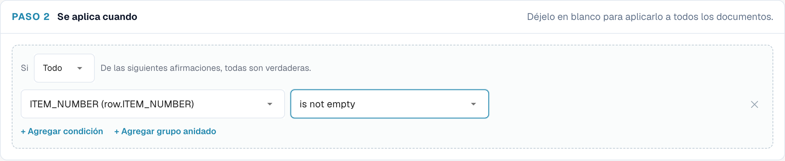<figcaption>
Solo se comprueban las líneas de artículo (filas con número de artículo)
</figcaption></figure>

Las condiciones se explican en detalle (cada campo, operador y regla de comparación, con muchos ejemplos) en [Rule Conditions (Applies when)](rule-conditions-applies-when.md).

### Paso 3 — Check: what must be true

Elija una comprobación. Los ajustes situados debajo de las tarjetas cambian según la comprobación elegida.

<figure>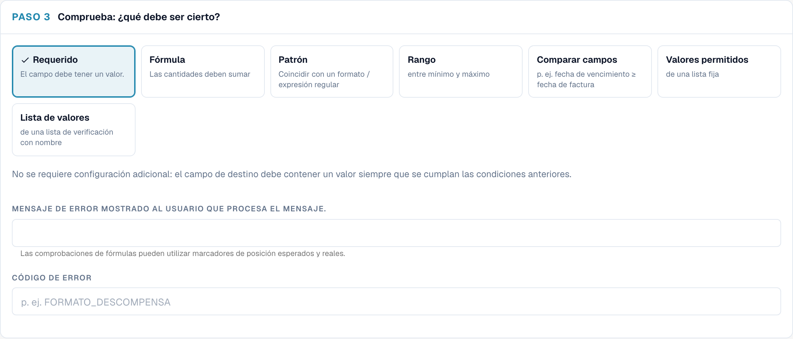<figcaption>
Las siete comprobaciones. Required no necesita más ajustes
</figcaption></figure>

#### Required — el campo debe tener un valor

<figure><figcaption>
Una comprobación Required: sin más ajustes
</figcaption></figure>

Falla cuando el campo está vacío (ausente o solo con espacios). Sin más ajustes.

Úsela junto con **Applies when** para que un campo sea obligatorio **de forma condicional**. Un campo que siempre debe estar rellenado se configura mejor como campo obligatorio en los ajustes de campos.

> *Supplier Tax ID is required* — se aplica cuando *Document Origin is Deutsch* y *Total Amount greater than 250*.

#### Formula — los importes deben cuadrar

<figure>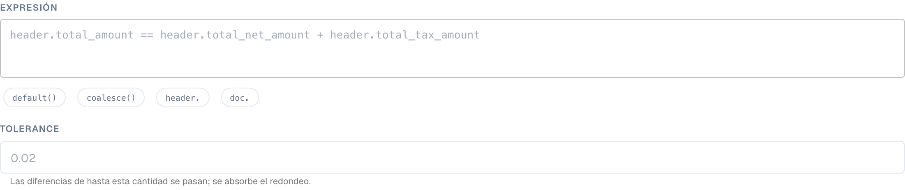<figcaption>
Una fórmula de tabla completa con una tolerancia y marcadores de posición en el mensaje
</figcaption></figure>

Una comparación aritmética. La expresión contiene exactamente **una** comparación (`==`, `!=`, `>`, `>=`, `<`, `<=`); ambos lados pueden usar `+ - * /`, números, paréntesis y referencias a campos.

* Haga clic en los chips situados debajo de la expresión para insertar funciones y prefijos de campos: `sum()`, `count()`, `min()`, `max()`, `default()`, `coalesce()`, `header.`, `doc.`. Mientras escribe un nombre de campo, se abre una lista de campos coincidentes.
* `sum(row.NET_AMOUNT)`, `count(row.ITEM_NUMBER)`, `min(...)`, `max(...)` funcionan sobre todas las filas y solo están disponibles en el nivel **Whole table**. `count()` cuenta las filas en las que la columna está rellenada.
* `default(header.discount, 0)` usa `0` cuando el campo está vacío; `coalesce(header.a, header.b, 0)` usa el primer valor rellenado.
* **Tolerance**: para `==` y `!=`, las diferencias de hasta este importe se consideran iguales. Utilice `0.01` o `0.05` para absorber redondeos. No tiene efecto en `<`, `>`, `<=` ni `>=`.
* Los importes vacíos o ilegibles cuentan como `0`. Una división por cero omite la regla en lugar de provocar un error.
* En el mensaje de error, `{actual}` se sustituye por el resultado del lado izquierdo y `{expected}` por el resultado del lado derecho.

Ejemplos:

| Finalidad | Nivel | Expresión | Tolerancia |
| --- | --- | --- | --- |
| Los totales de cabecera son coherentes | Header field | `header.total_amount == header.total_net_amount + header.total_tax_amount` | 0.01 |
| Las líneas suman el importe neto | Whole table | `sum(row.NET_AMOUNT) == header.total_net_amount` | 0.05 |
| Importe de línea = cantidad × precio unitario | Table line | `row.NET_AMOUNT == row.QUANTITY * row.UNIT_PRICE` | 0.01 |
| Impuestos no superiores al 19 % del importe neto | Header field | `header.total_tax_amount <= header.total_net_amount * 0.19` | – |
| Al menos una línea | Whole table | `count(row.ITEM_NUMBER) >= 1` | 0 |

#### Pattern — coincidir con un formato / regex

<figure>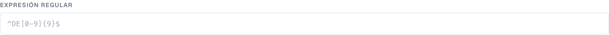<figcaption>
Una comprobación Pattern con una expresión regular
</figcaption></figure>

El valor debe coincidir con una **expresión regular**. La expresión busca dentro del valor, por lo que debe anclarla con `^` (inicio) y `$` (fin) cuando todo el valor deba coincidir. Marque **Case-insensitive match** si las mayúsculas y minúsculas no importan.

| Formato | Expresión regular |
| --- | --- |
| `INV-` seguido de seis dígitos | `^INV-\d{6}$` |
| NIF-IVA alemán | `^DE\d{9}$` |
| Pedido de compra que empieza por 45 y tiene 10 dígitos | `^45\d{8}$` |
| Solo dígitos | `^\d+$` |
| IBAN (comprobación aproximada) | `^[A-Z]{2}\d{2}[A-Z0-9]{11,30}$` |

#### Range — entre mínimo y máximo

<figure>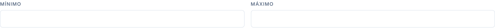<figcaption>
Range solo con mínimo: las cantidades deben ser al menos 0,01
</figcaption></figure>

El valor debe ser un número comprendido entre **Minimum** y **Maximum** (ambos incluidos). Rellene uno o ambos. Un valor que no sea un número falla. Se entienden importes con formato como `1.234,56`.

#### Compare fields — p. ej., fecha de vencimiento ≥ fecha de factura

<figure>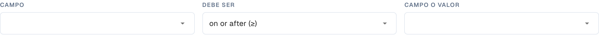<figcaption>
Compare fields: comparar un campo con otro campo, con hoy o con un valor fijo
</figcaption></figure>

Compara el valor de un campo con otro campo, con **hoy** o con un valor fijo, mediante *igual a*, *distinto de*, *mayor que*, *menor que*, *igual o posterior a (≥)* o *igual o anterior a (≤)*. Los números se comparan como números y las fechas como fechas.

* Due Date **igual o posterior a (≥)** Invoice Date
* Invoice Date **igual o anterior a (≤)** hoy: sin facturas con fecha futura
* Discount **menor que** 100

#### Allowed values — de una lista fija

<figure>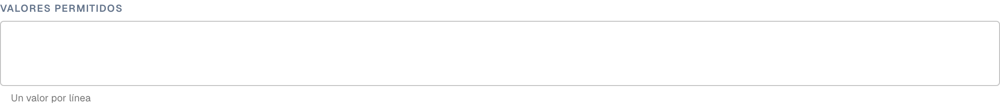<figcaption>
Allowed values: un valor por línea, opcionalmente sin distinguir mayúsculas
</figcaption></figure>

El valor debe ser uno de los valores que usted escriba, **un valor por línea**. Opcionalmente, sin distinguir mayúsculas de minúsculas. Adecuado para listas cortas y estables (`EUR`, `CHF`, `USD`).

#### List of Values — de un LOV con nombre

<figure><figcaption>
List of Values: los valores proceden de una lista con nombre de los ajustes
</figcaption></figure>

Como *Allowed values*, pero los valores proceden de una **List of Values** compartida que se gestiona en **Settings › List of Values**. Elija la lista en lugar de volver a escribirla; cuando la lista cambia, la regla usa los nuevos valores (tras un breve retraso de caché). Solo cuentan los valores de las entradas de la lista, no sus etiquetas.


Salvo **Required**, todas las comprobaciones **se superan cuando el valor está vacío**. Una regla Pattern sobre el pedido de compra no se queja de las facturas sin pedido de compra. Si un valor vacío también es un problema, añada una regla Required o limite la regla con *Applies when … is not empty*.


#### Mensaje de error y código de error

* **Error message shown to the processing user**: el texto de la pantalla de validación. Indique qué está mal **y** qué hacer: “Supplier tax ID is missing. German invoices over 250 EUR must show it.”
* **Error code**: un código técnico corto, por ejemplo `REQUIRED_CONDITIONAL`, `FORMAT_MISMATCH`, `OUT_OF_RANGE`, `DATE_ORDER`, `LINES_HEADER_MISMATCH`, `VALUE_NOT_ALLOWED`. Aparece en las exportaciones y permite agrupar errores.

## Test rule

Haga clic en **Test rule** para ejecutar la versión actual de la regla, guardada o no, contra un documento. Introduzca un **Document ID** o cambie a **By Document JSON** y pegue datos extraídos. **No se guarda nada** y el documento no se modifica.

El resultado es uno de tres desenlaces:

| Resultado | Significado |
| --- | --- |
| **Rule failed — error raised** | La condición coincidió y la comprobación falló. El mensaje se muestra exactamente como lo vería el usuario. |
| **Rule passed** | La condición coincidió y la comprobación se superó. Las reglas de línea de tabla muestran el resultado por fila (“4 of 4 checked rows passed”). |
| **Rule skipped — scope not matched** | La condición *Applies when* era falsa para este documento, por lo que no se comprobó nada y no se generó ningún error. |

<figure>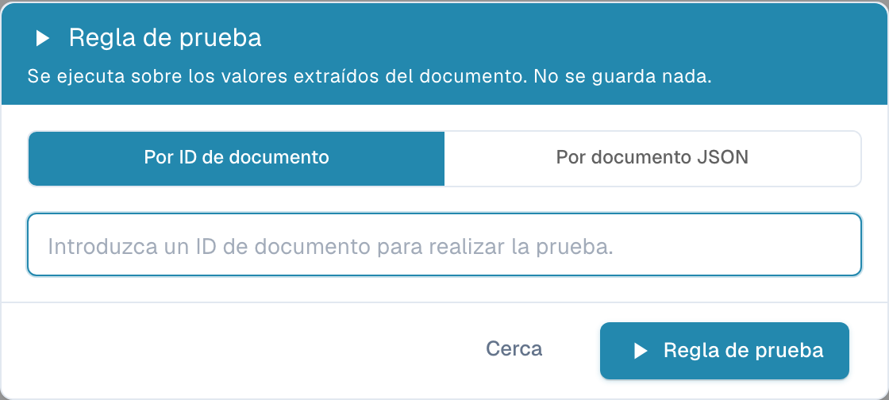<figcaption>
La factura alemana no tiene número de identificación fiscal del proveedor: la regla falla con el mensaje configurado
</figcaption></figure>

<figure>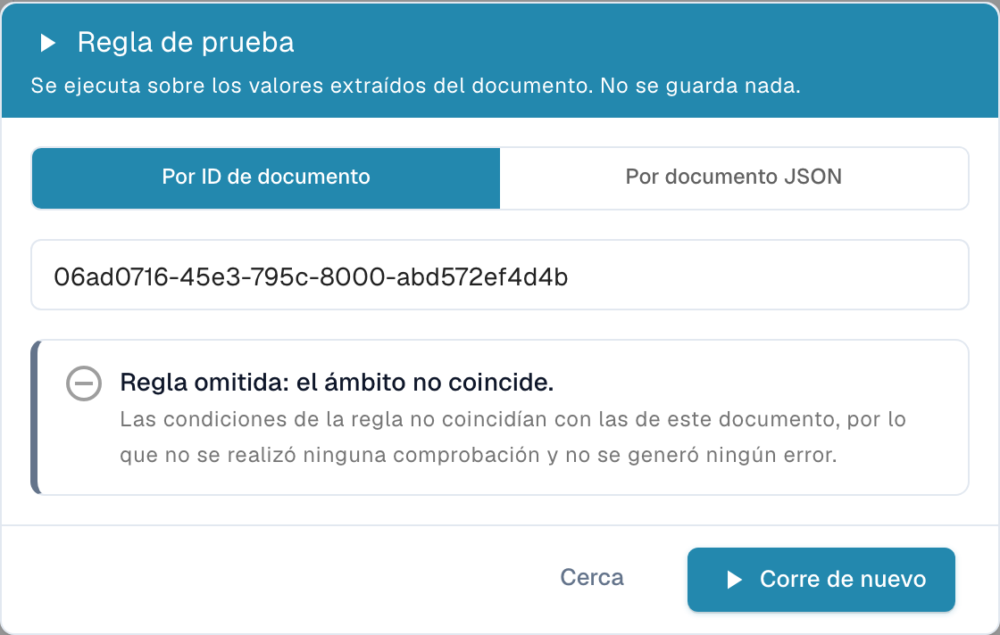<figcaption>
La misma regla con el umbral elevado a 1000: la factura (469,18) queda fuera del ámbito, por lo que la regla se omite
</figcaption></figure>

<figure>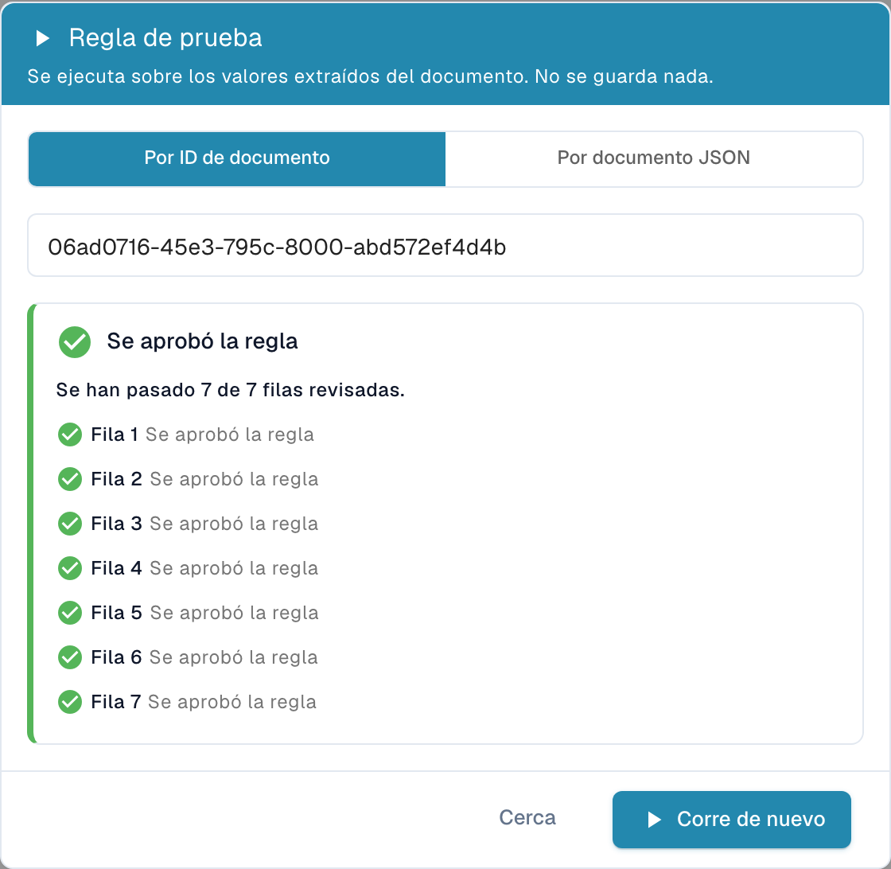<figcaption>
Una regla de línea de tabla informa de cada fila comprobada
</figcaption></figure>

Pruebe cada regla nueva al menos con un documento que deba fallar, uno que deba superarla y uno que deba omitirse.

## Cuándo se ejecutan las reglas

* **Durante el procesamiento**, junto con las demás validaciones, después de las reglas de extracción y transformación.
* **En cada guardado** del documento en la pantalla de validación.
* **Tras un cambio de regla**, los documentos existentes **no** se vuelven a comprobar todos a la vez. Cada documento se vuelve a comprobar con las nuevas reglas la próxima vez que se guarde o se reprocese. Los documentos ya exportados no se ven afectados.
* Las reglas se ejecutan por orden de prioridad (y después por clave). Un campo muestra **un** error: si dos reglas fallan en el mismo campo, gana la primera; las reglas posteriores no lo sobrescriben.
* Las advertencias se recopilan por separado y nunca ocultan un error.
* Si una regla no se puede evaluar (por ejemplo, una división por cero en una fórmula), se omite. Una regla defectuosa nunca marca un documento como no válido por error.

## Recetas

Copie estas reglas como punto de partida. Las claves de campos y columnas son las del tipo de documento estándar **Invoice**; adáptelas a sus tipos de documento.

**1. Número de identificación fiscal del proveedor en facturas alemanas de más de 250 EUR**
Header field · Error · asociar a *Supplier Tax ID* · Applies when **All**: *Document Origin* is *Deutsch*, *Total Amount* greater than *250* · Check **Required** · Mensaje “Supplier tax ID is missing. German invoices over 250 EUR must show it.” · Código `REQUIRED_CONDITIONAL`.

**2. Los totales de cabecera cuadran** (sustituye la comprobación integrada)
Header field · Error · asociar a *Total Amount* · siempre · **Formula** `header.total_amount == header.total_net_amount + header.total_tax_amount`, tolerancia `0.01` · Mensaje “Total {actual} does not equal net plus tax ({expected}).”

**3. Las líneas suman el importe neto** (sustituye la comprobación integrada)
Whole table · Error · asociar a *Total Net Amount* · siempre · **Formula** `sum(row.NET_AMOUNT) == header.total_net_amount`, tolerancia `0.05` · Mensaje “Line net amounts add up to {actual}, but the invoice net amount is {expected}.” · Código `LINES_HEADER_MISMATCH`.

**4. La cantidad debe ser positiva en las líneas de artículo**
Table line · Error · tabla `INVOICE_TABLE`, columna `QUANTITY` · Applies when *row.ITEM_NUMBER* is not empty · **Range** mínimo `0.01` · Código `OUT_OF_RANGE`.

**5. Importe de línea = cantidad × precio unitario**
Table line · Warning · columna `NET_AMOUNT` · siempre · **Formula** `row.NET_AMOUNT == row.QUANTITY * row.UNIT_PRICE`, tolerancia `0.01`.

**6. Formato del número de factura de un proveedor**
Header field · Error · *Invoice Number* · Applies when *Supplier ID* is *20723* · **Pattern** `^INV-\d{6}$`.

**7. La fecha de vencimiento no es anterior a la fecha de la factura**
Header field · Error · *Due Date* · siempre · **Compare fields** Due Date *on or after (≥)* Invoice Date · Código `DATE_ORDER`.

**8. Sin facturas con fecha futura**
Header field · Error · *Invoice Date* · siempre · **Compare fields** Invoice Date *on or before (≤)* today.

**9. Solo monedas aprobadas (solo aviso)**
Header field · **Warning** · *Currency* · siempre · **List of Values** *approved_currencies* · Código `VALUE_NOT_ALLOWED`.

**10. Pedido de compra obligatorio a partir de 5.000**
Header field · Error · *Purchase Order* · Applies when *Total Amount* greater than *5000* · **Required**.

## Buenas prácticas

* **Empiece como advertencia.** Guarde una regla nueva con la gravedad **Warning**, obsérvela durante unos días (Test rule) y después cámbiela a **Error**.
* **Una regla, un mensaje.** Varias reglas pequeñas con mensajes claros son más fáciles de entender que una fórmula grande.
* **Utilice Applies when en lugar de copias.** Una regla con una condición es mejor que cinco copias para cinco proveedores.
* **Sea tolerante con el dinero.** Dé siempre una tolerancia a las fórmulas de importes.
* **Ponga a las reglas el nombre de la regla de negocio**, no de la técnica (“Due date not before invoice date”, no “Compare rule 3”).

## Resolución de problemas

| Síntoma | Qué comprobar |
| --- | --- |
| La regla nunca genera un error | ¿Está activada la función para el tipo de documento y la regla está **Active**? Ejecute **Test rule** en el documento: “skipped” significa que *Applies when* era falso. |
| No se informa de un campo vacío | Solo **Required** informa de valores vacíos. Añada una regla Required. |
| Las comprobaciones de totales integradas han desaparecido | Es lo esperado mientras las reglas personalizadas están activadas. Recréelas como reglas Formula (recetas 2 y 3). |
| Una regla modificada no tiene efecto en un documento | Los documentos se vuelven a comprobar en su siguiente guardado. Guarde o reprocese el documento. |
| Un Pattern coincide con valores que no debería | Los patrones buscan dentro del valor. Ancle con `^` y `$`. |
| Solo se muestra uno de dos errores en un campo | Un campo solo muestra la primera regla que falla. Ajuste las prioridades o asocie una de las reglas a otro campo. |
| Faltan columnas de tabla en *Applies when* | Solo están disponibles en el nivel **Table line**. |
| La regla System default no se puede cambiar | Haga clic en **Customize** para crear su propia copia. |

## Relacionado

* [Rule Conditions (Applies when)](rule-conditions-applies-when.md) — las condiciones en profundidad
* [Transformation Rules](transformation-rules.md) — corrija los valores antes de que se validen
* [Layout Selection Rules](layout-manager/layout-selection-rules.md) — elija el diseño que utiliza un documento
* [Setting Validation and Match Score](fields/setting-validation-and-match-score.md) — ajustes de validación por campo
