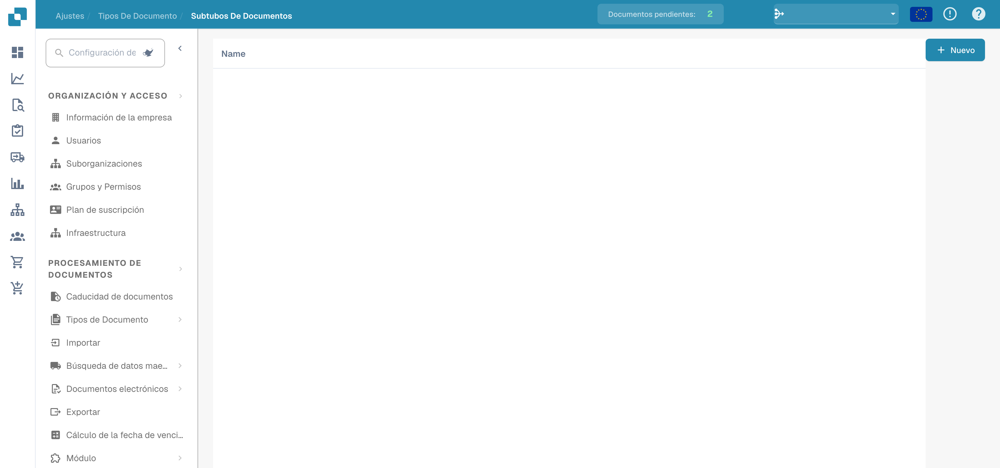
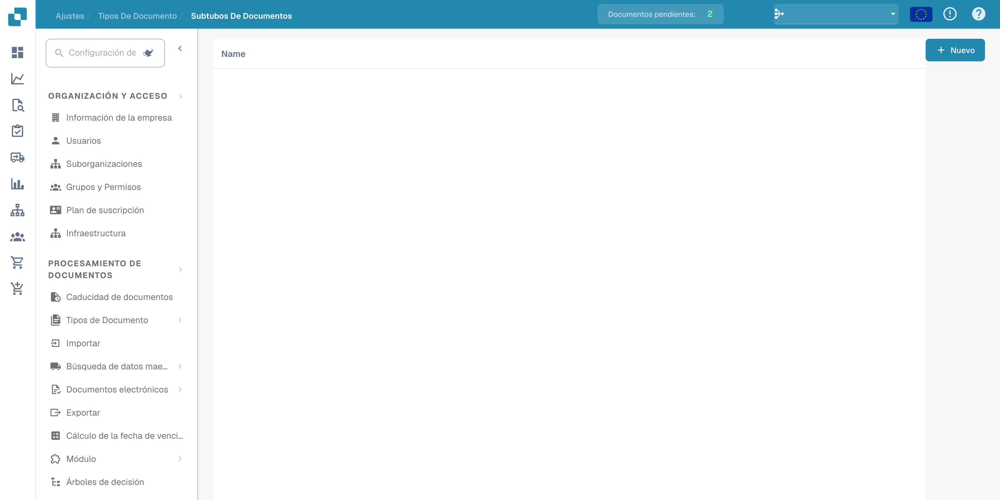

# Subtipos de documento

Los subtipos permiten distinguir categorías dentro de un tipo de documento. Abra **Ajustes → Tipos de Documento** y seleccione el enlace de subtipos del tipo previsto.

<figure><figcaption>
Resumen de los subtipos de documento.
</figcaption></figure>

La lista muestra los subtipos configurados. La interfaz puede conservar las cabeceras **Nombre** y **Acciones** en inglés.

<figure><figcaption>
Subtipos de documento en la administración.
</figcaption></figure>

Use **Nuevo** para preparar un subtipo y revise su nombre y configuración antes de guardarlo. Los ejemplos muestran el resumen y la lista; no demuestran un subtipo creado ni ajustes guardados.
