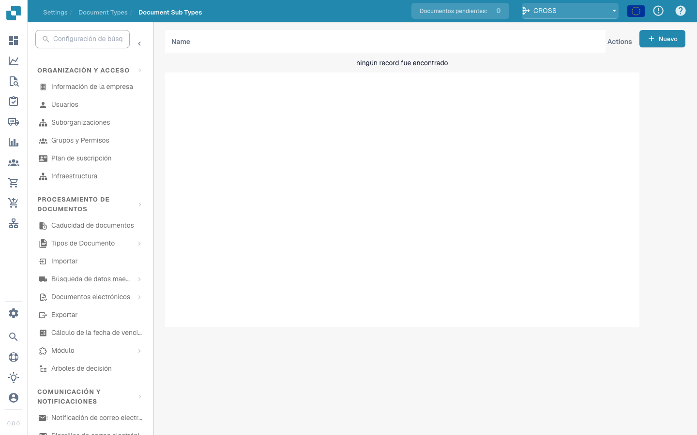

# Subtipos de Documentos

<figure><figcaption></figcaption></figure>

#### Visión general

Los Tipos de Documentos Secundarios son básicamente versiones especializadas de los tipos de documentos principales. Por ejemplo, bajo el tipo de documento principal "Factura," puede haber subtipos como "Factura Estándar," "Factura Proforma" y "Nota de Crédito," cada uno con requisitos de datos ligeramente diferentes o reglas de procesamiento.

#### Características Clave y Opciones

1. **Lista de Subtipos**:

* Cada fila representa un subtipo de un tipo de documento principal.
* Incluye el nombre del subtipo y un conjunto de acciones que se pueden realizar en él.

2. **Acciones**:

* **Campos**: Configurar qué campos de datos se incluyen en el subtipo y cómo se gestionan.
* **Editar Diseño**: Modificar el diseño visual de cómo se muestra y se introduce la información para este subtipo.
* **Scripts**: Adjuntar o editar scripts que ejecutan operaciones específicas cuando se procesan documentos de este subtipo.
* **Copiar**: Duplicar una configuración de subtipo existente para usarla como base para una nueva.
* **Eliminar**: Eliminar el subtipo si ya no es necesario.

3. **Agregar Nuevos Subtipos**:

* El botón "+ Nuevo" permite a los administradores crear nuevos subtipos, definiendo propiedades y reglas únicas según sea necesario.

Los Tipos de Documentos Secundarios en Docbits proporcionan una forma flexible y poderosa de manejar una variedad de documentos dentro de un único sistema, asegurando que cada tipo y subtipo se procese con precisión y eficiencia de acuerdo con sus especificaciones únicas.


