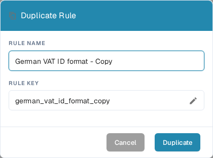

# Duplicate a Custom Validation Rule

Utilice **Duplicate** cuando una regla sea un buen punto de partida y desee una copia independiente. DocBits copia la definición de la regla; usted elige el nombre y la clave de la nueva regla. La regla original permanece en la lista.

1. Vaya a **Settings → Document Types**, abra el tipo de documento que desea configurar y seleccione **Custom Validation Rules**. La página muestra el tipo de documento seleccionado encima de sus tarjetas de reglas. Consulte [Document Types](README.md) para ver los demás ajustes disponibles allí.
2. Busque la regla de origen. Utilice el campo de búsqueda o los filtros de ámbito y estado si la lista es larga. Abra su menú de acciones de tres puntos y seleccione **Duplicate**. Puede copiar una regla predeterminada del sistema o una regla personalizada.
3. En **Rule Name**, conserve el nombre sugerido que termina en “Copy” o introduzca un nombre más claro. La **Rule Key** se genera a partir de ese nombre. Seleccione el icono del lápiz si necesita editar la clave usted mismo.
4. Seleccione **Duplicate** para crear la regla independiente. DocBits actualiza la lista tras guardar. Seleccione **Cancel** para cerrar el cuadro de diálogo sin crear una copia.

<figure><figcaption>
El cuadro de diálogo Duplicate Rule en inglés en la organización de prueba de DocBits Sandbox. El nombre y la clave copiados se pueden cambiar antes de seleccionar Duplicate.
</figcaption></figure>

El botón **Duplicate** necesita tanto un nombre como una clave. Si el guardado falla, DocBits muestra un error; corrija el nombre o la clave e inténtelo de nuevo. Revise la nueva regla antes de activarla o modificarla, porque una copia comienza con la definición de la regla de origen.
