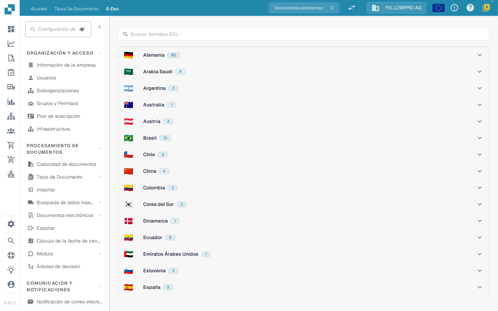
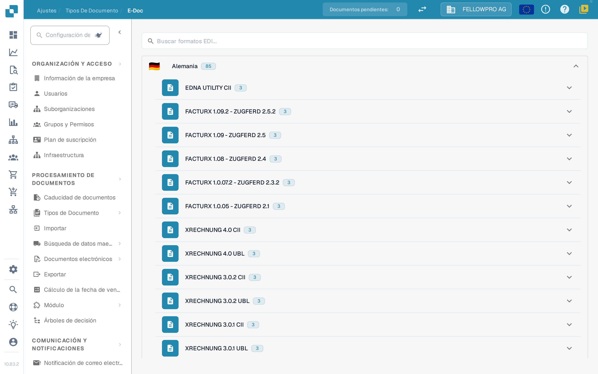
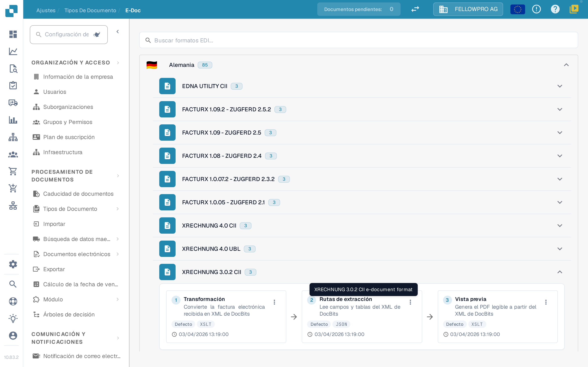
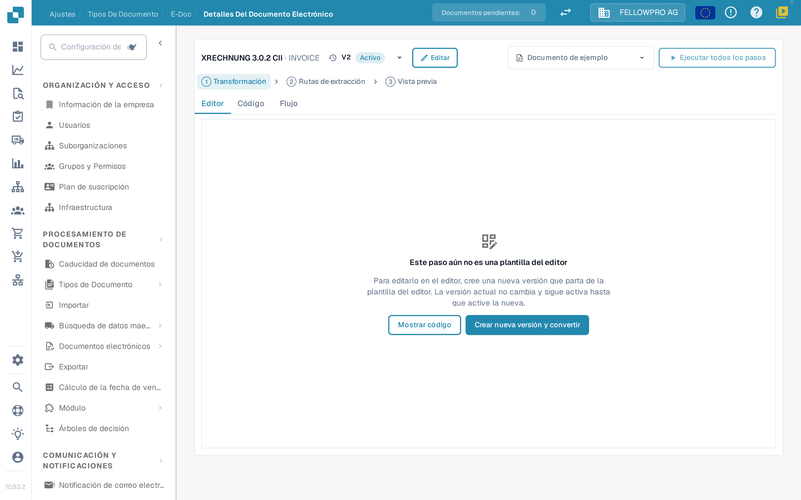
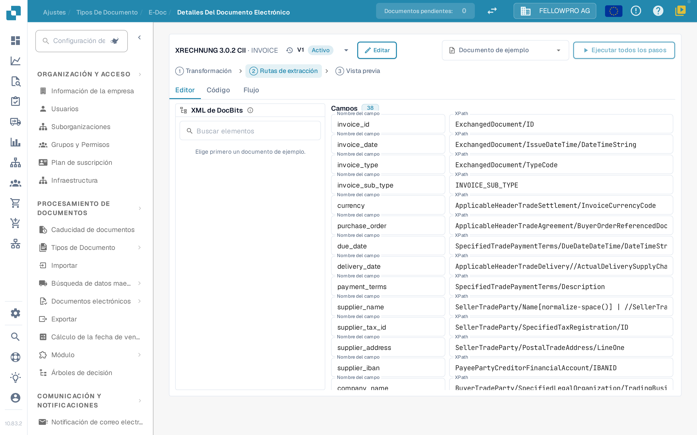

# Documentos electrónicos y configuración EDI


Tutorial de DocBits sobre facturas electrónicas: procesar XRechnung / ZUGFeRD (Factur-X), validar datos y automatizar flujos de trabajo


Los documentos electrónicos como XRechnung, ZUGFeRD/Factur-X, CFDI o FatturaPA llegan como XML o como PDF híbrido. DocBits lee el archivo, extrae los datos de la factura y genera un PDF legible. La configuración de **E-Doc** contiene las reglas de cada formato que usa su organización.

## Abrir la administración de E-Doc

1. Abra **Ajustes → Tipos de documento**.
2. Seleccione el tipo de documento, por ejemplo **Factura**, y abra **E-Doc**.

Los formatos están agrupados por país. Cada país muestra su bandera, su nombre y cuántos formatos contiene.

<figure><figcaption>
Los formatos están agrupados por país y contraídos al inicio.
</figcaption></figure>

Seleccione un país para abrir sus formatos. Dentro de un país, la versión más reciente aparece primero. Los formatos combinados como Factur-X / ZUGFeRD se encuentran bajo Alemania. El campo de búsqueda busca a la vez en nombres de formato y de país.

<figure><figcaption>
Abra un país para ver sus formatos.
</figcaption></figure>

## Los formatos y sus pasos

Cada formato muestra sus pasos como tres tarjetas unidas por flechas, en el orden en que DocBits los ejecuta:

| Paso | Qué hace |
| --- | --- |
| **Transformación** | Mapea el XML entrante al XML de DocBits. |
| **Rutas de extracción** | Define qué valores toma DocBits del XML transformado. |
| **Vista previa** | Define el diseño del PDF legible que genera DocBits. |

Los demás atributos del formato se enumeran bajo las tarjetas.

<figure><figcaption>
Los tres pasos de un formato: Transformación, Rutas de extracción y Vista previa.
</figcaption></figure>

Seleccione una tarjeta para abrir ese paso.

## Editar un paso

La página de detalle tiene la misma estructura para los tres pasos:

* La cabecera muestra el formato y un desplegable con sus versiones, incluido el estado de cada una. Desde el desplegable puede activar, editar o eliminar una versión.
* **Editor**, **Código** y **Flujo** alternan entre el editor visual, la hoja de estilos o el JSON subyacente, y el resultado del pipeline.
* **Documento de ejemplo** ofrece los documentos más recientes de este formato; también puede pegar un ID o una URL de documento.
* **Ejecutar todos los pasos** ejecuta transformación, extracción y vista previa para el documento de ejemplo de una sola vez.
* **Ctrl + S** guarda un borrador.

Editar una versión activa o ya usada no la cambia: DocBits crea una copia borrador y abre esa. Un borrador sin usar se edita directamente. Un paso escrito a mano permanece en **Código** hasta que el editor pueda asumirlo sin cambios.

<figure><figcaption>
La página de detalle: desplegable de versiones en la cabecera, pestañas Editor, Código y Flujo, documento de ejemplo y el paso en sí.
</figcaption></figure>

### Transformación

El **Editor** muestra el XML de origen a la izquierda, el mapeo en el centro y el XML resultante a la derecha. Seleccione un elemento del árbol de origen y arrástrelo a un campo, o añada un valor de texto fijo.

Un campo puede construirse a partir de varias partes, y cada parte puede tener una condición: **existe**, **falta**, **es igual a**, **no es igual a** o una expresión XPath libre, unidas con **todos** o **cualquiera**. Los tres paneles pueden redimensionarse, y el área de resultado tiene una lista **Campos** y la vista **XML**.

### Rutas de extracción

El editor de rutas de extracción muestra el XML de DocBits a la izquierda, los campos en el centro y la ruta que usa cada campo a la derecha. Seleccione un campo y establezca su ruta; las entradas existentes, incluidas las antiguas entradas planas, siguen funcionando.

<figure><figcaption>
El editor de rutas de extracción: XML de DocBits, campos y sus rutas.
</figcaption></figure>

### Vista previa

El editor de vista previa organiza el PDF con bloques de arrastrar y soltar y muestra el resultado junto a ellos. Tamaño de página, márgenes, tamaño de letra, colores y espaciado de bloques se configuran para todo el documento y se aplican a cada bloque.

### Flujo

**Flujo** muestra todo el pipeline para el documento de ejemplo elegido: lo que produjo la transformación, los valores que encontraron las rutas de extracción y cómo los presenta la vista previa. Úselo para comprobar un cambio de principio a fin sin salir de la página.

## Páginas relacionadas

* [Formatos, versiones y guías por país de eDocs](supported-electronic-documents/README.md)

Las capturas de pantalla de esta página muestran la interfaz en español.
