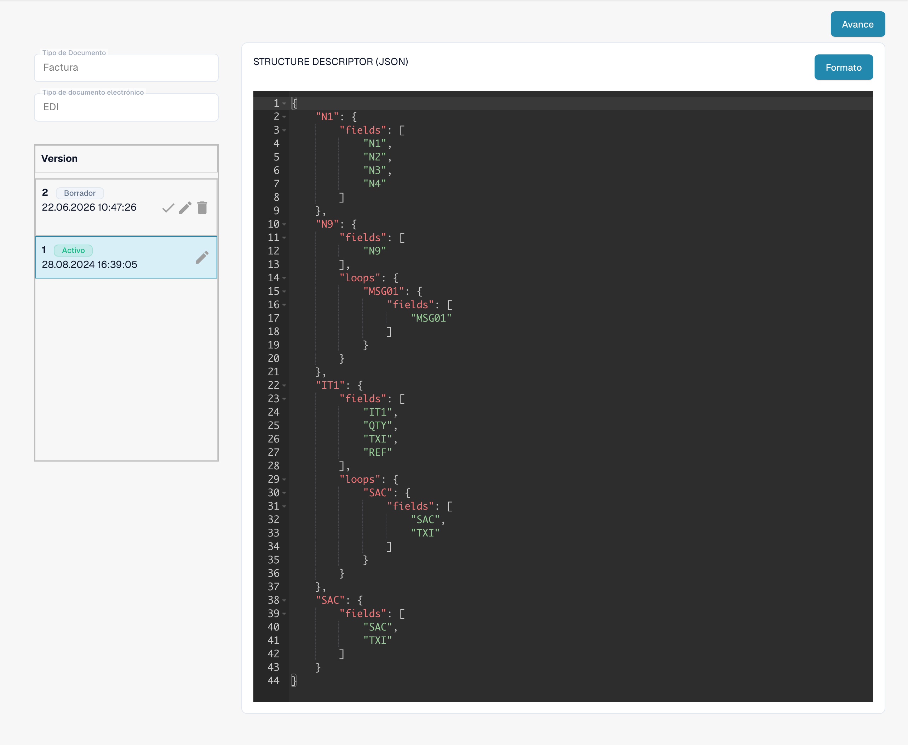

# Documentos electrónicos y configuración EDI


DocBits Tutorial de Factura Electrónica: Procesar XRechnung / ZUGFeRD (Factur-X), validar datos y automatizar flujos de trabajo


Seleccione el tipo de documento y el formato electrónico en la configuración de documentos electrónicos. Esta configuración procesa mensajes EDI entrantes; no configura su transmisión de salida.

<figure><figcaption>
Formato EDI existente con sus cuatro atributos configurados.
</figcaption></figure>

* STRUCTUREDESCRIPTOR: un descriptor de estructura JSON analiza el mensaje EDI original y genera JSON. Después, DocBits crea un XML intermedio.

* TRANSFORMATION: una hoja XSLT transforma el XML intermedio en el XML estándar utilizado en el procesamiento posterior.

* PREVIEW: una hoja XSLT crea una presentación legible a partir del XML transformado. La captura del editor muestra el código, no el documento renderizado.

* EXTRACTIONPATHS: la configuración JSON asigna campos y columnas a expresiones XPath que se evalúan sobre el XML transformado.

<figure><figcaption>
Atributo STRUCTUREDESCRIPTOR activo: descriptor de estructura JSON en el editor de solo lectura.
</figcaption></figure>

## Reglas utilizadas y activación

Si una nota de crédito electrónica aparece como Invoice, siga la [guía de resolución de problemas de clasificación](credit-note-recognized-as-invoice.md). Explica el origen personalizado o predeterminado que se está utilizando, los códigos de tipo, Extraction Paths y la activación segura.

## Guías por país

Consulte las guías por país para conocer las etiquetas de formato exactas, la sintaxis, los límites de versión y el estado de configuración inspeccionado. [Formatos, versiones y guías por país de eDocs](supported-electronic-documents/README.md).

Las vistas muestran una configuración y una versión existentes. Los ajustes varían según el tipo de documento y el formato. Valide los cambios en un borrador antes de activarlos.

Algunas etiquetas, como Custom, Default, Version y Last Modified At, siguen apareciendo en inglés en la interfaz actual del producto. Los identificadores técnicos de atributos y el código de configuración se conservan sin cambios.
