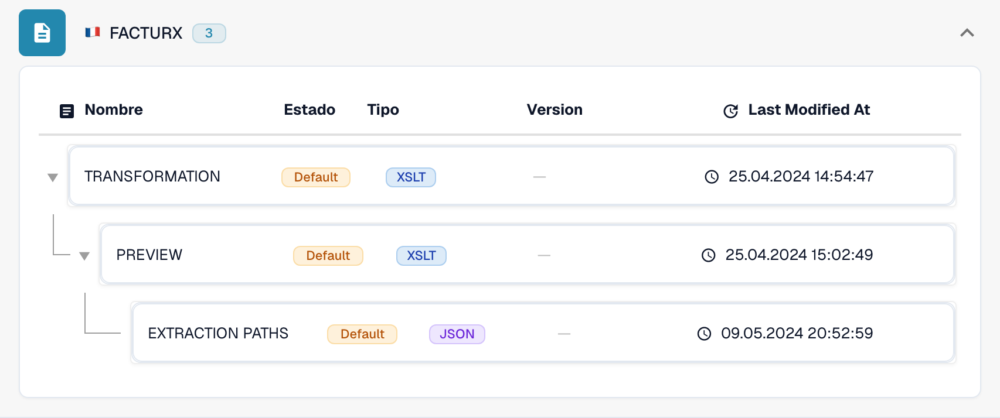
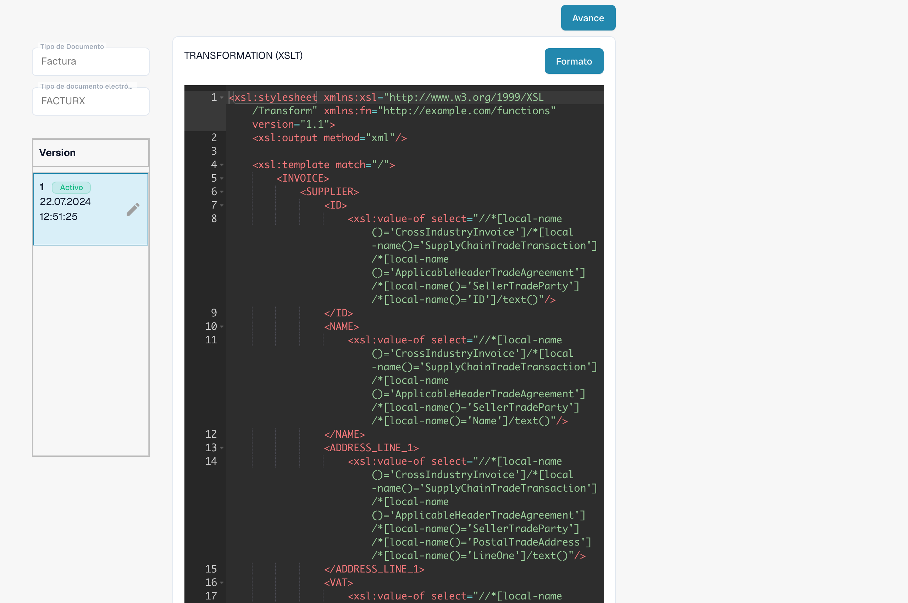

# Una nota de crédito electrónica se reconoce como factura

Una nota de crédito electrónica puede aparecer como **Invoice** aunque su XML original contenga un código de nota de crédito. Compruebe la configuración que se está utilizando antes de considerarlo un defecto del producto. Una **TRANSFORMATION** específica de la organización tiene prioridad sobre la predeterminada para ese formato eDoc. Por tanto, un valor constante como `<INVOICE_TYPE>Invoice</INVOICE_TYPE>` puede sobrescribir la clasificación predeterminada.

## Comprobar la clasificación de notas de crédito electrónicas


Comprobar la clasificación de notas de crédito electrónicas



WebVTT


## Compruebe el código del documento

Consulte el código de tipo en el XML original, no solo en el PDF o en el título del documento. Su ubicación depende de la sintaxis XML. CII utiliza `ExchangedDocument/TypeCode`; UBL utiliza `InvoiceTypeCode` o `CreditNoteTypeCode`. Tenga en cuenta los espacios de nombres XML al comprobar un XPath.

| Código | Significado | Clasificación que debe comprobar |
| --- | --- | --- |
| `380` | Factura comercial | Invoice |
| `381` | Nota de crédito | Credit Note |
| `261` | Nota de crédito por autofacturación | Credit Note en la asignación predeterminada (FACTURX/ZUGFeRD) |
| `383` | Nota de débito | No la asigne a Credit Note solo porque ajuste una factura |
| `384` | Factura rectificada | No la asigne a Credit Note solo porque corrija una factura |

La asignación predeterminada de notas de crédito de FACTURX/ZUGFeRD incluye **381 y 261**. Un requisito de negocio que solo mencione el código 381 no convierte los códigos 383 o 384 en códigos de nota de crédito. Consulte cualquier desviación prevista con la persona responsable de su integración contable.

## Localice dónde cambia el valor

1. **Identifique el formato real.** Abra **Configuración → Tipos de documento → Invoice → E-Doc**. Seleccione el formato detectado para el documento afectado, por ejemplo, **FACTURX**. Un PDF ZUGFeRD puede contener XML Factur-X; comprobar las reglas de otro formato no explicará el comportamiento de este documento.
2. **Compruebe el origen y la versión utilizados.** Revise **TRANSFORMATION**. La lista distingue entre **Default** y **Custom**. Abra la regla y anote la versión activa y su código fuente. Un borrador más reciente no está necesariamente activo. Para un documento histórico, identifique el origen y la versión utilizados en aquella ejecución; la versión activa actual puede ser diferente. Compare el código fuente personalizado de la organización con el predeterminado; no dé por hecho que se está utilizando el predeterminado.

<figure><figcaption>El estado identifica el origen de cada regla. Este ejemplo utiliza las reglas predeterminadas.</figcaption></figure>

3. **Revise el XML transformado.** Para FACTURX/ZUGFeRD, busque `INVOICE_TYPE` en la XSLT que se está utilizando. Si el código original es 381, una salida fija de `<INVOICE_TYPE>Invoice</INVOICE_TYPE>` indica un problema de configuración. Pruebe la transformación propuesta y revise su salida; el resultado previsto para una nota de crédito es `Credit Note`. Conserve todas las demás asignaciones específicas que necesite la organización.
4. **Compruebe Extraction Paths.** Confirme que el ID de campo de DocBits `invoice_type` lee el nodo de clasificación previsto del **XML transformado**. FACTURX/ZUGFeRD suele utilizar `INVOICE_TYPE`; XRechnung puede conservar `TypeCode` (CII), `InvoiceTypeCode` o `CreditNoteTypeCode` (UBL). Revise el origen efectivo y su salida antes de elegir una ruta. Después de reestructurar el XML, las rutas que apuntan al archivo original pueden dejar de ser válidas. Consulte la [guía de Extraction Paths](edi/edi-extraction-paths-file-guide.md).
5. **Compruebe el procesamiento posterior.** Revise los scripts que pueden asignar `invoice_type` y compare después el campo almacenado, el panel y los datos de exportación. Una transformación correcta no demuestra por sí sola que un script posterior conserve el valor. Una **Preview** renderizada muestra la presentación; no demuestra la clasificación almacenada.

<figure><figcaption>Revise el origen y la versión seleccionados antes de crear o activar un cambio.</figcaption></figure>

Las [herramientas MCP de eDocs](../../../../../advanced-functions-and-tools/edocs-mcp/README.md) permiten realizar las mismas comprobaciones: `list_edoc_custom_attributes`, `get_edoc_attribute_source` y `list_edoc_attribute_versions` identifican el origen; `compare_edoc_extraction` compara el comportamiento de la versión predeterminada, la personalizada y una propuesta de cambio. Utilice `test_electronic_document` para realizar una prueba sin cambios antes de la activación.

## Corrija y active de forma segura

1. Anote la versión activa actual y conserve su código fuente para poder volver a ella.
2. Cree un **borrador** con el icono del lápiz. Modifique la condición de clasificación o la ruta de extracción que haya identificado durante el diagnóstico. Evite sustituir toda la transformación para corregir un solo campo.
3. Seleccione el borrador y **guárdelo**. Guardar un borrador **no** lo activa.
4. Pruebe el borrador en una organización de desarrollo o de pruebas con documentos representativos: códigos 380 y 381. Incluya 261, 383 y 384 cuando el formato detectado y su flujo de trabajo los acepten. Compruebe la clasificación, los importes y los demás campos personalizados. Compare los resultados con la versión activa.
5. Una vez superadas las comprobaciones, utilice la **marca de verificación** del borrador para activarlo. Confirme que la versión prevista ahora aparece como **Activa**. Con MCP, la activación se realiza mediante `activate_edoc_attribute_version`; es un cambio independiente de la prueba sin cambios.
6. Procese un documento de prueba nuevo. Verifique el campo `invoice_type` almacenado, el panel, los importes y la exportación a **Infor ERP / SAP** o a su sistema de destino. Mantenga disponible la versión anterior para poder volver a ella.


No restablezca las reglas de una organización a sus valores predeterminados sin comparar y conservar antes las personalizaciones necesarias. No reinicie documentos históricos en bloque. Un reinicio elimina los datos extraídos y los registros de exportación y puede repetir los procesos de aprobación o exportación. Compruebe el estado de exportación, las aprobaciones y las modificaciones manuales de cada documento antes de decidir cómo volver a procesarlo.


## Compruebe por separado el signo de los importes

La clasificación y el signo de los importes son comprobaciones relacionadas. [Establecer signo negativo para notas de crédito](../../../document-processing/module/set-negative-sign-for-credit-notes.md) está activado de forma predeterminada, pero puede desactivarse. Cuando está activado, guarda los importes de las notas de crédito como valores negativos. Verifique la configuración real de la organización y la convención de signos del sistema receptor; no deduzca el tipo de documento únicamente a partir del signo.

Si el resultado sigue siendo incorrecto con el código fuente activo ya verificado, conserve para el equipo de soporte el XML original, el formato detectado, los ID de versión, la salida transformada, la asignación de extracción y cualquier cambio posterior realizado por scripts. Estos datos permiten determinar si la discrepancia procede de la configuración o requiere una investigación adicional del producto.

<!-- Internal evidence: TRL-72. The organization-specific constant is a likely cause; later scripts/effective historical versions were not conclusively excluded. -->
