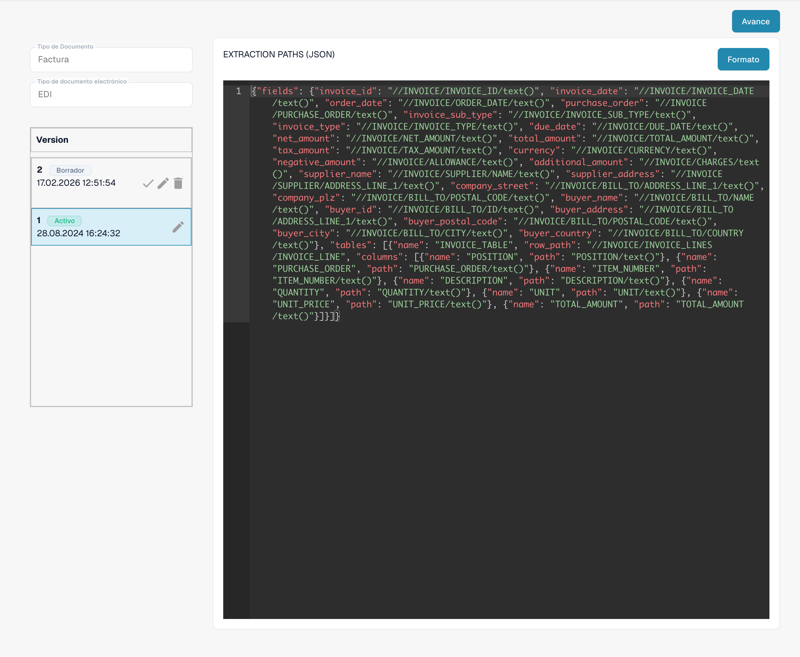

# Guía de Archivos de Rutas de Extracción EDI

## 1. Visión general

El **Archivo de Rutas de Extracción** define cómo se extraen los datos del **XML estructurado** en campos y tablas específicos dentro de la interfaz. Mapea los **IDs de campo** a **expresiones XPath**, que se evalúan para extraer valores del XML en los campos de documento correspondientes. Este archivo desempeña un papel crítico en garantizar que los datos extraídos aparezcan correctamente durante la validación de campos y el procesamiento posterior.

## 2. Propósito y Función

* Mapea cada campo de documento y columna de tabla a una ubicación específica en el XML estructurado utilizando expresiones XPath.
* Asegura que los valores correctos se populen en campos como `order_number`, `supplier_name` y `total_amount`.
* Admite tanto **campos individuales** (a través de un objeto `fields`) como **tablas** (a través de una matriz `tables` con rutas de fila y mapeos de columnas).
* Permite un control preciso sobre cómo se recuperan los datos del XML, incluido el uso de funciones XPath como `sum()`.

Mapeo de campo de ejemplo:

Copy

```
"order_number": "//PURCHASE_ORDER/PURCHASE_ORDER/text()"
```

## 3. Acceso y Edición Básica

#### **Acceder al Archivo:**

1.  Ve a **Configuración** → **Tipo de Documento** → _\[Tu Documento (por ejemplo, Orden de Compra)]_ → **E-Doc**.

    
2. En la pestaña **E-Doc**, selecciona tu formato (por ejemplo, **EDI**).
3.  Haz clic en **Rutas de Extracción** para ver o editar el archivo.

    

#### **Gestión de Borradores:**

* **Crear un Borrador:** Haz clic en el icono de lápiz ✏️.
* **Eliminar Borradores:** Utiliza el icono de papelera 🗑️ para eliminar borradores no utilizados.
* **Activar Cambios:** Haz clic en la marca de verificación ✅ para publicar una versión.
  * **Nota**: Activar una nueva versión **desactivará automáticamente** la anterior.

## 4. Editor y Sintaxis

El Archivo de Rutas de Extracción está escrito en **JSON** y contiene dos componentes principales:

* **fields**: Un diccionario donde cada clave es un ID de campo y cada valor es una expresión XPath que define cómo extraer los datos.
* **tables**: Una lista de definiciones de tabla que incluyen:
  * `name`: El ID de la tabla.
  * `row_path`: Un XPath que identifica cada fila de la tabla.
  * `columns`: Una lista de mapeos de columnas (`name`, `path`).

También puedes usar funciones XPath (por ejemplo, `sum()`) y expresiones para calcular valores dinámicamente a partir de elementos repetidos.

Copy

```json
"total_net_amount": "sum(//PURCHASE_ORDER/ORDER_LINES/ORDER_LINE/SUB_TOTAL)"
```

## 5. Función de Vista Previa (Evaluar Extracción)

La **Función de Vista Previa** te permite simular cómo se comportarán las rutas de extracción con un documento cargado real.

**Uso:**

* Carga un archivo EDI a través del proceso de carga estándar.
* Copia el **ID del Documento**.
* Ve a la interfaz de **Rutas de Extracción**.
* Abre la **Función de Vista Previa**.\
  \
  &#x20;
* Ingresa el ID del Documento y haz clic en **Probar**.
* El resultado mostrará cómo se poblaron cada campo y tabla basados en las rutas configuradas.

Esta función es esencial para verificar que tus expresiones XPath estén correctamente definidas y extraigan los valores esperados antes de activar el borrador.


## 6. Video Tutorial

Una guía en video para este tipo de archivo está disponible en la [página de Videos.](https://docs.docbits.com/administration-and-setup/settings/global-settings/document-types/edi/edi/edi-videos) Úsala para seguir la configuración, edición y vista previa.

## Reglas utilizadas y activación

Si una nota de crédito electrónica aparece como Invoice, siga la [guía de resolución de problemas de clasificación](../credit-note-recognized-as-invoice.md). Explica el origen personalizado o predeterminado que se está utilizando, los códigos de tipo, Extraction Paths y la activación segura.


<figure><figcaption><p>Formato EDI existente con sus cuatro atributos configurados.</p></figcaption></figure>

<figure><figcaption><p>Atributo EXTRACTIONPATHS activo: configuración JSON que contiene expresiones XPath de extracción.</p></figcaption></figure>


Las vistas muestran una configuración y una versión existentes. Los ajustes varían según el tipo de documento y el formato. Valide los cambios en un borrador antes de activarlos.

Algunas etiquetas, como Custom, Default, Version y Last Modified At, siguen apareciendo en inglés en la interfaz actual del producto. Los identificadores técnicos de atributos y el código de configuración se conservan sin cambios.
