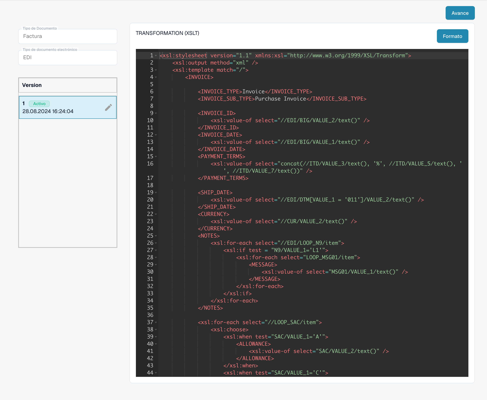

# Configurar atributos EDI

Seleccione el formato real del mensaje y el tipo de documento. Revise los atributos existentes y las versiones activas antes de modificar la configuración.

<figure><figcaption>
Formato EDI existente con sus cuatro atributos configurados.
</figcaption></figure>

Defina los segmentos, elementos y bucles en un descriptor de estructura JSON. Pruebe mensajes representativos e inspeccione el XML intermedio generado.

<figure><figcaption>
Atributo STRUCTUREDESCRIPTOR activo: descriptor de estructura JSON en el editor de solo lectura.
</figcaption></figure>

Utilice TRANSFORMATION con XSLT para convertir el XML intermedio en el XML estándar requerido. Configure PREVIEW por separado para la presentación; XSLT no transforma directamente el JSON.

<figure><figcaption>
Atributo TRANSFORMATION activo: código XSLT para transformar el XML intermedio.
</figcaption></figure>

Configure EXTRACTIONPATHS como JSON con expresiones XPath para el XML resultante. Compruebe campos, filas e importes con ejemplos reales. Valide un borrador antes de activarlo; las capturas muestran una configuración activa existente.

<figure><figcaption>
Atributo EXTRACTIONPATHS activo: configuración JSON que contiene expresiones XPath de extracción.
</figcaption></figure>

Algunas etiquetas, como Custom, Default, Version y Last Modified At, siguen apareciendo en inglés en la interfaz actual del producto. Los identificadores técnicos de atributos y el código de configuración se conservan sin cambios.
