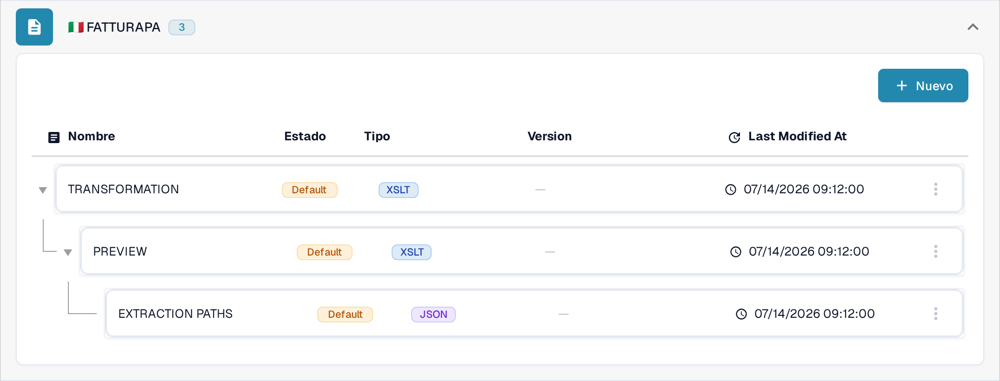
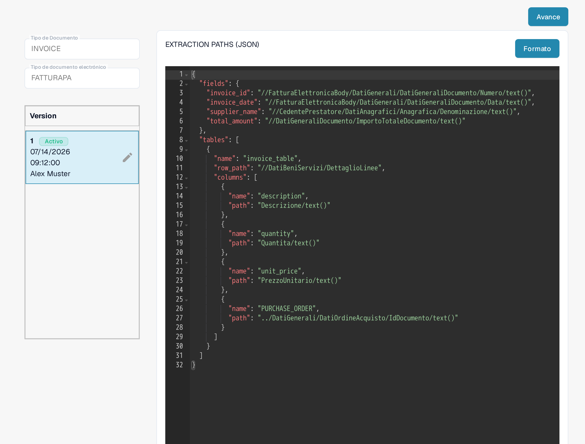
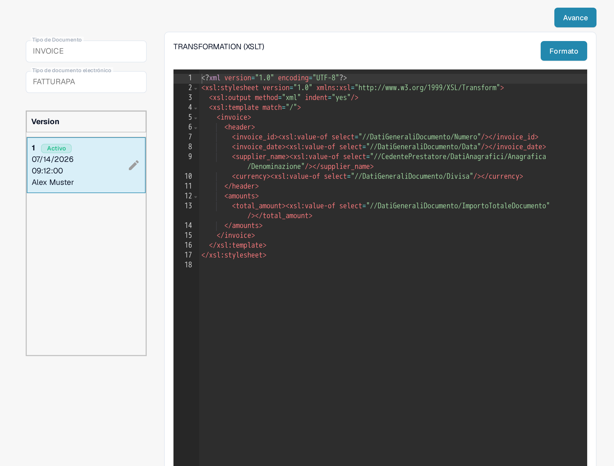
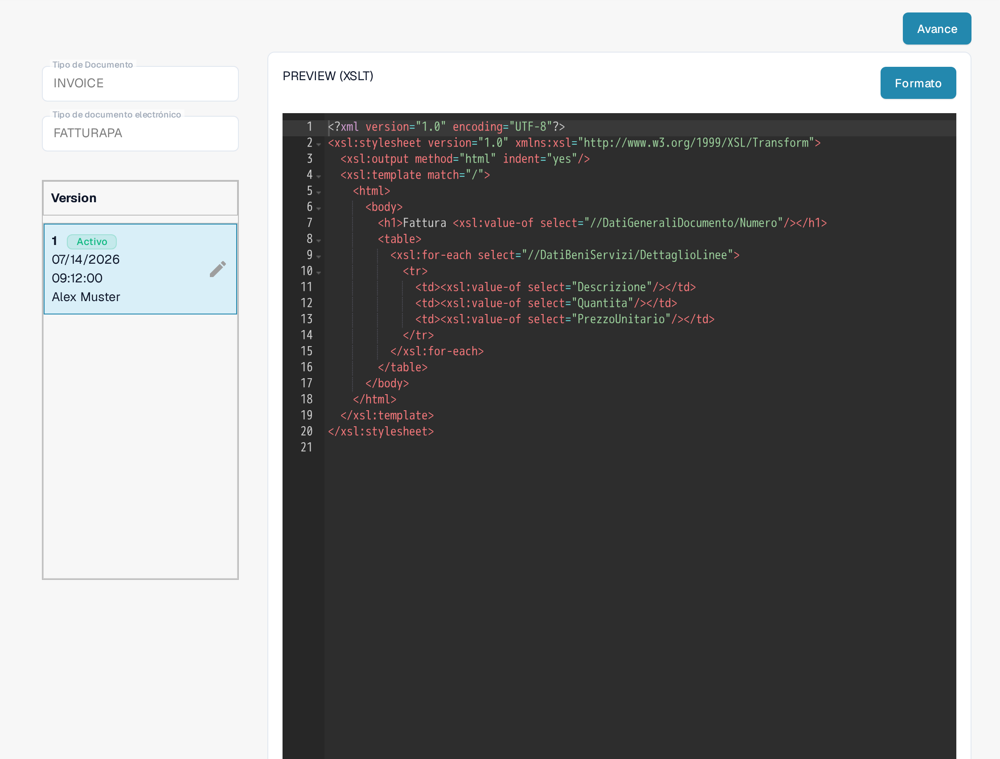

# FatturaPA: mostrar un atributo en las líneas de factura

FatturaPA es el formato italiano de factura electrónica. Esta página explica dónde comprobar un atributo de línea, como el número de pedido de compra, antes de modificar su mapeo o la vista previa de la factura. **No añada una segunda columna `PURCHASE_ORDER` sin comprobar antes el mapeo activo:** el mapeo actual de Sandbox ya contiene una.

## Encontrar los tres archivos de FatturaPA

Abra **Ajustes → Tipos de Documento → E-Doc**, seleccione **Invoice** y despliegue **FATTURAPA**. La lista actual contiene tres archivos diferentes:

* **TRANSFORMATION (XSLT)** lee el XML de origen de FatturaPA y produce los datos de factura normalizados.
* **PREVIEW (XSLT)** genera a partir de esos datos la vista previa visual de la factura, similar a HTML/PDF.
* **EXTRACTION PATHS (JSON)** mapea los valores normalizados a los campos y columnas de tabla de DocBits.

<figure><figcaption>
La lista actual de archivos FATTURAPA en la Sandbox en español.
</figcaption></figure>

## Comprobar el valor de línea extraído

Abra **EXTRACTION PATHS (JSON)**. En la versión activa, busque el array `tables` y sus `columns`. La versión visible de Sandbox ya incluye `{"name": "PURCHASE_ORDER", "path": "PURCHASE_ORDER"}`. Compruebe el valor en una factura de prueba real antes de editarlo. Si necesita otro atributo, identifique su valor en los datos normalizados y, a continuación, añada un nombre de columna distinto y la ruta correspondiente en una versión de borrador.

<figure><figcaption>
El mapeo de extracción JSON activo ya tiene una columna de pedido de compra.
</figcaption></figure>

## Cambiar la transformación o la vista previa solo cuando sea necesario

Si falta el valor normalizado, examine **TRANSFORMATION (XSLT)** y la ruta XML de origen que debería producirlo. Un cambio aquí afecta a los datos que utilizan los pasos posteriores de mapeo y vista previa. Si el valor se extrae correctamente pero no aparece en la factura visual, examine **PREVIEW (XSLT)** y la fila de tabla correspondiente en esa plantilla. Los dos archivos XSLT tienen propósitos diferentes.

<figure><figcaption>
Transformation lee el XML de origen y genera los campos de factura normalizados.
</figcaption></figure>

<figure><figcaption>
Preview controla la salida visual de la factura.
</figcaption></figure>

Utilice el lápiz de una tarjeta de versión para preparar un cambio. Revise el borrador y use **Preview** con una factura FatturaPA representativa antes de activarlo. Las capturas muestran las versiones actualmente activas; en esta sesión de Sandbox no se guardó ningún borrador ni se ejecutó ninguna prueba de vista previa.

La instrucción anterior de que todos los documentos electrónicos tienen Gran Bretaña como origen no es una regla general segura. Compruebe el país, la moneda y el formato numérico de la factura con el documento de origen y la configuración de su organización.
