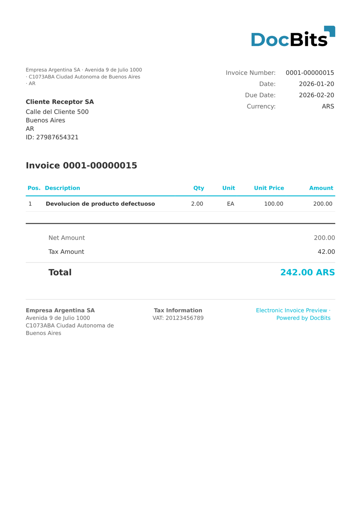

# 🇦🇷 ARGENTINA FACTURA ELECTRONICA

<!-- edocs-country-scope -->


Consulte la guía del país para conocer los límites de versión, la configuración que se está utilizando y el vídeo explicativo del país. [Argentina](countries/argentina.md). La entrada de clasificación de notas de crédito no tiene un paquete de extracción dedicado en el estado inspeccionado. Verifique la asignación utilizada y pruebe un ejemplo real de nota de crédito.


| Propiedad            | Valor                                                                           |
| -------------------- | ------------------------------------------------------------------------------- |
| **País / Región**    | Argentina                                                                       |
| **Tipos de documento** | Factura                                                                       |
| **Formato**          | XML                                                                             |
| **Estándar**         | Argentina Factura Electrónica (tipos de comprobante AFIP más allá de Factura A) |
| **Idioma**           | `es_AR`                                                                         |

ARGENTINA FACTURA ELECTRONICA abarca el conjunto más amplio de documentos electrónicos argentinos de la AFIP más allá de la Factura A (tipo 001). Esto incluye otros tipos de comprobante como Factura B (tipo 006), Factura C (tipo 011), Nota de Crédito (tipo 003) y otras variantes. DocBits detecta automáticamente el tipo de documento a partir de `<tipoComprobante>` y aplica la extracción adecuada.

## Estado de soporte

| Componente           | Estado       |
| -------------------- | ------------ |
| Vista previa         | ✅ Compatible |
| Extracción de campos | ✅ Compatible |
| Transformación       | ✅ Compatible |

## Vista previa predeterminada

<figure><figcaption>
Vista previa predeterminada de DocBits para un documento ARGENTINA FACTURA ELECTRONICA
</figcaption></figure>

## Mapeo de campos

### Campos de cabecera

| Campo DocBits    | Elementos XML de origen                                                   | Notas                                                |
| ---------------- | ------------------------------------------------------------------------- | ---------------------------------------------------- |
| `invoice_id`     | `//NumeroFactura`, `//cbte_nro`, `//CbteNro`, `//InvoiceNumber`           | Múltiples rutas XPath alternativas para esquemas variantes |
| `invoice_date`   | `//FechaEmision`, `//cbte_fch`, `//CbteFch`, `//IssueDate`                |                                                      |
| `due_date`       | `//fechaVencimiento`, `//fechaVtoPago`                                    |                                                      |
| `currency`       | `//Moneda`, `//mon_id`, `//MonId`, alternativa: `ARS`                     |                                                      |
| `total_amount`   | `//MontoTotal`, `//imp_total`, `//ImpTotal`, `//TotalAmount`              |                                                      |
| `net_amount`     | `//MontoNeto`, `//imp_neto`, `//ImpNeto`, `//NetAmount`                   |                                                      |
| `tax_amount`     | `//MontoIVA`, `//imp_iva`, `//ImpIVA`, `//TaxAmount`                      |                                                      |
| `supplier_name`  | `//NombreProveedor`, `//razon_social`, `//RazonSocial`, `//SellerName`    |                                                      |
| `supplier_id`    | `//CUITProveedor`, `//cuit`, `//Cuit`, `//SellerID`                       | CUIT = identificación fiscal argentina               |
| `buyer_name`     | `//NombreComprador`, `//nombre_cliente`, `//NombreCliente`, `//BuyerName` |                                                      |
| `buyer_id`       | `//CUITComprador`, `//doc_nro`, `//DocNro`, `//BuyerID`                   |                                                      |
| `iban`           | `//PAYMENT/IBAN`                                                          | Normalmente vacío                                    |
| `bic`            | `//PAYMENT/BIC`                                                           | Normalmente vacío                                    |
| `payment_terms`  | `//PAYMENT_TERMS`                                                         | Normalmente vacío                                    |
| `purchase_order` | `//PURCHASE_ORDER`                                                        | Normalmente vacío                                    |

### Tabla de líneas (`INVOICE_TABLE`)

Ruta de fila: `<items>/<item>`, `<Items>/<Item>` o `<Detalle>/<Linea>`

| Columna       | Atributo / Elemento de origen           | Notas                       |
| ------------- | --------------------------------------- | --------------------------- |
| `POSITION`    | `@numero`, `<numero>` o `position()`    | Número de secuencia de la posición |
| `DESCRIPTION` | `<descripcion>`, `<Descripcion>`        |                             |
| `QUANTITY`    | `<cantidad>`, `<Cantidad>`              |                             |
| `UNIT_PRICE`  | `<precioUnitario>`, `<PrecioUnitario>`  |                             |
| `VAT_RATE`    | `<alicuotaIVA>`, `<AlicuotaIVA>`        | p. ej. `21.00`              |
| `VAT`         | `<importeIVA>`, `<ImporteIVA>`          |                             |
| `NET_AMOUNT`  | `<subtotal>`, `<Subtotal>`, `<importe>` | Total de la línea           |

## Regla de clasificación

DocBits detecta los documentos ARGENTINA FACTURA ELECTRONICA por la ausencia del marcador de Factura A: los documentos con valores de `<tipoComprobante>` distintos de `001` (p. ej. `003`, `006`, `011`) se enrutan a este estándar.

## Relacionados

* [ARGENTINA AFIP](argentina-afip.md)
* [Documentos electrónicos compatibles](./)
