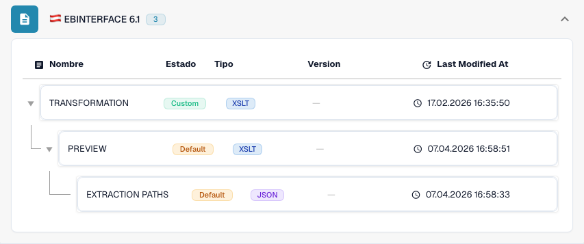

# Austria

Utilice esta guía para identificar la familia configurada y el alcance de versiones antes de probar un archivo de origen.

[Todos los países y alcance de la compatibilidad](../README.md)

## Variantes y límites de versión

ebInterface 4.3, 5.0, 6.0 y 6.1 tienen entradas independientes.

**Sintaxis:** XML

Haga coincidir el espacio de nombres XML con la versión configurada. Un espacio de nombres diferente puede requerir otra asignación.

Las tablas recogen una comprobación del catálogo de desarrollo realizada el 17 de octubre de 2026 y del código de procesamiento correspondiente. Describen las reglas y los componentes de configuración disponibles; no certifican todos los archivos, los requisitos legales ni el despliegue en producción. Su organización puede sobrescribir los valores predeterminados.

## Matriz de reglas y componentes inspeccionados

| Etiqueta de formato exacta | Clave de documento de la regla | Componentes disponibles |
| --- | --- | --- |
| `EBINTERFACE 4.3` | `INVOICE` | C / T / P / E |
| `EBINTERFACE 5.0` | `INVOICE` | C / T / P / E |
| `EBINTERFACE 6.0` | `INVOICE` | C / T / P / E |
| `EBINTERFACE 6.1` | `INVOICE` | C / T / P / E |

C = clasificación, T = Transformation, P = Preview, E = Extraction Paths. La clave de documento se utiliza para buscar la regla o configuración; no garantiza el valor final almacenado de invoice_type. Una transformación puede clasificar una nota de crédito mediante una asignación INVOICE.

Un guion indica que la comprobación de estado no informó de un componente dedicado para esa combinación exacta de formato y clave de documento. No descarta una asignación compartida o alternativa. Verifique la lógica de resolución que se está utilizando y un archivo representativo antes de depender de esa ruta.

## Encuentre la asignación en DocBits

<figure><figcaption>
Interfaz real de desarrollo: el formato representativo y sus componentes de configuración disponibles. Las demás versiones figuran en la matriz.
</figcaption></figure>

## Vídeo explicativo del país

La narración y los subtítulos WebVTT en el idioma correspondiente explican la selección del formato, la configuración y las pruebas de aceptación.

Este recorrido de solo lectura muestra la configuración existente del país en DocBits. Compruebe la fuente utilizada y la versión activa y valide facturas, notas de crédito y exportaciones representativas en su organización.


Austria — Vídeo explicativo del país



WebVTT


## Pruebas de aceptación

Una comprobación de componentes confirma que existe una configuración. No es una prueba de procesamiento de principio a fin para todas las versiones. Pruebe el contenido exacto y la ruta de factura o nota de crédito que necesite su integración.

## Compruebe un formato en su organización

1. Conserve el XML original o el PDF con su XML incrustado. Consulte el espacio de nombres, el identificador de esquema o de personalización y la versión y el perfil declarados.

2. Abra Configuración → Tipos de documento → E-Doc para el documento de negocio correspondiente. Busque el formato de documento electrónico exacto que aparece en la guía.

3. Compruebe el origen Default o Custom que se está utilizando y su versión de configuración activa. Revise Transformation, Preview y Extraction Paths. Guardar un borrador no lo activa.

4. Pruebe archivos de origen representativos de cada sintaxis, versión y documento de negocio que necesite. Verifique los campos clave, los importes, los impuestos, la clasificación como factura o nota de crédito y la exportación al ERP.

5. Confirme por separado la política de validación y el transporte. Conserve las asignaciones personalizadas y compruebe las aprobaciones y el historial de exportación antes de reiniciar documentos existentes.

## Referencia de formato relacionada

- [🇦🇹 AUSTRIA EBINTERFACE](../austria-ebinterface.md)
- [🇦🇹 AUSTRIA EBINTERFACE 6.0](../austria-ebinterface-6-0.md)
- [🇦🇹 AUSTRIA EBINTERFACE 6.1](../austria-ebinterface-6-1.md)
