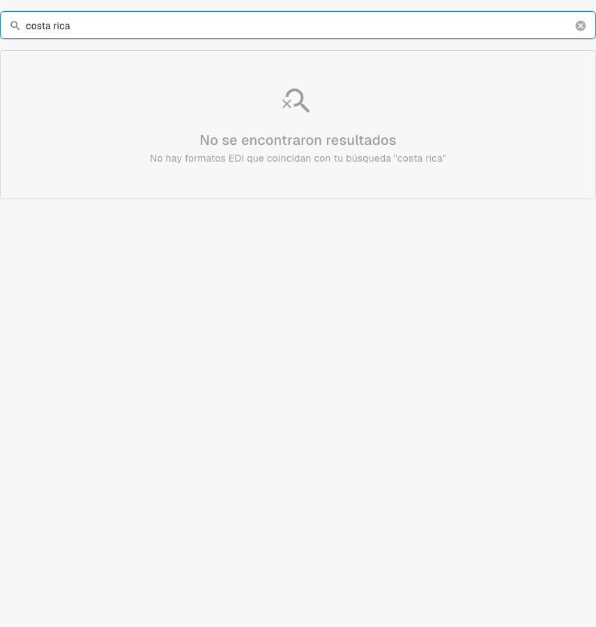

# Costa Rica

Utilice esta guía para identificar la familia configurada y el alcance de versiones antes de probar un archivo de origen.

[Todos los países y alcance de la compatibilidad](../README.md)

## Variantes y límites de versión

La documentación anterior menciona Costa Rica, pero no se encontró ninguna entrada de clasificación o configuración coincidente en el catálogo de desarrollo inspeccionado.

**Sintaxis:** Sin confirmar

Esta comprobación no confirma el procesamiento integrado actual. Pida a soporte que verifique la asignación desplegada y pruebe un archivo de origen representativo antes de la puesta en marcha.

Las tablas recogen una comprobación del catálogo de desarrollo realizada el 17 de octubre de 2026 y del código de procesamiento correspondiente. Describen las reglas y los componentes de configuración disponibles; no certifican todos los archivos, los requisitos legales ni el despliegue en producción. Su organización puede sobrescribir los valores predeterminados.

## Matriz de reglas y componentes inspeccionados

No se encontró ninguna entrada de clasificación o configuración coincidente. Esta comprobación no confirma la compatibilidad integrada actual.

## Encuentre la asignación en DocBits

<figure><figcaption>
Interfaz real de desarrollo: la búsqueda del nombre de este país no devolvió ninguna entrada de configuración coincidente en el catálogo inspeccionado.
</figcaption></figure>

## Vídeo explicativo del país

La narración y los subtítulos WebVTT en el idioma correspondiente explican la selección del formato, la configuración y las pruebas de aceptación.


Costa Rica — Vídeo explicativo del país



WebVTT


## Pruebas de aceptación

Una comprobación de componentes confirma que existe una configuración. No es una prueba de procesamiento de principio a fin para todas las versiones. Pruebe el contenido exacto y la ruta de factura o nota de crédito que necesite su integración.

## Compruebe un formato en su organización

1. Conserve el XML original o el PDF con su XML incrustado. Consulte el espacio de nombres, el identificador de esquema o de personalización y la versión y el perfil declarados.

2. Abra Configuración → Tipos de documento → E-Doc para el documento de negocio correspondiente. Busque el formato de documento electrónico exacto que aparece en la guía.

3. Compruebe el origen Default o Custom que se está utilizando y su versión de configuración activa. Revise Transformation, Preview y Extraction Paths. Guardar un borrador no lo activa.

4. Pruebe archivos de origen representativos de cada sintaxis, versión y documento de negocio que necesite. Verifique los campos clave, los importes, los impuestos, la clasificación como factura o nota de crédito y la exportación al ERP.

5. Confirme por separado la política de validación y el transporte. Conserve las asignaciones personalizadas y compruebe las aprobaciones y el historial de exportación antes de reiniciar documentos existentes.

## Referencia de formato relacionada

- [🇨🇷 COSTA RICA](../costa-rica.md)
