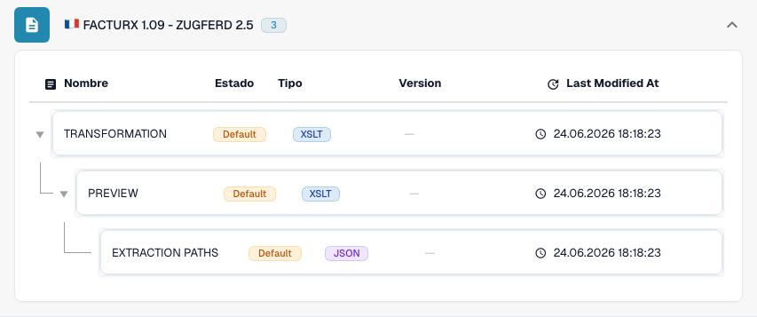

# Francia

Utilice esta guía para identificar la familia configurada y el alcance de versiones antes de probar un archivo de origen.

[Todos los países y alcance de la compatibilidad](../README.md)

## Variantes y límites de versión

Factur-X tiene entradas genéricas y específicas de publicación, incluidas 1.0.05, 1.08 y 1.09. VRBL FR CIUS 1.0 es independiente.

**Sintaxis:** CII / PDF + XML

El marcador XML 1p0 y Factur-X XMP Version 1.0 no identifican una versión de publicación. Mantenga la etiqueta genérica cuando se desconozca la publicación.

Las tablas recogen una comprobación del catálogo de desarrollo realizada el 17 de octubre de 2026 y del código de procesamiento correspondiente. Describen las reglas y los componentes de configuración disponibles; no certifican todos los archivos, los requisitos legales ni el despliegue en producción. Su organización puede sobrescribir los valores predeterminados.

## Matriz de reglas y componentes inspeccionados

| Etiqueta de formato exacta | Clave de documento de la regla | Componentes disponibles |
| --- | --- | --- |
| `FACTURX` | `INVOICE` | C / T / P / E |
| `FACTURX 1.0.05 - ZUGFERD 2.1` | `INVOICE` | C / T / P / E |
| `FACTURX 1.0.05 BASIC` | `INVOICE` | C / T / P / E |
| `FACTURX 1.0.05 EN16931` | `INVOICE` | C / T / P / E |
| `FACTURX 1.0.05 EXTENDED` | `INVOICE` | C / T / P / E |
| `FACTURX 1.08 - ZUGFERD 2.4` | `INVOICE` | C / T / P / E |
| `FACTURX 1.09 - ZUGFERD 2.5` | `INVOICE` | C / T / P / E |
| `VRBL FR CIUS 1.0` | `INVOICE` | C / T / P / E |

C = clasificación, T = Transformation, P = Preview, E = Extraction Paths. La clave de documento se utiliza para buscar la regla o configuración; no garantiza el valor final almacenado de invoice_type. Una transformación puede clasificar una nota de crédito mediante una asignación INVOICE.

Un guion indica que la comprobación de estado no informó de un componente dedicado para esa combinación exacta de formato y clave de documento. No descarta una asignación compartida o alternativa. Verifique la lógica de resolución que se está utilizando y un archivo representativo antes de depender de esa ruta.

### Etiquetas de configuración adicionales

Estas etiquetas tienen entradas de configuración, pero no una regla de clasificación independiente en el catálogo inspeccionado. Una familia genérica o una identificación más precisa pueden permitir seleccionar una ruta compatible. Su presencia por sí sola no demuestra la detección automática de esa publicación o perfil.

- `FACTURX 1.0.05 BASIC WL`
- `FACTURX 1.0.05 MINIMUM`
- `FACTURX 1.0.06 BASIC`
- `FACTURX 1.0.06 BASIC WL`
- `FACTURX 1.0.06 EN16931`
- `FACTURX 1.0.06 EXTENDED`
- `FACTURX 1.0.06 MINIMUM`
- `FACTURX 1.0.07 BASIC`
- `FACTURX 1.0.07 BASIC WL`
- `FACTURX 1.0.07 EN16931`
- `FACTURX 1.0.07 EXTENDED`
- `FACTURX 1.0.07 MINIMUM`
- `FACTURX 1.0.07.2 - ZUGFERD 2.3.2`
- `FACTURX 1.0.07.2 BASIC`
- `FACTURX 1.0.07.2 BASIC WL`
- `FACTURX 1.0.07.2 EN16931`
- `FACTURX 1.0.07.2 EXTENDED`
- `FACTURX 1.0.07.2 MINIMUM`
- `FACTURX 1.08 BASIC`
- `FACTURX 1.08 BASIC WL`
- `FACTURX 1.08 EN16931`
- `FACTURX 1.08 EXTENDED`
- `FACTURX 1.08 MINIMUM`
- `FACTURX 1.09 BASIC`
- `FACTURX 1.09 BASIC WL`
- `FACTURX 1.09 EN16931`
- `FACTURX 1.09 EXTENDED`
- `FACTURX 1.09 MINIMUM`

### Factur-X / ZUGFeRD: no deduzca una versión de publicación sin pruebas

Un CII Guideline ID armonizado puede identificar una familia y un perfil aunque varias publicaciones compartan el mismo marcador 1p0. Factur-X XMP Version 1.0 es un marcador de esquema, no una publicación como 1.08 o 1.09. El XMP de ZUGFeRD puede declarar su versión. Si no se dispone de metadatos de una fuente autorizada, mantenga el resultado de familia genérica y confirme el archivo original con el remitente.

MINIMUM y BASIC WL pueden omitir información de líneas de detalle necesaria en procesos posteriores. BASIC, EN16931/COMFORT y EXTENDED ofrecen distintas coberturas de datos. Un perfil más amplio puede incluir campos que su asignación de extracción no utiliza. Compruebe los campos necesarios con ejemplos reales.

## Encuentre la asignación en DocBits

<figure><figcaption>
Interfaz real de desarrollo: el formato representativo y sus componentes de configuración disponibles. Las demás versiones figuran en la matriz.
</figcaption></figure>

## Vídeo explicativo del país

La narración y los subtítulos WebVTT en el idioma correspondiente explican la selección del formato, la configuración y las pruebas de aceptación.


Francia — Vídeo explicativo del país



WebVTT


## Pruebas de aceptación

Una comprobación de componentes confirma que existe una configuración. No es una prueba de procesamiento de principio a fin para todas las versiones. Pruebe el contenido exacto y la ruta de factura o nota de crédito que necesite su integración.

## Compruebe un formato en su organización

1. Conserve el XML original o el PDF con su XML incrustado. Consulte el espacio de nombres, el identificador de esquema o de personalización y la versión y el perfil declarados.

2. Abra Configuración → Tipos de documento → E-Doc para el documento de negocio correspondiente. Busque el formato de documento electrónico exacto que aparece en la guía.

3. Compruebe el origen Default o Custom que se está utilizando y su versión de configuración activa. Revise Transformation, Preview y Extraction Paths. Guardar un borrador no lo activa.

4. Pruebe archivos de origen representativos de cada sintaxis, versión y documento de negocio que necesite. Verifique los campos clave, los importes, los impuestos, la clasificación como factura o nota de crédito y la exportación al ERP.

5. Confirme por separado la política de validación y el transporte. Conserve las asignaciones personalizadas y compruebe las aprobaciones y el historial de exportación antes de reiniciar documentos existentes.

## Referencia de formato relacionada

- [🇫🇷 FACTURX](../facturx.md)
- [🇫🇷 FACTURX 1.0.05 - ZUGFERD 2.1](../facturx-1-0-05-zugferd-2-1.md)
- [🇫🇷 FACTURX 1.0.07.2 - ZUGFERD 2.3.2](../facturx-1-0-07-2-zugferd-2-3-2.md)
- [🇫🇷 FACTURX 1.09 - ZUGFERD 2.5](../facturx-1-09-zugferd-2-5.md)
