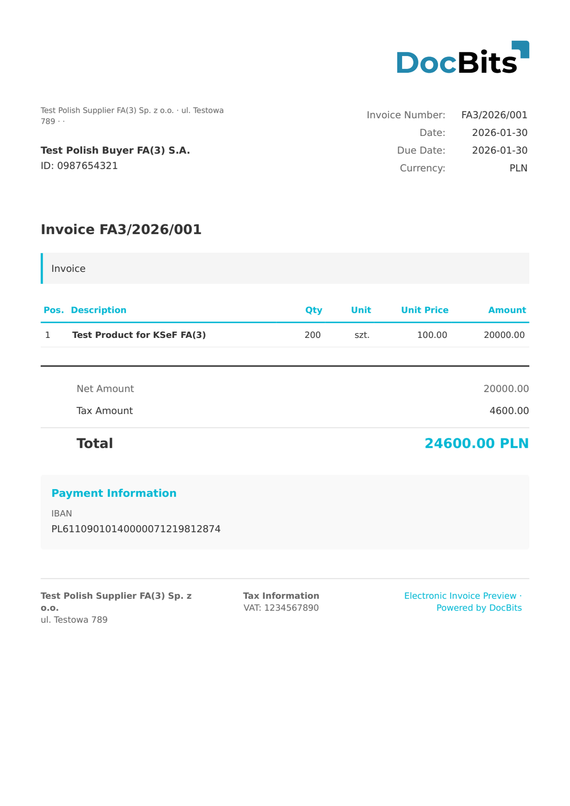

# 🇵🇱 KSEF FA3

<!-- edocs-country-scope -->


Consulte la guía del país para conocer los límites de versión, la configuración que se está utilizando y el vídeo explicativo del país. [Polonia](countries/poland.md). FA2 y FA3 utilizan estructuras diferentes. Confirme el esquema de origen y pruebe la asignación adecuada. Analizar el archivo no envía una factura a KSeF.


| Propiedad              | Valor                           |
| ---------------------- | ------------------------------- |
| **País / Región**      | Polonia                         |
| **Tipos de documento** | Factura, Factura rectificativa  |
| **Formato**            | XML                             |
| **Estándar**           | KSeF FA(3)                      |

KSeF FA3 es la versión más reciente del esquema del Sistema Nacional de Facturación Electrónica de Polonia. Añade compatibilidad con tipos de documento adicionales, una mejor gestión de las facturas rectificativas y reglas de validación actualizadas, alineadas con la normativa polaca de IVA más reciente.

## Estado de compatibilidad

| Componente             | Estado          |
| ---------------------- | --------------- |
| Vista previa           | ✅ Compatible    |
| Extracción de campos   | ✅ Compatible    |
| Transformación         | ✅ Compatible    |

## Vista previa predeterminada

<figure><figcaption>
Vista previa predeterminada de DocBits para una factura KSeF FA(3) de Polonia
</figcaption></figure>

## Relacionado

* [Documentos electrónicos compatibles](./)
