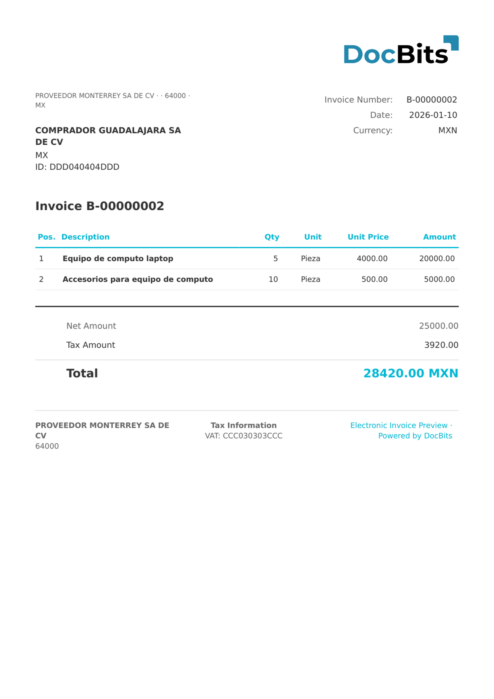

# 🇲🇽 MEXICO CFDI 3.3

| Propiedad              | Valor                                              |
| ---------------------- | -------------------------------------------------- |
| **País / Región**      | México                                             |
| **Tipos de documento** | Factura, Nota de crédito, Recibo de pago           |
| **Formato**            | XML                                                |
| **Estándar**           | CFDI 3.3 (Comprobante Fiscal Digital por Internet) |

CFDI 3.3 es la generación anterior del estándar mexicano de comprobante fiscal digital emitido por el SAT (Servicio de Administración Tributaria). Aunque fue sustituida por CFDI 4.0, muchas facturas históricas siguen utilizando esta versión. Incluye el UUID (folio fiscal), los identificadores RFC y los cálculos de impuestos IEPS/IVA.

## Estado de compatibilidad

| Componente             | Estado          |
| ---------------------- | --------------- |
| Vista previa           | ✅ Compatible    |
| Extracción de campos   | ✅ Compatible    |
| Transformación         | ✅ Compatible    |

## Vista previa predeterminada

<figure><figcaption>
Vista previa predeterminada de DocBits para una factura CFDI 3.3 de México
</figcaption></figure>

## Relacionado

* [Documentos electrónicos compatibles](./)
