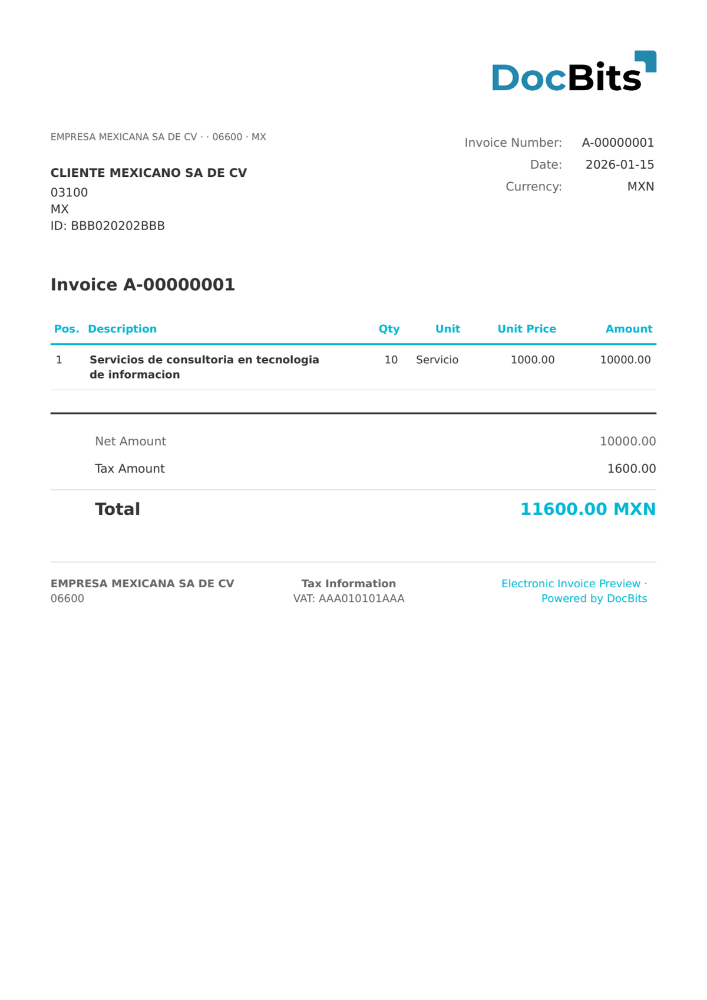

# 🇲🇽 MEXICO CFDI 4.0

| Propiedad              | Valor                                              |
| ---------------------- | -------------------------------------------------- |
| **País / Región**      | México                                             |
| **Tipos de documento** | Factura, Nota de crédito, Recibo de pago           |
| **Formato**            | XML                                                |
| **Estándar**           | CFDI 4.0 (Comprobante Fiscal Digital por Internet) |

CFDI 4.0 es la versión actual del estándar mexicano de comprobante fiscal digital, obligatoria desde enero de 2023. Exige el nombre del receptor y su régimen fiscal, añade el campo de exportación e incluye el sello digital actualizado y la cadena de certificados del SAT.

## Estado de compatibilidad

| Componente             | Estado          |
| ---------------------- | --------------- |
| Vista previa           | ✅ Compatible    |
| Extracción de campos   | ✅ Compatible    |
| Transformación         | ✅ Compatible    |

## Vista previa predeterminada

<figure><figcaption>
Vista previa predeterminada de DocBits para una factura CFDI 4.0 de México
</figcaption></figure>

## Relacionado

* [Documentos electrónicos compatibles](./)
