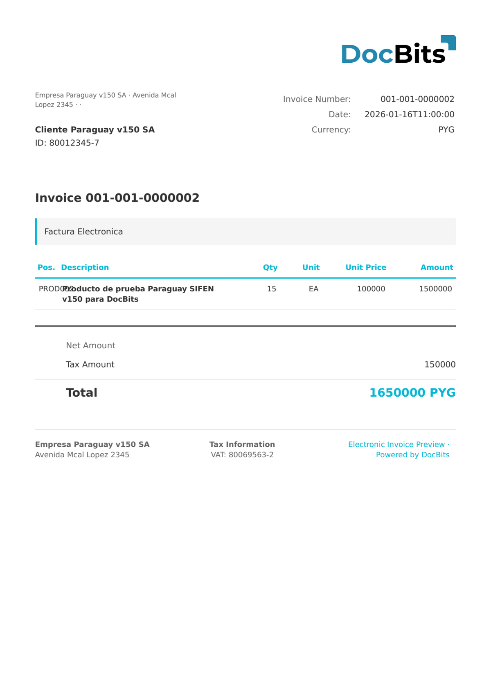

# 🇵🇾 PARAGUAY SIFEN

| Propiedad              | Valor                                                         |
| ---------------------- | ------------------------------------------------------------- |
| **País / Región**      | Paraguay                                                      |
| **Tipos de documento** | Factura, Nota de crédito, Nota de débito, Retención           |
| **Formato**            | XML                                                           |
| **Estándar**           | SIFEN (Sistema Integrado de Facturación Electrónica Nacional) |

SIFEN es el sistema nacional integrado de facturación electrónica de Paraguay, gestionado por la SET. Todos los documentos electrónicos deben enviarse a SIFEN para su validación y reciben un identificador único CDC (Código de Control Digital).

## Estado de compatibilidad

| Componente             | Estado          |
| ---------------------- | --------------- |
| Vista previa           | ✅ Compatible    |
| Extracción de campos   | ✅ Compatible    |
| Transformación         | ✅ Compatible    |

## Vista previa predeterminada

<figure><figcaption>
Vista previa predeterminada de DocBits para una factura Paraguay SIFEN
</figcaption></figure>

## Relacionado

* [Documentos electrónicos compatibles](./)
* [Paraguay SIFEN 150](paraguay-sifen-150.md)
