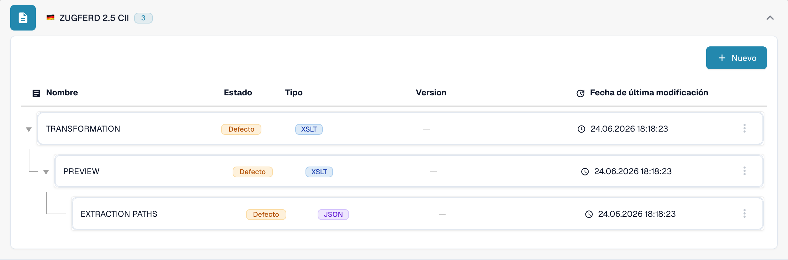

# 🇩🇪 ZUGFERD 2.5

<!-- edocs-country-scope -->


Consulte la guía del país para conocer los límites de versión, la configuración que se está utilizando y el vídeo explicativo del país. [Alemania](countries/germany.md). La sintaxis, la versión de publicación y el perfil son opciones diferentes. No deduzca una publicación de Factur-X a partir del marcador compartido 1p0.


| Propiedad | Valor |
|-----------|-------|
| **País / Región** | Alemania |
| **Tipos de documento** | Factura, Nota de crédito (compruebe la asignación efectiva) |
| **Formato** | XML CII incrustado en PDF/A-3 |
| **Estándar** | ZUGFeRD 2.5 |
| **Basado en** | EN 16931 |

ZUGFeRD 2.5 y Factur-X 1.09 son publicaciones equivalentes. El formato híbrido incorpora XML CII D22B en PDF/A-3; UBL no es su sintaxis XML. Consulte la [referencia de publicación de FeRD](https://www.ferd-net.de/publikationen-produkte/publikationen/detailseite/zugferd-25-english).

El estándar define los perfiles MINIMUM, BASIC WL, BASIC, EN16931 y EXTENDED. Un nombre de perfil en el catálogo no demuestra su detección automática ni la cobertura completa de campos. MINIMUM y BASIC WL pueden omitir información de las líneas que su integración necesita.

Esta página describe la publicación de junio de 2026. La posterior [publicación Factur-X 1.09.2 / ZUGFeRD 2.5.2](https://fnfe-mpe.org/factur-x/factur-x_en/) debe identificarse por separado; el identificador de familia `1p0` por sí solo no basta.

## Estado de compatibilidad

La comprobación de solo lectura del catálogo de desarrollo del 31 de octubre de 2026 encontró entradas separadas `ZUGFERD 2.5 CII` y `ZUGFERD 2.5 UBL` para `INVOICE`. La entrada UBL es una etiqueta de configuración de DocBits; no convierte UBL en un formato híbrido ZUGFeRD conforme al estándar.

| Componente | Configuración observada |
|------------|-------------------------|
| Vista previa | `PREVIEW` (XSLT) |
| Extracción de campos | `EXTRACTION_PATHS` (JSON) |
| Transformación | `TRANSFORMATION` (XSLT) |

Estas entradas confirman la configuración disponible, no el procesamiento correcto de cada archivo o perfil. Compruebe el origen predeterminado o personalizado y la versión activa en su organización. La compatibilidad del estándar con versiones anteriores no garantiza resultados de extracción o transformación sin cambios. Pruebe por separado facturas y notas de crédito representativas, los campos necesarios y la exportación al ERP; la validación legal y los requisitos de la red de transmisión necesitan su propia aceptación.

<figure><figcaption>
Vista de desarrollo en español, de solo lectura, del 31 de octubre de 2026: la entrada del catálogo para INVOICE y sus componentes predeterminados disponibles. La captura no muestra una prueba de procesamiento de archivos.
</figcaption></figure>

## Relacionados

* [Factur-X 1.09 / ZUGFeRD 2.5](facturx-1-09-zugferd-2-5.md)
* [Configuración de ZUGFeRD](../zugferd/configuration.md)
* [Mapeo de campos de ZUGFeRD](../zugferd/README.md)
* [Documentos electrónicos compatibles](./)
